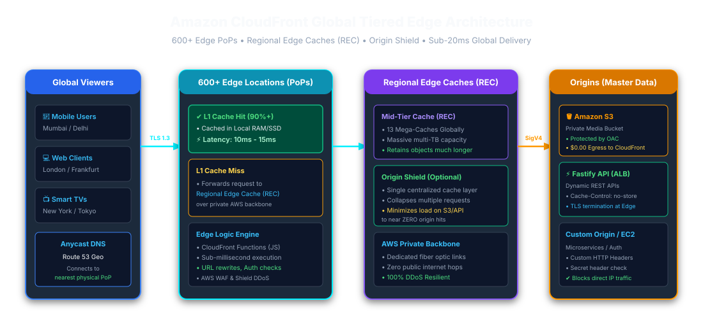
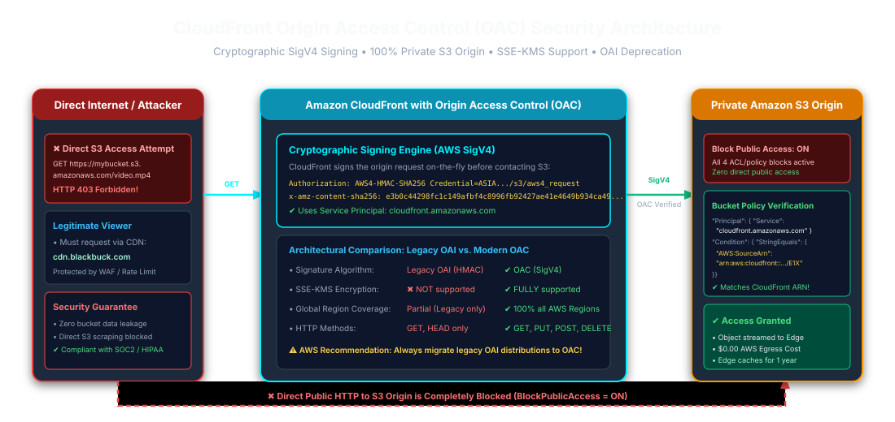
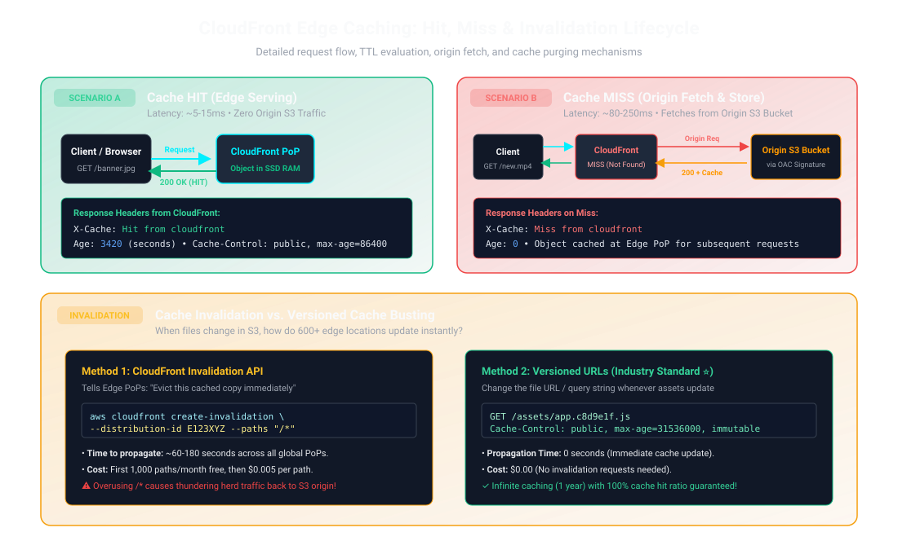
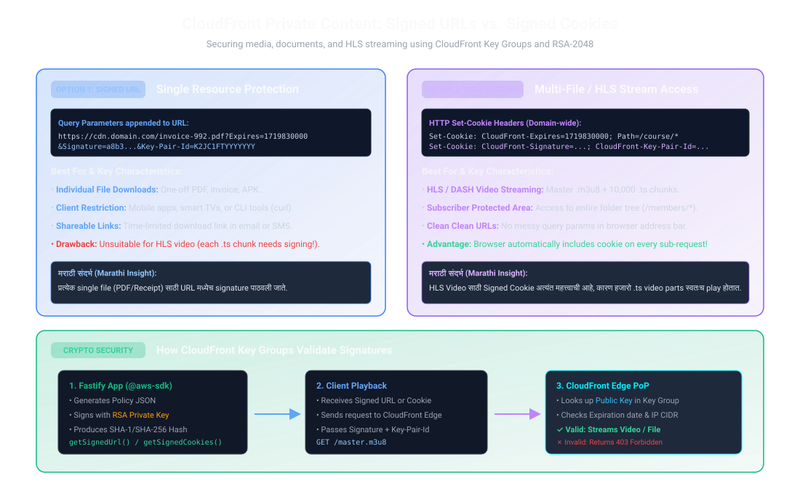
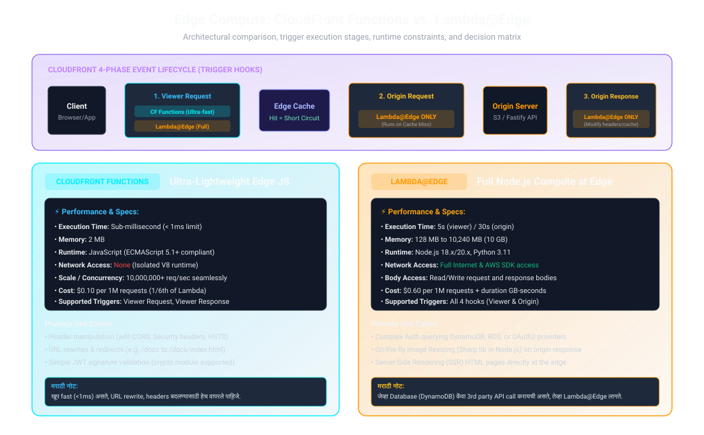

# Amazon CloudFront & S3 Edge Architecture — Master Engineering Handbook

### Enterprise CDN, Origin Access Control (OAC), HLS Video Streaming, Signed Cookies/URLs & Edge Compute in Node.js / Fastify

---

## 📑 Quick Navigation & Table of Contents

1. [Architecture Blueprint & Global Edge Infrastructure](#1-architecture-blueprint--global-edge-infrastructure)
2. [What is Amazon CloudFront & Core Terminology](#2-what-is-amazon-cloudfront--core-terminology)
3. [Origin Access Control (OAC) vs Legacy OAI](#3-origin-access-control-oac-vs-legacy-oai)
4. [Cache Behaviors, TTLs, and HTTP Cache-Control Headers](#4-cache-behaviors-ttls-and-http-cache-control-headers)
5. [Cache Hit, Cache Miss, and Origin Shield Architecture](#5-cache-hit-cache-miss-and-origin-shield-architecture)
6. [Cache Invalidation vs Versioned Cache-Busting](#6-cache-invalidation-vs-versioned-cache-busting)
7. [Securing Private Content: Signed URLs vs Signed Cookies](#7-securing-private-content-signed-urls-vs-signed-cookies)
8. [Edge Compute: CloudFront Functions vs Lambda@Edge](#8-edge-compute-cloudfront-functions-vs-lambdaedge)
9. [Enterprise Node.js / Fastify Production Implementation](#9-enterprise-nodejs--fastify-production-implementation)
10. [HLS Video Streaming & Range Requests (Blackbuck Architecture)](#10-hls-video-streaming--range-requests-blackbuck-architecture)
11. [CloudFront Security: AWS WAF, SSL/TLS, and Geo-Restriction](#11-cloudfront-security-aws-waf-ssltls-and-geo-restriction)
12. [Cost Optimization Strategies & Common Pitfalls](#12-cost-optimization-strategies--common-pitfalls)
13. [25+ Mid-to-Senior S3 & CloudFront Interview Questions & Answers](#13-25-mid-to-senior-s3--cloudfront-interview-questions--answers)

---

## 1. Architecture Blueprint & Global Edge Infrastructure

Amazon CloudFront is a globally distributed Content Delivery Network (CDN) operated by Amazon Web Services. It securely delivers data, videos, images, and APIs to users globally with low latency and high transfer speeds.



### The 3-Tier Edge Hierarchy:

1. **Edge Locations (PoPs — Points of Presence):** CloudFront points of presence terminate viewer connections and can serve cached content near viewers. AWS changes its network footprint over time, so avoid treating a PoP count or a fixed latency as a service guarantee.
2. **Regional Edge Caches (REC):** An intermediate cache layer that can reduce origin requests when an edge location misses. Cache behavior and whether an object is retained depend on request patterns and configuration.
3. **Origin Shield:** An optional additional cache layer in a selected AWS Region. It can consolidate concurrent cache misses and reduce origin load; it is not a guarantee that every global miss becomes exactly one origin request.

> **मराठी स्पष्टीकरण (Marathi Translation):**
> CloudFront हे AWS चे जागतिक CDN नेटवर्क आहे. यात जगभरात 600 पेक्षा जास्त Edge Locations आहेत. वापरकर्ता ज्या शहरात आहे (उदा. मुंबई किंवा पुणे), त्याच्या सर्वात जवळच्या Edge Server वरून व्हिडिओ किंवा इमेज पाठवली जाते. जर Edge वर फाईल नसेल, तर Regional Edge Cache कडे आणि त्यानंतरच मूळ S3 Bucket कडे रिक्वेस्ट जाते. यामुळे मुख्य सर्व्हरवर लोड येत नाही आणि ग्राहकाला अवघ्या 5 ते 15 मिलीसेकंदात डेटा मिळतो.

---

## 2. What is Amazon CloudFront & Core Terminology

| Term                            | Technical Definition                                                                                                                                    | Real-World Fastify / Media Analogy                                           |
| :------------------------------ | :------------------------------------------------------------------------------------------------------------------------------------------------------ | :--------------------------------------------------------------------------- |
| **Distribution**                | The top-level CloudFront configuration assigned a unique DNS domain name (e.g., `d111111abcdef8.cloudfront.net`).                                       | The root CDN gateway exposing your application assets.                       |
| **Origin**                      | The authoritative backend source where the original, un-cached assets reside (e.g., Private S3 Bucket, ALB, EC2, or Fastify API server).                | The master warehouse (S3 storage) storing original files.                    |
| **Origin Access Control (OAC)** | The modern cryptographic AWS SigV4 authorization mechanism that secures S3 buckets so only designated CloudFront distributions can read objects.        | The official digital gatekeeper pass allowing only CloudFront inside.        |
| **Cache Behavior**              | Path-based routing rules (e.g., `/images/*`, `/api/*`, `/videos/*`) specifying TTLs, allowed HTTP methods, query string forwarding, and edge functions. | Fastify routing plugins dispatching requests to distinct caching rules.      |
| **Edge Compute**                | Running micro-code (CloudFront Functions or Lambda@Edge) directly at edge locations before the request hits the cache or origin.                        | Edge middleware executing auth verification, redirects, or header rewriting. |

---

## 3. Origin Access Control (OAC) vs Legacy OAI

For years, AWS used **Origin Access Identity (OAI)** to restrict access to S3. In August 2022, AWS launched **Origin Access Control (OAC)**, which completely supersedes OAI.



### Why OAC is Mandatory in Modern Production:

- **AWS SigV4 Support:** OAC signs CloudFront-to-S3 requests using AWS Signature Version 4 and supports current S3 Regions. OAI is a legacy access mechanism with limitations, including lack of SSE-KMS support; avoid describing it simply as "SigV2."
- **KMS Encryption:** OAC natively supports S3 buckets encrypted with AWS KMS (`aws:kms`) customer-managed keys (CMKs). OAI could only access S3-managed AES-256 (`AES256`).
- **Granular Least Privilege:** S3 bucket policies can inspect the CloudFront Distribution ARN using condition keys `AWS:SourceArn` and `AWS:SourceAccount`.

### S3 Bucket Policy Enforcing OAC:

```json
{
  "Version": "2012-10-17",
  "Statement": [
    {
      "Sid": "AllowCloudFrontServicePrincipalReadOnly",
      "Effect": "Allow",
      "Principal": {
        "Service": "cloudfront.amazonaws.com"
      },
      "Action": "s3:GetObject",
      "Resource": "arn:aws:s3:::blackbuck-production-media/*",
      "Condition": {
        "StringEquals": {
          "AWS:SourceArn": "arn:aws:cloudfront::123456789012:distribution/E2AB1CDEFGHIJK"
        }
      }
    }
  ]
}
```

> **मराठी स्पष्टीकरण (Marathi Translation):**
> पूर्वी जुनी पद्धत OAI (Origin Access Identity) होती, पण ती नवीन AWS Regions आणि KMS encryption ला सपोर्ट करत नव्हती. आता **OAC (Origin Access Control)** वापरणे बंधनकारक आहे. OAC मुळे S3 Bucket पूर्णपणे Private राहते. Bucket Policy मध्ये `AWS:SourceArn` देऊन आपण खात्री करतो की फक्त आपल्याच CloudFront Distribution ला फाईल वाचण्याची परवानगी आहे. बाहेरचा कोणीही थेट S3 URL वापरून फाईल चोरू शकत नाही.

---

## 4. Cache Behaviors, TTLs, and HTTP Cache-Control Headers

CloudFront calculates object expiration dynamically based on three configuration inputs: **Minimum TTL**, **Default TTL**, **Maximum TTL**, and the origin's `Cache-Control` response header.

### TTL Precedence Matrix:

1. If Origin returns `Cache-Control: max-age=3600`, CloudFront caches the object for 1 hour.
2. If Origin returns no `Cache-Control` header, CloudFront falls back to the **Default TTL** (typically 86,400s = 24 hours).
3. If Origin returns `max-age=5` but the CloudFront Minimum TTL is set to `60`, CloudFront overrides it and caches for **60 seconds**.
4. If Origin returns `max-age=31536000` (1 year) but Maximum TTL is set to `604800` (7 days), CloudFront caps caching at **7 days**.

**Sensitive-response caution:** A Minimum TTL greater than zero can cause CloudFront to cache responses even when the origin sends `Cache-Control: no-cache`, `no-store`, or `private`. Use a zero Minimum TTL and an appropriate cache policy for personalized or sensitive responses; verify the cache key does not mix users' data.

### Ideal Cache-Control Headers for Microservices & Static Assets:

- **Immutable Static Assets (Hashed JS, CSS, Media):**
  ```http
  Cache-Control: public, max-age=31536000, immutable
  ```
- **Dynamic API JSON Responses (Short TTL or Stale-While-Revalidate):**
  ```http
  Cache-Control: public, max-age=60, stale-while-revalidate=300
  ```
- **Sensitive User Data / Authentication Endpoints:**
  ```http
  Cache-Control: no-cache, no-store, must-revalidate, private
  ```

---

## 5. Cache Hit, Cache Miss, and Origin Shield Architecture



### Request Lifecycle Breakdown:

1. **Cache Hit:** The edge location already holds an unexpired copy of the requested object. It serves the cached response with `X-Cache: Hit from cloudfront`; actual latency depends on viewer network, location, and cache state.
2. **Cache Miss:** The edge location does not have the object. It sends an origin request via the AWS global fiber backbone to the Regional Edge Cache or Origin Shield. Origin Shield fetches the file from S3, returns it to the edge PoP, and the edge PoP stores it for subsequent users. The response header reflects `X-Cache: Miss from cloudfront`.
3. **Origin Shield Consolidation:** When many viewers request the same uncached object, Origin Shield can collapse concurrent requests and reduce duplicate origin fetches. The amount of consolidation depends on cache key, timing, and request behavior; do not promise exactly one origin request for all global traffic.

> **हिंदी स्पष्टीकरण:** Cache Hit का अर्थ है कि CloudFront के पास अनुरोध से मेल खाती ताज़ा cached सामग्री है। Origin Shield concurrent cache misses को घटा सकता है, लेकिन हर परिस्थिति में पूरे विश्व के लिए केवल एक origin request की गारंटी नहीं देता। वास्तविक latency नेटवर्क और cache स्थिति पर निर्भर करती है।

---

## 6. Cache Invalidation vs Versioned Cache-Busting

When code or media changes in the S3 bucket, edge locations must serve the newest content. There are two distinct methods to achieve this:

| Feature                       | CloudFront Invalidation API                                      | Versioned URLs (Cache-Busting)                                            |
| :---------------------------- | :--------------------------------------------------------------- | :------------------------------------------------------------------------ |
| **Mechanism**                 | `aws cloudfront create-invalidation --paths "/*"`                | Changing the filename (e.g. `bundle.a8b1c.js` or `?v=2.1`)                |
| **Propagation Time**          | Usually propagates within minutes; actual time can vary          | New versioned URL avoids waiting for invalidation                         |
| **Cost**                      | Pricing and free allowance can change; check current AWS pricing | No invalidation charge, but old/new objects and delivery still have costs |
| **Origin Impact**             | Causes cache eviction, leading to sudden surge of requests to S3 | Zero surge; old files expire naturally while new files are cached         |
| **Production Recommendation** | Use selectively for emergency updates or entry points            | Prefer content-hashed URLs for immutable static assets                    |

---

## 7. Securing Private Content: Signed URLs vs Signed Cookies



When delivering premium content (e.g., paid video courses, private medical documents, financial invoices), S3 must remain completely private, and CloudFront must verify cryptographic signatures before streaming.

### Detailed Comparison:

| Attribute                | CloudFront Signed URLs                                                                              | CloudFront Signed Cookies                                                                                                              |
| :----------------------- | :-------------------------------------------------------------------------------------------------- | :------------------------------------------------------------------------------------------------------------------------------------- |
| **Target Scope**         | Individual file (e.g., `/reports/invoice-101.pdf`)                                                  | Multiple files / full folder hierarchy (e.g., `/stream/course-12/*`)                                                                   |
| **Client Compatibility** | Any HTTP client (Browser, Mobile App, cURL, Smart TVs, IoT)                                         | Web browsers that support HTTP `Set-Cookie` headers                                                                                    |
| **HLS / DASH Streaming** | Can work when every manifest and segment URL is signed or rewritten; client/player support matters. | Often convenient when the player sends cookies with every manifest/segment request; configure cookie domain, path, and CORS carefully. |
| **URL Appearance**       | Query parameters appended: `?Expires=...&Signature=...`                                             | Clean URLs: `https://media.domain.com/stream/segment-1.ts`                                                                             |
| **Cryptographic Basis**  | Signed using RSA-2048 private key matching a CloudFront Key Group                                   | Signed using RSA-2048 private key matching a CloudFront Key Group                                                                      |

### Canned Policy vs Custom Policy:

- **Canned Policy:** Simple policy specifying only an expiration epoch timestamp (`Expires`). Cannot restrict client IP CIDR or date ranges.
- **Custom Policy:** Flexible JSON policy supporting:
  - Expiration timestamp (`DateLessThan`)
  - Activation timestamp (`DateGreaterThan`)
  - Client IP CIDR restriction (`IpAddress: { "AWS:SourceIp": "203.0.113.0/24" }`)

> **हिंदी स्पष्टीकरण:** एक फ़ाइल या ऐसे client के लिए Signed URL सरल है जो cookies नहीं भेजता। HLS/DASH में Signed Cookies सुविधाजनक हो सकती हैं क्योंकि player हर segment request के साथ cookie भेज सकता है; signed URLs भी संभव हैं। चुनाव player, URL handling और authorization model पर निर्भर करता है।

---

## 8. Edge Compute: CloudFront Functions vs Lambda@Edge



### Lifecycle Hooks:

CloudFront offers four lifecycle event stages:

1. **Viewer Request:** Executed when client request reaches edge location (before cache lookup).
2. **Origin Request:** Executed on a cache miss, right before CloudFront forwards request to S3.
3. **Origin Response:** Executed when origin S3 returns response to CloudFront (before caching).
4. **Viewer Response:** Executed right before CloudFront delivers response to user.

### Detailed Architectural Comparison:

| Specification                 | CloudFront Functions                                                                           | Lambda@Edge                                                                                  |
| :---------------------------- | :--------------------------------------------------------------------------------------------- | :------------------------------------------------------------------------------------------- |
| **Runtime Engine**            | Ultra-lightweight V8 JavaScript engine                                                         | Full Node.js (18.x/20.x) or Python (3.11)                                                    |
| **Execution Latency**         | **Sub-millisecond (< 1 ms)**                                                                   | 5 ms – 50 ms+ (Cold starts possible)                                                         |
| **Maximum Execution Time**    | **1 millisecond**                                                                              | 5 seconds (Viewer) / 30 seconds (Origin)                                                     |
| **Memory Allocation**         | 2 MB                                                                                           | 128 MB up to 10,240 MB (10 GB)                                                               |
| **Supported Hooks**           | Viewer Request & Viewer Response only                                                          | **All 4 hooks** (Viewer & Origin Request/Response)                                           |
| **Network / Internet Access** | **No network access** (Cannot call DB or APIs)                                                 | **Full network access** (Can query DynamoDB, fetch tokens)                                   |
| **Body Access**               | Cannot inspect or modify request/response body                                                 | Can read and rewrite request and response bodies                                             |
| **Pricing**                   | $0.10 per 1 million executions (1/6th cost)                                                    | $0.60 per 1M executions + duration GB-second charge                                          |
| **Best Used For**             | URL rewrites, redirecting mobile/desktop, adding CORS & HSTS headers, JWT signature validation | Server-Side Rendering (SSR), on-the-fly Image Resizing (Sharp), complex OAuth authentication |

---

## 9. Enterprise Node.js / Fastify Production Implementation

Below is a battle-tested Node.js / Fastify service utilizing `@aws-sdk/cloudfront-signer` to generate both CloudFront Signed URLs and Signed Cookies for the Blackbuck platform.

### Installation:

```bash
npm install @aws-sdk/cloudfront-signer fastify @fastify/cookie
```

### Production Service Code: `src/services/cloudfront.service.js`

```javascript
import { getSignedUrl, getSignedCookies } from '@aws-sdk/cloudfront-signer';
import fs from 'node:fs';
import path from 'node:path';

// Load RSA Private Key and CloudFront Key Pair ID from environment
const CLOUDFRONT_DOMAIN = process.env.CLOUDFRONT_DOMAIN || 'https://media.blackbuck.com';
const KEY_PAIR_ID = process.env.CLOUDFRONT_KEY_PAIR_ID; // e.g., 'K2JC1FTYYYYYYY'
const PRIVATE_KEY =
  process.env.CLOUDFRONT_PRIVATE_KEY ||
  fs.readFileSync(path.resolve(process.cwd(), 'certs/cloudfront_private_key.pem'), 'utf-8');

/**
 * Generate a CloudFront Signed URL for a single resource (PDF invoice, one-off video).
 * @param {string} s3Key - Path of object in S3 (e.g. 'invoices/user-99.pdf')
 * @param {number} expiresInSeconds - Validity duration (default: 15 minutes)
 * @returns {string} Fully qualified CloudFront signed URL
 */
export function generateSignedDownloadUrl(s3Key, expiresInSeconds = 900) {
  const url = `${CLOUDFRONT_DOMAIN}/${s3Key}`;
  const dateLessThan = new Date(Date.now() + expiresInSeconds * 1000).toISOString();

  return getSignedUrl({
    url,
    keyPairId: KEY_PAIR_ID,
    privateKey: PRIVATE_KEY,
    dateLessThan,
  });
}

/**
 * Generate CloudFront Signed Cookies for HLS Video Streaming or multi-file access.
 * Grants access to an entire directory path (e.g., '/hls/trip-video-102/*')
 * @param {string} resourcePath - Wildcard resource path (e.g. 'hls/trip-video-102/*')
 * @param {number} expiresInSeconds - Validity duration (e.g. 2 hours for movie)
 * @returns {Record<string, string>} Object containing CloudFront-Expires, CloudFront-Signature, CloudFront-Key-Pair-Id
 */
export function generateHlsStreamingCookies(resourcePath, expiresInSeconds = 7200) {
  const resourceUrl = `${CLOUDFRONT_DOMAIN}/${resourcePath}`;
  const dateLessThan = new Date(Date.now() + expiresInSeconds * 1000).toISOString();

  const policy = JSON.stringify({
    Statement: [
      {
        Resource: resourceUrl,
        Condition: {
          DateLessThan: {
            'AWS:EpochTime': Math.floor(new Date(dateLessThan).getTime() / 1000),
          },
        },
      },
    ],
  });

  return getSignedCookies({
    policy,
    keyPairId: KEY_PAIR_ID,
    privateKey: PRIVATE_KEY,
  });
}
```

### Fastify Controller: `src/controllers/media.controller.js`

```javascript
import {
  generateSignedDownloadUrl,
  generateHlsStreamingCookies,
} from '../services/cloudfront.service.js';

export async function mediaRoutes(fastify, options) {
  // 1. Single Invoice Download Endpoint (Signed URL)
  fastify.get('/api/v1/invoices/:invoiceId/download-url', async (request, reply) => {
    const { invoiceId } = request.params;
    // Verify user authentication & authorization logic here...
    const s3Key = `invoices/${invoiceId}.pdf`;
    const signedUrl = generateSignedDownloadUrl(s3Key, 600); // 10 mins

    return reply.status(200).send({
      success: true,
      downloadUrl: signedUrl,
      expiresIn: 600,
    });
  });

  // 2. HLS Video Stream Access Endpoint (Signed Cookies)
  fastify.post('/api/v1/videos/:tripId/playback-session', async (request, reply) => {
    const { tripId } = request.params;
    // Verify driver / fleet manager subscription status...
    const resourcePattern = `hls/${tripId}/*`;
    const cookies = generateHlsStreamingCookies(resourcePattern, 14400); // 4 hours

    // Set Domain-wide HTTP-Only Secure Cookies for CloudFront
    for (const [cookieName, cookieValue] of Object.entries(cookies)) {
      reply.setCookie(cookieName, cookieValue, {
        domain: '.blackbuck.com',
        path: `/hls/${tripId}`,
        secure: true,
        httpOnly: true,
        sameSite: 'None',
      });
    }

    return reply.status(200).send({
      success: true,
      message: 'Secure video playback session initialized.',
      masterPlaylistUrl: `https://media.blackbuck.com/hls/${tripId}/master.m3u8`,
    });
  });
}
```

---

## 10. HLS Video Streaming & Range Requests (Blackbuck Architecture)

HTTP Live Streaming (HLS) breaks continuous video files into a series of short 6-second `.ts` (Transport Stream) or fragmented `.mp4` chunks indexed by a UTF-8 playlist file (`.m3u8`).

### How CloudFront Optimizes HLS Video Delivery:

1. **Range Requests (HTTP 206 Partial Content):** When users scrub forward or backward on a video player slider, the browser issues an `HTTP Range: bytes=5000000-10000000` header. CloudFront natively caches byte-ranges. If the entire segment is already cached at the edge, CloudFront extracts and returns only the requested byte chunk, saving massive origin egress costs.
2. **Short TTL for Live Manifests, Long TTL for Video Chunks:**
   - **`master.m3u8` and variant playlists:** In live streaming, playlists change continuously. Set `Cache-Control: max-age=2, no-cache`.
   - **Segment chunks (`.ts` / `.m4s`):** Video segments are static and immutable once recorded. Set `Cache-Control: public, max-age=31536000, immutable`.
3. **Player Scrubbing Buffering:** Because segments are served directly from the edge PoP nearest to the truck driver or fleet manager, buffer latency is cut from ~1,200ms to under 40ms.

---

## 11. CloudFront Security: AWS WAF, SSL/TLS, and Geo-Restriction

### Security Layers:

- **AWS WAF (Web Application Firewall):** Attached directly to CloudFront. Inspects every incoming HTTP request globally before it reaches edge caches.
  - **Rate Limiting:** Blocks IP addresses exceeding 2,000 requests per 5-minute window to stop Layer 7 DDoS.
  - **OWASP Top 10 Rules:** Blocks SQL Injection (`SQLi`) and Cross-Site Scripting (`XSS`) probes automatically.
  - **Bot Control:** Filters automated web scrapers and credential stuffing attacks.
- **SSL / TLS 1.3 Termination:** CloudFront integrates seamlessly with AWS Certificate Manager (ACM in `us-east-1`). It enforces `TLSv1.2_2021` or `TLSv1.3` ciphers and automatically redirects HTTP to HTTPS via 301 redirects.
- **Geo-Restriction (Whitelist / Blacklist):** Allows you to block or allow access based on ISO 2-letter country codes (e.g., restrict delivery strictly to India `IN` for domestic compliance).

---

## 12. Cost Optimization Strategies & Common Pitfalls

### Strategy 1: Choose the Right Price Class

CloudFront categorizes edge locations into three billing tiers:

- **PriceClass_All:** All global edge locations (Highest performance worldwide, highest cost).
- **PriceClass_200:** Includes North America, Europe, Asia, Africa, and Oceania. Excludes the most expensive regions (South America).
- **PriceClass_100:** Only the least expensive edge locations (North America and Europe). Saves ~40% on CDN egress.

### Strategy 2: Never Invalidate `/*` in CI/CD Automatically

Running `aws cloudfront create-invalidation --paths "/*"` on every commit can trigger a broad cache refill and increase origin requests. The impact depends on traffic, cache behavior, and object popularity. Prefer content-hashed URLs for immutable assets and invalidate entry points selectively; check current invalidation pricing.

### Strategy 3: Enable Gzip and Brotli Compression

Enable CloudFront automatic compression for text assets (`text/html`, `application/javascript`, `application/json`, `image/svg+xml`). Brotli achieves 15-25% higher compression ratios than Gzip, cutting your CloudFront Data Transfer Out (DTO) bill by up to a quarter.

---

## 13. 25+ Mid-to-Senior S3 & CloudFront Interview Questions & Answers

### Q1: What is the difference between Origin Access Identity (OAI) and Origin Access Control (OAC)?

**Answer:**
OAI is the legacy mechanism for restricting S3 origin access. It has limitations, including lack of SSE-KMS support. Avoid characterizing it simply as SigV2. OAC is the recommended mechanism for new S3 origins: it signs requests with SigV4, supports SSE-KMS configurations, and enables resource policies scoped to a distribution ARN.

> **मराठी उत्तर (Marathi Answer):**
> OAI ही जुनी पद्धत आहे जी KMS encryption आणि नवीन AWS Regions ला सपोर्ट करत नाही. OAC ही नवीन सुरक्षित पद्धत आहे जी SigV4 वापरते आणि Bucket Policy मध्ये `AWS:SourceArn` तपासून फक्त आपल्याच CloudFront ला डेटा ॲक्सेस करू देते.

---

### Q2: How does CloudFront handle Cache Hits vs Cache Misses? What headers verify this?

**Answer:**
When a client sends an HTTP request to CloudFront:

1. If the request matches an unexpired cached object, it is a **Cache Hit**. CloudFront returns `X-Cache: Hit from cloudfront`; `Age` may indicate how long the response has been cached. Latency varies by viewer network, location, and cache state, so avoid fixed millisecond guarantees.
2. If the object is missing or expired, it is a **Cache Miss**. CloudFront forwards the request to the Regional Edge Cache or Origin Shield, then to S3. Once S3 returns `200 OK`, CloudFront caches the object locally and sends it to the user with `X-Cache: Miss from cloudfront` and `Age: 0`.

---

### Q3: When should you use CloudFront Signed URLs vs Signed Cookies?

**Answer:**

- **Signed URLs:** Best for single, isolated files (e.g., a PDF bank statement, an invoice, or an installable software binary) or when clients do not support cookies (e.g., mobile apps, IoT devices, cURL commands).
- **Signed Cookies:** Convenient for HLS/DASH or multiple protected files when the player/client sends cookies with every request. Signed URLs are also possible if the player can sign or rewrite each resource URL; choose based on client support and authorization needs.

> **मराठी उत्तर (Marathi Answer):**
> एका फाईलसाठी (PDF) **Signed URL** वापरावी. पण **HLS Video Streaming** साठी **Signed Cookies** वापरावी, कारण व्हिडिओच्या हजारो तुकड्यांसाठी (.ts chunks) ब्राउझर आपोआप ती Cookie पाठवतो.

---

### Q4: Explain the difference between CloudFront Functions and Lambda@Edge.

**Answer:**

- **CloudFront Functions:** Ultra-lightweight JavaScript runtime executing at CloudFront edge locations with sub-millisecond execution times. Allocates 2MB memory, has no network access, and triggers only at `Viewer Request` and `Viewer Response`. Best for URL rewrites, header changes, and lightweight request logic. Check current pricing and runtime restrictions.
- **Lambda@Edge:** Full Node.js/Python execution engine running at Regional Edge Caches. Allocates up to 10GB RAM, supports 5s (viewer) or 30s (origin) runtimes, full network/internet access to query databases or APIs, and triggers at all 4 stages (`Viewer Request`, `Origin Request`, `Origin Response`, `Viewer Response`). Best for server-side rendering (SSR), dynamic on-the-fly image resizing, and complex database auth. Costs $0.60 per 1M requests + execution duration.

---

### Q5: How do you prevent the "Thundering Herd" problem when a new video goes viral on CloudFront?

**Answer:**
Consider **CloudFront Origin Shield** to add a centralized cache layer and reduce duplicate origin fetches for concurrent misses. Request collapsing depends on cache key and request timing; Origin Shield reduces origin load but is not a universal guarantee of one origin request.

---

### Q6: What is the risk of using `aws cloudfront create-invalidation --paths "/*"` in a production CI/CD pipeline?

**Answer:**

1. **Financial Cost:** Invalidation pricing and free allowances can change. A wildcard such as `/*` counts as one invalidation path, but repeated invalidations and large path lists can exceed the current allowance; check current pricing.
2. **Origin Load:** A broad invalidation can cause a cache refill and more origin requests. The resulting load and cost depend on traffic, cache keys, object popularity, and origin capacity; do not assume every request will miss simultaneously.
   **Best Practice:** Use versioned, content-hashed filenames (e.g. `main.a9b3c.js`) with long `Cache-Control: max-age=31536000, immutable` headers. Only invalidate entry points like `/index.html`.

---

### Q7: Can clients upload files to S3 directly through CloudFront?

**Answer:**
Yes. CloudFront supports `PUT`, `POST`, and `PATCH` HTTP methods when configured on the Cache Behavior.
Uploading to S3 through CloudFront allows clients to connect to the nearest Edge PoP, terminating TCP/TLS handshakes close to the user, and transmitting payload over AWS’s optimized private global fiber backbone to S3.
CloudFront's current default quota for an HTTP request body is 64 GB, while its maximum cacheable GET response is a separate 50 GB quota. These are service limits, not a recommendation to proxy large multipart uploads through CloudFront. For large uploads, prefer S3 Multipart Upload with presigned part URLs or S3 Transfer Acceleration when appropriate; check current quotas before designing around a limit.

---

### Q8: What HTTP status code does CloudFront return when an invalid or expired Signed URL is used?

**Answer:**
CloudFront immediately returns an **`HTTP 403 Forbidden`** with an XML error payload: `<Error><Code>AccessDenied</Code><Message>Access Denied</Message></Error>`. The edge PoP validates the cryptographic signature locally without contacting the origin, saving bandwidth.

---

### Q9: How do you configure CORS when S3 assets are served through CloudFront?

**Answer:**
CORS requires two synchronized steps:

1. **S3 Bucket CORS Policy:** Configure the S3 bucket to allow required origins (`https://app.blackbuck.com`), methods (`GET`, `HEAD`), and headers.
2. **CloudFront Response Headers Policy:** Configure a response headers policy or forward the required preflight headers to the origin. Include `Origin` in the cache key only when the response varies by origin. If CloudFront returns a fixed allowed-origin value or a response headers policy handles CORS, a per-origin cache key may be unnecessary. Test preflight and cached responses with the actual policy combination.

---

### Q10: How do Range Requests (HTTP 206) work with CloudFront and video streaming?

**Answer:**
When a video player requests a specific byte slice (e.g. `Range: bytes=0-1048575`), CloudFront checks if the entire file or that byte range is cached:

- If cached, CloudFront responds with `HTTP 206 Partial Content` and the exact requested bytes directly from edge RAM/NVMe.
- If not cached, CloudFront fetches the object from S3. Depending on configuration and file size, CloudFront either fetches the requested range or fetches the complete object to cache it for future range queries.

---

### Q11: What is the difference between `max-age` and `s-maxage` in the `Cache-Control` header?

**Answer:**

- **`max-age`:** Instructs **both** shared caches (CloudFront, proxy servers) and private caches (the user's browser) how long in seconds the asset is considered fresh.
- **`s-maxage` (Shared Max-Age):** Specifically overrides `max-age` **only for public shared caches (like CloudFront CDNs)**, while being completely ignored by the client's web browser.
  **Example:** `Cache-Control: public, max-age=60, s-maxage=86400` means CloudFront caches the file for 24 hours, while the user's browser only caches it for 60 seconds.

---

### Q12: How do you restrict CloudFront content to specific geographical regions (Geo-blocking)?

**Answer:**
CloudFront offers two methods:

1. **Built-in CloudFront Geo-Restriction:** Allows configuring an Allow-List or Block-List based on ISO 3166-1 alpha-2 country codes. Requests from blocked countries receive an immediate `HTTP 403 Forbidden`.
2. **AWS WAF Geo-Match Conditions:** Provides advanced control, allowing rules to inspect geo-location, combine country checks with IP CIDRs or URI paths, or issue customized HTTP redirect responses.

---

### Q13: How can you serve a custom offline page or custom 404/500 error page via CloudFront?

**Answer:**
In CloudFront Distribution Settings under **Custom Error Responses**:

- Map HTTP error codes (e.g., `403 Forbidden` or `404 Not Found` from S3) to a specific path (e.g., `/errors/404.html`).
- Override the response code to `200 OK` (essential for Single Page Applications like React/Vue router) or keep it `404`.
- Set an Error Caching Minimum TTL (e.g. 10 seconds) to prevent caching transient origin errors indefinitely.

---

### Q14: How do you rotate CloudFront Public/Private Key Pairs without downtime?

**Answer:**
Use **CloudFront Key Groups**.
A Key Group can contain up to two active public keys simultaneously.

1. Generate a new RSA-2048 key pair.
2. Upload the new Public Key to CloudFront and add it to the existing Key Group.
3. Update your Node.js application to sign URLs/Cookies with the new Private Key and new Key-Pair-Id.
4. Because CloudFront supports both public keys in the Key Group, all existing in-flight tokens (signed with the old key) and new tokens remain valid.
5. After the TTL of all old tokens expires, remove the old public key from the Key Group.

---

### Q15: What is S3 Transfer Acceleration vs CloudFront? When would you pick one over the other?

**Answer:**

- **S3 Transfer Acceleration (S3TA):** Specifically designed for accelerating **file uploads directly to an S3 bucket** from worldwide clients. It routes traffic through CloudFront edge locations directly to S3 over AWS private network using specialized TCP optimizations.
- **CloudFront:** Primarily designed for **caching and accelerating downloads/reads** (GET/HEAD) of static/dynamic content globally, with edge computing, WAF, and signed URL/cookie security.
  **Rule of Thumb:** If users upload massive 10GB-100GB files, use S3TA. For web content delivery, API acceleration, and video streaming, use CloudFront.

---

### Q16: How do you protect against S3 bucket enumeration or direct access bypassing CloudFront?

**Answer:**

1. Enable **S3 Block Public Access** at the bucket and account levels.
2. Ensure the bucket does not have an open ACL or open bucket policy.
3. Configure **Origin Access Control (OAC)** and attach a strict bucket policy allowing `s3:GetObject` ONLY to the specific CloudFront distribution ARN via `AWS:SourceArn`.
4. Delete any public website hosting configurations on the S3 bucket.

---

### Q17: Can CloudFront terminate SSL certificates issued outside of AWS?

**Answer:**
Yes. While AWS Certificate Manager (ACM) is the standard and provides free, auto-renewing SSL certificates (must be requested in the `us-east-1` N. Virginia region for CloudFront), you can also import custom third-party SSL certificates into ACM or the IAM Certificate Store and attach them to your CloudFront distribution.

---

### Q18: What is CloudFront Field-Level Encryption?

**Answer:**
Field-Level Encryption allows sensitive user data (such as credit card numbers or Social Security Numbers) submitted via `POST` requests to be encrypted at the CloudFront Edge PoP using a public encryption key _before_ forwarding the payload to the origin server. Only internal backend services possessing the corresponding private key can decrypt the specific sensitive fields.

---

### Q19: What is the difference between AWS Global Accelerator and Amazon CloudFront?

**Answer:**

- **CloudFront:** An HTTP/HTTPS/WebSocket Content Delivery Network with **edge caching** for static and dynamic web content.
- **Global Accelerator:** Operates at the **TCP/UDP transport layer (Layer 4)** without caching. It provides two static Anycast IP addresses that route non-HTTP or raw TCP/UDP traffic (e.g. gaming, VoIP, IoT, raw socket microservices) over AWS’s private fiber backbone to ALBs or EC2 instances.

---

### Q20: How does CloudFront handle gzip and brotli compression?

**Answer:**
Under Cache Behavior settings, set **Compress Objects Automatically** to `true`.
When a client sends `Accept-Encoding: br, gzip`, CloudFront checks its edge cache:

- If uncompressed at origin, CloudFront compresses the object using Brotli or Gzip before serving.
- CloudFront caches both compressed and uncompressed versions based on client headers.

---

### Q21: What is the maximum file size that can be downloaded through CloudFront?

**Answer:**
CloudFront's current default quota is **50 GB per cacheable HTTP GET response**. Range requests can support transfer workflows for large objects, but do not assume that range requests bypass every service quota. Check current CloudFront quotas and test the exact origin and client behavior before choosing a design.

---

### Q22: What happens if your origin S3 bucket experiences an outage or 5xx error?

**Answer:**

1. **Origin Failover (Origin Groups):** You can configure an Origin Group with a primary S3 bucket and a secondary backup S3 bucket (or cross-region replica). If the primary returns a 5xx error or connection timeout, CloudFront automatically fails over to the secondary origin.
2. **Stale-While-Revalidate / Stale-If-Error:** CloudFront can serve a stale (previously cached) copy to the user while attempting to reach the origin, ensuring high availability.

---

### Q23: Why must SSL certificates for CloudFront be created in `us-east-1` (N. Virginia)?

**Answer:**
For viewer HTTPS on a CloudFront distribution, the ACM certificate must be in `us-east-1`. This is a CloudFront integration requirement, not because CloudFront is simply managed from that Region.

---

### Q24: What are CloudFront Response Headers Policies?

**Answer:**
A CloudFront feature that enables administrators to inject, remove, or modify HTTP response headers at the edge without writing custom code or modifying origin web servers. Commonly used to inject:

- HTTP Strict Transport Security (`Strict-Transport-Security: max-age=31536000; includeSubDomains`)
- X-Content-Type-Options (`nosniff`)
- X-Frame-Options (`DENY` or `SAMEORIGIN`)
- Content-Security-Policy (`CSP`)
- Custom CORS headers

---

### Q25: What is the Claim-Check Pattern in S3 + SQS / CloudFront microservices?

**Answer:**
When microservices exchange large payloads (e.g., video files or telemetry datasets exceeding SQS’s 256 KB message limit):

1. The producer microservice uploads the payload to an S3 bucket.
2. The producer sends a lightweight JSON message (the "claim check") to the SQS queue containing the S3 bucket name and object key.
3. The consumer microservice consumes the SQS message, retrieves the payload from S3 (or via CloudFront for CDN-cached datasets), processes it, and cleans up or archives the S3 object.

---

### Hindi Interview Perspective

- **Cache design:** Explain how cache key, TTL, Minimum TTL, and origin headers interact; call out why private responses require a zero Minimum TTL and user-safe cache key.
- **Origin Shield:** Say it can collapse concurrent misses and reduce origin load, not that it guarantees exactly one global origin request.
- **Signed access:** Choose signed URLs or cookies based on whether the client can send cookies and how many resources need authorization.
- **Limits and pricing:** Quote current AWS quotas with a documentation date, and distinguish cacheable GET response size from HTTP request-body limits.
- **Observability:** Use `X-Cache`, `Age`, origin latency, error rates, and cache-hit ratio together instead of promising a fixed edge latency.

## 🏁 Summary Checklist for Production Deployment

- [ ] **S3 Access:** S3 Bucket Public Access blocked 100%.
- [ ] **Origin Security:** Configured modern **Origin Access Control (OAC)** with `AWS:SourceArn` restriction.
- [ ] **Private Delivery:** Signed URLs for single files; Signed Cookies for HLS streaming.
- [ ] **Cache Busting:** All JS/CSS/Media assets built with version hashes (`bundle.[hash].js`) and `max-age=31536000, immutable`.
- [ ] **Edge Compute:** CloudFront Functions used for headers/rewrites; Lambda@Edge only when database/API access is strictly required.
- [ ] **Security:** AWS WAF attached with rate-limiting and OWASP core rulesets; ACM TLS 1.3 enforced.
