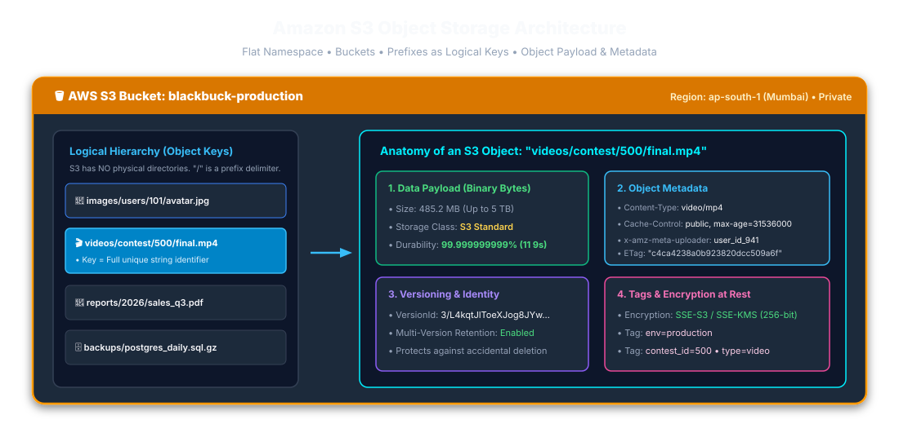
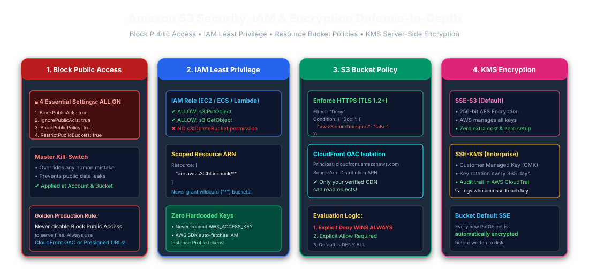
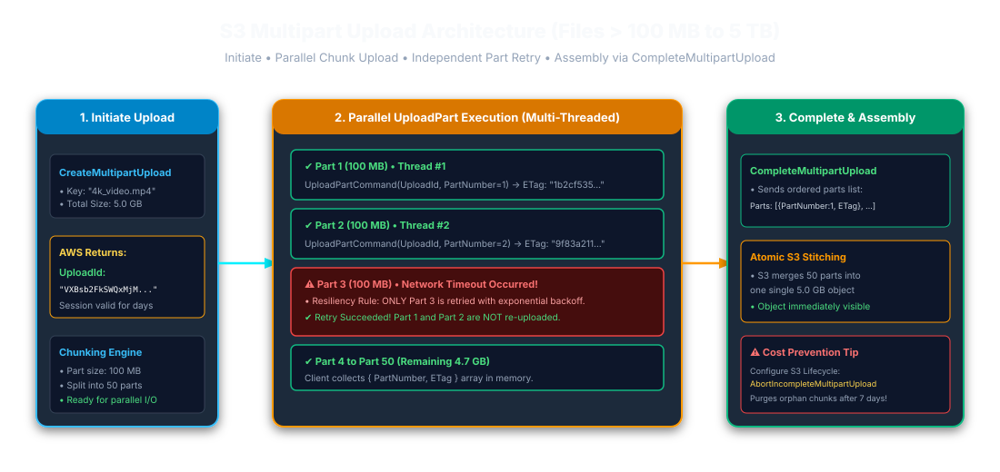
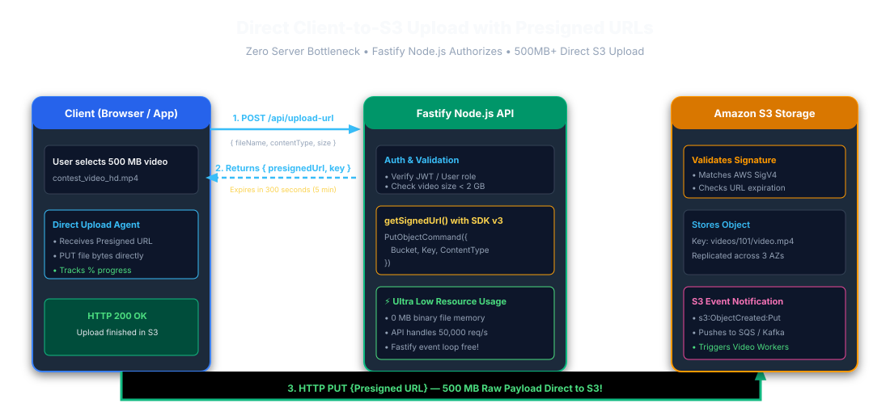
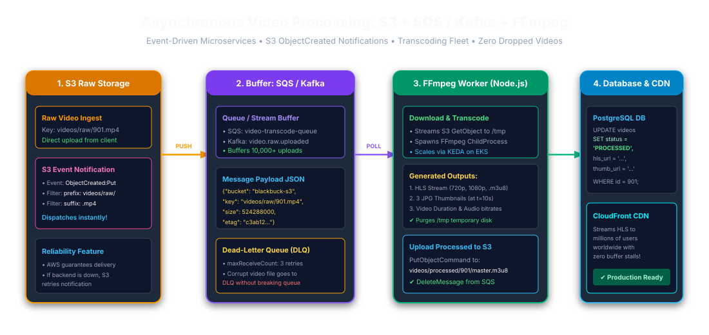
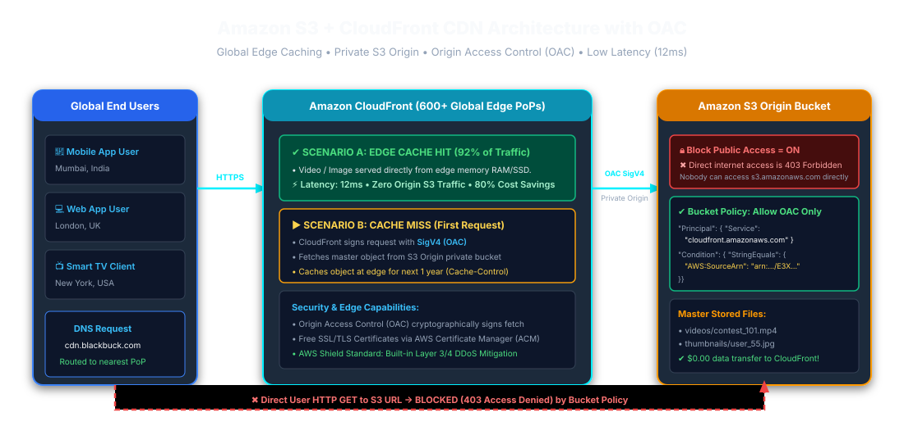

# Amazon S3 & CloudFront Master Production Handbook

### Production Node.js / Fastify Architecture, Distributed Media Pipelines & Senior Interview Guide

---

## Table of Contents

1. [What is Amazon S3?](#1-what-is-amazon-s3)
2. [Why Do We Need S3? The Problem with Server Disks](#2-why-do-we-need-s3-the-problem-with-server-disks)
3. [Important S3 Terminology & Mental Model](#3-important-s3-terminology--mental-model)
4. [S3 Bucket Mechanics & Naming Rules](#4-s3-bucket-mechanics--naming-rules)
5. [The S3 Object Anatomy](#5-the-s3-object-anatomy)
6. [S3 Object Key Design & Prefix Delimiters](#6-s3-object-key-design--prefix-delimiters)
7. [S3 Regions, Availability Zones & High Durability](#7-s3-regions-availability-zones--high-durability)
8. [S3 Storage Classes & Cost Optimization](#8-s3-storage-classes--cost-optimization)
9. [S3 Security Architecture & The 4 Pillars](#9-s3-security-architecture--the-4-pillars)
10. [IAM Roles, Least Privilege & Execution Profiles](#10-iam-roles-least-privilege--execution-profiles)
11. [S3 Bucket Policies (Resource-Based JSON Policies)](#11-s3-bucket-policies-resource-based-json-policies)
12. [S3 Block Public Access (The Golden Security Rule)](#12-s3-block-public-access-the-golden-security-rule)
13. [S3 Object Versioning & Accidental Deletion Recovery](#13-s3-object-versioning--accidental-deletion-recovery)
14. [S3 Lifecycle Management & Automatic Tiering](#14-s3-lifecycle-management--automatic-tiering)
15. [S3 Object Metadata (System vs. User-Defined)](#15-s3-object-metadata-system-vs-user-defined)
16. [S3 Object Tags & Cost Allocation](#16-s3-object-tags--cost-allocation)
17. [S3 Multipart Upload for Large Objects](#17-s3-multipart-upload-for-large-objects)
18. [Presigned Upload URLs (Bypassing Server Data Bottlenecks)](#18-presigned-upload-urls-bypassing-server-data-bottlenecks)
19. [Presigned GET URLs for Time-Limited Private Downloads](#19-presigned-get-urls-for-time-limited-private-downloads)
20. [Exhaustive S3 Operations & SDK v3 Command Reference](#20-exhaustive-s3-operations--sdk-v3-command-reference)
21. [Node.js Setup with AWS SDK for JavaScript v3](#21-nodejs-setup-with-aws-sdk-for-javascript-v3)
22. [AWS Credentials & Multi-Environment Configuration](#22-aws-credentials--multi-environment-configuration)
23. [Creating the High-Performance S3 Client Singleton](#23-creating-the-high-performance-s3-client-singleton)
24. [Uploading Files via PutObjectCommand](#24-uploading-files-via-putobjectcommand)
25. [Detailed Breakdown of PutObject Parameters](#25-detailed-breakdown-of-putobject-parameters)
26. [Production-Ready Reusable S3 Service Module](#26-production-ready-reusable-s3-service-module)
27. [Downloading Objects via GetObjectCommand (Streaming Responses)](#27-downloading-objects-via-getobjectcommand-streaming-responses)
28. [Deleting Objects via DeleteObjectCommand & Bulk Deletes](#28-deleting-objects-via-deleteobjectcommand--bulk-deletes)
29. [Checking Existence & Reading Headers via HeadObjectCommand](#29-checking-existence--reading-headers-via-headobjectcommand)
30. [Listing Objects via ListObjectsV2Command & Pagination](#30-listing-objects-via-listobjectsv2command--pagination)
31. [Generating Presigned Upload URLs in Node.js (AWS SDK v3)](#31-generating-presigned-upload-urls-in-nodejs-aws-sdk-v3)
32. [Direct Browser Upload Workflow (Client-Side PUT Architecture)](#32-direct-browser-upload-workflow-client-side-put-architecture)
33. [End-to-End Fastify Microservices + S3 Architecture](#33-end-to-end-fastify-microservices--s3-architecture)
34. [Relational Database (PostgreSQL / MySQL) + S3 Reference Pattern](#34-relational-database-postgresql--mysql--s3-reference-pattern)
35. [High-Performance S3 Key Partitioning & Naming Conventions](#35-high-performance-s3-key-partitioning--naming-conventions)
36. [Real-World Project Architecture: Blackbuck Video Gallery System](#36-real-world-project-architecture-blackbuck-video-gallery-system)
37. [Asynchronous Video Transcoding Pipeline: S3 + Apache Kafka + FFmpeg](#37-asynchronous-video-transcoding-pipeline-s3--apache-kafka--ffmpeg)
38. [Decoupled Media Processing Fleet: S3 + Amazon SQS](#38-decoupled-media-processing-fleet-s3--amazon-sqs)
39. [S3 Event Notifications (ObjectCreated, ObjectRemoved)](#39-s3-event-notifications-objectcreated-objectremoved)
40. [Top 8 Production Use Cases of S3 in Modern Web Applications](#40-top-8-production-use-cases-of-s3-in-modern-web-applications)
41. [Architectural Showdown: S3 Object Storage vs. Relational Database](#41-architectural-showdown-s3-object-storage-vs-relational-database)
42. [Architectural Showdown: S3 vs. EC2 Local Ephemeral Storage](#42-architectural-showdown-s3-vs-ec2-local-ephemeral-storage)
43. [Architectural Showdown: S3 vs. Amazon EBS (Elastic Block Store)](#43-architectural-showdown-s3-vs-amazon-ebs-elastic-block-store)
44. [Architectural Showdown: S3 vs. Amazon EFS (Elastic File System)](#44-architectural-showdown-s3-vs-amazon-efs-elastic-file-system)
45. [Critical PutObject Properties Cheat Sheet](#45-critical-putobject-properties-cheat-sheet)
46. [Server-Side Encryption: SSE-S3 vs. SSE-KMS vs. DSSE-KMS](#46-server-side-encryption-sse-s3-vs-sse-kms-vs-dsse-kms)
47. [Cryptographic Flow of S3 Encryption at Rest & In Transit](#47-cryptographic-flow-of-s3-encryption-at-rest--in-transit)
48. [S3 Performance Tuning & 5,500 GET / 3,500 PUT TPS Scaling](#48-s3-performance-tuning--5500-get--3500-put-tps-scaling)
49. [Amazon CloudFront CDN Integration with S3 (Edge Caching)](#49-amazon-cloudfront-cdn-integration-with-s3-edge-caching)
50. [Origin Access Control (OAC) vs. Legacy Origin Access Identity (OAI)](#50-origin-access-control-oac-vs-legacy-origin-access-identity-oai)
51. [Production Video Ingestion & Delivery Flow: Fastify + S3 + CloudFront](#51-production-video-ingestion--delivery-flow-fastify--s3--cloudfront)
52. [Production Security Guardrails: Never Trust Client Filenames](#52-production-security-guardrails-never-trust-client-filenames)
53. [Robust S3 Error Handling & HTTP Status Code Mapping](#53-robust-s3-error-handling--http-status-code-mapping)
54. [Exponential Backoff, Retries & DLQ Resilience](#54-exponential-backoff-retries--dlq-resilience)
55. [Ephemeral /tmp Processing Patterns in Containerized Workers](#55-ephemeral-tmp-processing-patterns-in-containerized-workers)
56. [The 13-Point Enterprise S3 Production Security Checklist](#56-the-13-point-enterprise-s3-production-security-checklist)
57. [Master Senior Engineering Interview Questions & Answers](#57-master-senior-engineering-interview-questions--answers)
58. [The S3 Architectural Mental Model in One Sentence](#58-the-s3-architectural-mental-model-in-one-sentence)

---

## 1. What is Amazon S3?

**Amazon Simple Storage Service (Amazon S3)** is an industry-leading object storage service offering market-leading scalability, data availability, security, and performance. Unlike traditional file systems that organize files in a hierarchical tree of folders, S3 stores data as **objects** within containers called **buckets**.



### Key Characteristics

- **Elastic Capacity:** S3 scales to store very large datasets. AWS's current multipart-upload limits document lists a maximum object size of 48.8 TiB; confirm applicable bucket/API limits and distinguish multipart uploads from a single `PutObject` request.
- **11 9s Durability (99.999999999%):** S3 Standard is designed for high durability through redundant storage across multiple Availability Zones. Do not present a fixed physical replica count as a customer-visible guarantee.
- **RESTful HTTPS Native:** Every object is uniquely accessible through standard HTTPS REST APIs via its `Bucket + Key`.

```
Node.js / Fastify Application
          │
          │ 1. Direct HTTPS PUT (Presigned)
          ▼
   AWS S3 Bucket: blackbuck-production
          │
          ├── images/
          │    ├── user-101.jpg
          │    └── user-102.jpg
          └── videos/
               ├── contest-500.mp4
               └── thumbnail-500.jpg
```

---

> [!NOTE]
>
> ### 🌐 हिंदी स्पष्टीकरण — Amazon S3 क्या है?
>
> Amazon S3 एक object-storage सेवा है, जिसमें data को bucket और key के माध्यम से रखा और प्राप्त किया जाता है। S3 Standard उच्च durability के लिए बनाया गया है, लेकिन durability का अर्थ zero risk, availability या backup नहीं है। Versioning और recovery controls अलग से configure करें।

---

## 2. Why Do We Need S3? The Problem with Server Disks

When developers build their first Node.js or Fastify web server, they often save uploaded files directly to the server's local hard drive using `fs.writeFile()` or `multer.diskStorage()`. In production, this causes three catastrophic architectural failures:

```
❌ BAD ARCHITECTURE: Local Disk Storage
Node.js Web Server (EC2 / Container)
├── application code (server.js)
├── node_modules/
└── uploads/
     ├── video1.mp4 (500 MB)
     ├── video2.mp4 (1 GB)
     └── video3.mp4 (750 MB)
```

### Problem 1: Server Disk Exhaustion (Server Crash)

If 1,000 users upload 500 MB videos, your local 50 GB SSD disk is 100% consumed within minutes. When the disk runs out of space, the operating system cannot allocate swap space, database connections fail, and the entire backend crashes.

### Problem 2: Multi-Instance State Split (Horizontal Scaling Failure)

Production backends sit behind an AWS Application Load Balancer (ALB) with multiple EC2 instances or Docker containers:

```
                       [Load Balancer]
                              │
               ┌──────────────┴──────────────┐
               ▼                             ▼
       [Server Instance A]           [Server Instance B]
        uploads/photo.jpg              uploads/ (EMPTY!)
```

When User 1 uploads an image, the request hits **Server A**, storing `photo.jpg` on Server A's local disk. When User 1 refreshes the browser, the load balancer routes the request to **Server B**. Server B does not have `photo.jpg` on its disk and returns an **HTTP 404 Not Found** error!

### Problem 3: Stateless Container Destruction (Docker & Kubernetes)

Modern containerized applications (Docker on ECS / Kubernetes / EKS) are **ephemeral**. When your application autoscales, deploys a new commit, or restarts due to a crash, the container is destroyed along with all files stored on its local disk.

### The Solution: Centralized S3 Object Storage

```
                    ┌──────────────┐
                    │ Fastify API 1│
                    └──────┬───────┘
                           │ (Stateless)
                    ┌──────▼───────┐
                    │  AWS S3 Bucket │◄─── Shared Central Object Storage
                    └──────▲───────┘
                           │ (Stateless)
                    ┌──────┴───────┐
                    │ Fastify API 2│
                    └──────────────┘
```

All API instances remain completely stateless. They delegate file storage to AWS S3, enabling infinite horizontal autoscaling.

---

## 3. Important S3 Terminology & Mental Model

| Term                 | Technical Architectural Definition                                                 | मराठी सोपी व्याख्या                                       |
| :------------------- | :--------------------------------------------------------------------------------- | :-------------------------------------------------------- |
| **S3**               | Simple Storage Service — AWS managed distributed object store.                     | क्लाऊडवरील सुरक्षित व अमर्याद फाईल स्टोरेज.               |
| **Bucket**           | A globally unique top-level container for objects in a chosen region.              | फाईल्स ठेवण्यासाठी बनवलेली मुख्य बादली (Container).       |
| **Object**           | The fundamental entity stored in S3 consisting of data bytes, key, and metadata.   | S3 मध्ये साठवलेली मूळ फाईल (उदा. फोटो, व्हिडिओ).          |
| **Key**              | The full unique string identifier representing the object within the bucket.       | फाईलचा संपूर्ण युनिक मार्ग/नाव (उदा. `users/10/pic.jpg`). |
| **Prefix**           | Logical string grouping separated by `/` delimiters acting as virtual folders.     | व्हर्च्युअल फोल्डरचे नाव (उदा. `images/`).                |
| **Region**           | Physical AWS geographical cluster (e.g., `ap-south-1` Mumbai).                     | ज्या देशात किंवा शहरात डेटा सेंटर आहे ते ठिकाण.           |
| **Metadata**         | Name-value pairs describing the object (`Content-Type`, `Cache-Control`).          | फाईलची तांत्रिक माहिती (उदा. फाईलचा प्रकार, साईझ).        |
| **Tags**             | Key-value labels attached to objects for billing, lifecycle, and access control.   | फाईलचे लेबल (उदा. `env=production`).                      |
| **Storage Class**    | Tier defining access speed, availability, and cost (e.g., Glacier, Standard).      | फाईल ठेवण्याचा दर आणि प्रकार (महाग की स्वस्त).            |
| **Versioning**       | Retention mechanism preserving multiple revisions of an object under the same key. | एकाच फाईलच्या जुन्या आवृत्त्या सुरक्षित ठेवणे.            |
| **Presigned URL**    | Ephemeral cryptographically signed URL granting temporary read/write access.       | तात्पुरती सुरक्षित लिंक (उदा. ५ मिनिटांसाठी वैध).         |
| **Multipart Upload** | High-throughput upload dividing large files into independent concurrent chunks.    | मोठी फाईल तुकड्यांमध्ये विभागून जलद अपलोड करणे.           |

---

## 4. S3 Bucket Mechanics & Naming Rules

An S3 bucket is the fundamental container. Buckets have a **global namespace across all AWS accounts worldwide**.

### Universal Bucket Naming Rules

1. **Global Uniqueness:** No two AWS accounts in the world can have the same bucket name.
2. **Length:** Between 3 and 63 characters long.
3. **Allowed Characters:** Only lowercase letters (`a-z`), numbers (`0-9`), and hyphens (`-`).
4. **Disallowed:** NO uppercase letters, NO underscores (`_`), and must not start or end with a hyphen.
5. **No IP Addresses:** Must not be formatted as an IP address (e.g., `192.168.5.4`).

```bash
# Bucket Naming Examples
blackbuck-production-media-mumbai    # ✅ VALID
my.app.bucket                       # ❌ INVALID (contains dots, breaks SSL certs)
Production_Video_Bucket             # ❌ INVALID (contains uppercase and underscores)
```

---

## 5. The S3 Object Anatomy

Unlike a Unix inode or NTFS file, an S3 object is a self-contained bundle containing 5 key elements:

```
┌────────────────────────────────────────────────────────┐
│                      S3 OBJECT                         │
├────────────────────────────────────────────────────────┤
│ 1. DATA PAYLOAD: Raw binary bytes (up to current S3 API limits) │
│ 2. KEY: "videos/contests/101/final.mp4" (UTF-8 string) │
│ 3. METADATA: Content-Type, ETag, Cache-Control, Custom │
│ 4. VERSION ID: "3/L4kqtJlToeXJog8JYw..."               │
│ 5. ACCESS CONTROL & TAGS: env=prod, kms-key-id         │
└────────────────────────────────────────────────────────┘
```

---

## 6. S3 Object Key Design & Prefix Delimiters

S3 has a completely **flat key-value namespace**. There are **no folders or subdirectories** inside an S3 bucket!

When you store a file under the key `videos/contests/500/video.mp4`:

- The bucket does NOT create a folder named `videos`, then `contests`, then `500`.
- The string `videos/contests/500/video.mp4` is simply a single UTF-8 string up to 1,024 bytes long.
- The AWS Management Console and SDK parse the `/` delimiter visually to display a familiar folder structure.

---

## 7. S3 Regions, Availability Zones & High Durability

When creating a bucket, you select an AWS Region (e.g., `ap-south-1` for Mumbai).

### How S3 Achieves 99.999999999% (11 9s) Durability:

- S3 Standard is designed for high durability by redundantly storing data across multiple Availability Zones. Describe this at the storage-class level rather than promising a fixed physical replica count.
- Durability is not the same as availability, backup, or protection from accidental deletion and application-level corruption. Use versioning, replication, and recovery controls where required.

---

## 8. S3 Storage Classes & Cost Optimization

| Storage Class               | Designed Access Frequency                 | Minimum Duration | Retrieval Latency | Best Production Use Case                                           |
| :-------------------------- | :---------------------------------------- | :--------------- | :---------------- | :----------------------------------------------------------------- |
| **S3 Standard**             | Active, frequent daily reads              | None             | Milliseconds      | Profile avatars, active e-commerce images, Fastify API uploads     |
| **S3 Intelligent-Tiering**  | Unpredictable or changing access patterns | 30 days          | Milliseconds      | User-generated content, media libraries with variable popularity   |
| **S3 Standard-IA**          | Infrequent (1–2 times per month)          | 30 days          | Milliseconds      | 90-day-old invoices, previous month customer billing statements    |
| **S3 One Zone-IA**          | Infrequent, reproducible data             | 30 days          | Milliseconds      | Secondary backups, regenerated video thumbnail caches              |
| **S3 Glacier Instant**      | Rare access (quarterly), immediate need   | 90 days          | Milliseconds      | Medical imaging, compliance archives requiring instant playback    |
| **S3 Glacier Flexible**     | Rare archival (1–2 times per year)        | 90 days          | 1 min to 5 hours  | Annual accounting backups, audit trail logs                        |
| **S3 Glacier Deep Archive** | Long-term cold vault (once every 5 yrs)   | 180 days         | 12 to 48 hours    | 7-year statutory financial records, raw camera tapes ($0.00099/GB) |

---

## 9. S3 Security Architecture & The 4 Pillars



1. **S3 Block Public Access:** Blanket safety net preventing accidental public exposure.
2. **IAM Policies (Identity-Based):** Restrict what API roles can execute.
3. **Bucket Policies (Resource-Based):** Enforce HTTPS TLS 1.2+ and restrict origin access.
4. **Server-Side Encryption:** Protect data at rest using AES-256 (SSE-S3 or SSE-KMS).

---

## 10. IAM Roles, Least Privilege & Execution Profiles

Never create permanent AWS Access Keys for EC2, ECS, or Lambda. Attach an **IAM Role** to your compute instance:

```json
{
  "Version": "2012-10-17",
  "Statement": [
    {
      "Sid": "AllowS3ObjectOperationsOnly",
      "Effect": "Allow",
      "Action": ["s3:PutObject", "s3:GetObject", "s3:DeleteObject"],
      "Resource": "arn:aws:s3:::blackbuck-production-media/*"
    }
  ]
}
```

---

## 11. S3 Bucket Policies (Resource-Based JSON Policies)

Bucket policies apply directly to the bucket. Use them to enforce **TLS 1.2 encryption in transit**:

```json
{
  "Version": "2012-10-17",
  "Statement": [
    {
      "Sid": "EnforceTLSRequestsOnly",
      "Effect": "Deny",
      "Principal": "*",
      "Action": "s3:*",
      "Resource": [
        "arn:aws:s3:::blackbuck-production-media",
        "arn:aws:s3:::blackbuck-production-media/*"
      ],
      "Condition": {
        "Bool": {
          "aws:SecureTransport": "false"
        }
      }
    }
  ]
}
```

---

## 12. S3 Block Public Access (The Golden Security Rule)

Keep all 4 settings **ON**:

1. `BlockPublicAcls = true`
2. `IgnorePublicAcls = true`
3. `BlockPublicPolicy = true`
4. `RestrictPublicBuckets = true`

> [!CAUTION]
> **Golden Production Rule:** Never disable S3 Block Public Access just to serve images or videos to users. Keep the bucket completely private, and deliver public assets exclusively through **Amazon CloudFront with Origin Access Control (OAC)** or temporary **Presigned URLs**.

---

## 13. S3 Object Versioning & Accidental Deletion Recovery

When versioning is enabled:

- Uploading an object with the same key creates a new version. The newest version becomes current for ordinary reads, while earlier versions remain available by `VersionId`.
- Deleting an object places a lightweight **Delete Marker** on top. The original object remains intact and can be restored by deleting the Delete Marker.

---

## 14. S3 Lifecycle Management & Automatic Tiering

Automate cost reduction without touching application code:

```
[Day 0: Upload] ──► S3 Standard ($0.023 / GB)
         │
         ▼ (After 30 Days)
[Day 30] ─────────► S3 Standard-IA ($0.0125 / GB)  [45% Savings]
         │
         ▼ (After 90 Days)
[Day 90] ─────────► S3 Glacier Flexible ($0.0036 / GB) [84% Savings]
         │
         ▼ (After 365 Days)
[Day 365] ────────► Automatic Permanent Deletion (Purge)
```

---

## 15. S3 Object Metadata (System vs. User-Defined)

### Standard System Headers

- `Content-Type`: MIME type (`image/jpeg`, `video/mp4`, `application/pdf`).
- `Cache-Control`: CDN & browser cache TTL (`public, max-age=31536000, immutable`).
- `Content-Disposition`: Forces browser inline view (`inline`) or download prompt (`attachment; filename="tax_invoice.pdf"`).

### Custom User Metadata

Prefix user metadata with `x-amz-meta-`:

```javascript
Metadata: {
  "uploader-id": "user_8912",
  "contest-id": "500",
  "original-name": "my_audition.mp4"
}
```

---

## 16. S3 Object Tags & Cost Allocation

Tags are mutable key-value pairs stored outside the object body. Modifying tags does not mutate object bytes:

```
environment = production
team        = media-streaming
compliance  = hipaa
```

---

## 17. S3 Multipart Upload for Large Objects



### The 3-Step Lifecycle:

1. **`CreateMultipartUploadCommand`**: S3 registers the upload session and returns an `UploadId`.
2. **`UploadPartCommand`**: Parts are uploaded independently and may be uploaded in parallel. Current documented part sizes are 5 MiB to 5 GiB, with no minimum for the final part and at most 10,000 parts. Retry failed parts and configure an Abort Incomplete Multipart Upload lifecycle rule to clean up abandoned uploads.
3. **`CompleteMultipartUploadCommand`**: S3 atomically stitches all parts together into a single finished object.

---

## 18. Presigned Upload URLs (Bypassing Server Data Bottlenecks)



### Why Presigned URLs are Critical for Fastify:

- When a user uploads a 500 MB video, streaming it through your Node.js API consumes 500 MB of network ingress and keeps the socket open for minutes, choking Fastify's event loop.
- With Presigned URLs, Fastify only handles authentication (35ms). The browser streams the 500 MB file directly to AWS S3!

---

## 19. Presigned GET URLs for Time-Limited Private Downloads

Protect private files (paid customer courses, KYC passports, tax documents) without making the bucket public:

```javascript
import { GetObjectCommand } from '@aws-sdk/client-s3';
import { getSignedUrl } from '@aws-sdk/s3-request-presigner';

const command = new GetObjectCommand({
  Bucket: process.env.AWS_S3_BUCKET,
  Key: 'invoices/2026/INV-9012.pdf',
});

// URL expires in 120 seconds!
const temporaryDownloadUrl = await getSignedUrl(s3Client, command, { expiresIn: 120 });
```

---

## 20. Exhaustive S3 Operations & SDK v3 Command Reference

| Operation                  | SDK v3 Command Class             | Description                                      |
| :------------------------- | :------------------------------- | :----------------------------------------------- |
| **Upload Object**          | `PutObjectCommand`               | Uploads an object payload under 5 GB             |
| **Download Object**        | `GetObjectCommand`               | Downloads object byte stream & metadata          |
| **Check Exists / Headers** | `HeadObjectCommand`              | Reads headers without downloading body           |
| **Delete Single Object**   | `DeleteObjectCommand`            | Deletes object or inserts Delete Marker          |
| **Delete Multiple**        | `DeleteObjectsCommand`           | Batch deletes up to 1,000 objects in 1 call      |
| **List Objects**           | `ListObjectsV2Command`           | Lists objects with prefix filtering & pagination |
| **Copy Object**            | `CopyObjectCommand`              | Server-side clone without downloading bytes      |
| **Start Multipart**        | `CreateMultipartUploadCommand`   | Initiates multi-chunk upload session             |
| **Upload Chunk**           | `UploadPartCommand`              | Uploads individual part with PartNumber          |
| **Assemble Multipart**     | `CompleteMultipartUploadCommand` | Merges parts into completed object               |
| **Abort Multipart**        | `AbortMultipartUploadCommand`    | Cancels session and purges partial chunks        |

---

## 21. Node.js Setup with AWS SDK for JavaScript v3

Install modern modular v3 packages:

```bash
npm init -y
npm install @aws-sdk/client-s3 @aws-sdk/s3-request-presigner dotenv fastify
```

---

## 22. AWS Credentials & Multi-Environment Configuration

Create `.env`:

```ini
NODE_ENV=production
AWS_REGION=ap-south-1
AWS_S3_BUCKET=blackbuck-production-media-mumbai
CLOUDFRONT_DOMAIN=https://d111111abcdef8.cloudfront.net
```

---

## 23. Creating the High-Performance S3 Client Singleton

```javascript
// config/s3Client.js
import { S3Client } from '@aws-sdk/client-s3';
import dotenv from 'dotenv';

dotenv.config();

export const s3Client = new S3Client({
  region: process.env.AWS_REGION || 'ap-south-1',
  maxAttempts: 3, // Automatic exponential backoff
});
```

---

## 24. Uploading Files via PutObjectCommand

```javascript
import { PutObjectCommand } from '@aws-sdk/client-s3';
import { s3Client } from './config/s3Client.js';

export async function uploadBufferToS3(key, buffer, contentType, cacheControl) {
  const command = new PutObjectCommand({
    Bucket: process.env.AWS_S3_BUCKET,
    Key: key,
    Body: buffer,
    ContentType: contentType,
    ...(cacheControl ? { CacheControl: cacheControl } : {}),
  });

  return await s3Client.send(command);
}
```

---

## 25. Detailed Breakdown of PutObject Parameters

- `Bucket`: Target bucket name string.
- `Key`: Unique object path identifier.
- `Body`: Buffer, ReadableStream, or string payload.
- `ContentType`: MIME type to prevent browser download issues.
- `ContentLength`: Exact byte size of the payload.
- `CacheControl`: Caching behavior for CloudFront and browsers.
- `ServerSideEncryption`: `"AES256"` (SSE-S3) or `"aws:kms"` (SSE-KMS).

---

## 26. Production-Ready Reusable S3 Service Module

```javascript
// services/s3.service.js
import {
  PutObjectCommand,
  GetObjectCommand,
  DeleteObjectCommand,
  HeadObjectCommand,
  ListObjectsV2Command,
} from '@aws-sdk/client-s3';
import { getSignedUrl } from '@aws-sdk/s3-request-presigner';
import { s3Client } from '../config/s3Client.js';

const BUCKET = process.env.AWS_S3_BUCKET;

export const S3Service = {
  // Generate upload ticket for client direct upload
  async getPresignedUploadUrl(key, contentType, expiresInSeconds = 300) {
    const command = new PutObjectCommand({
      Bucket: BUCKET,
      Key: key,
      ContentType: contentType,
    });
    const uploadUrl = await getSignedUrl(s3Client, command, { expiresIn: expiresInSeconds });
    return { uploadUrl, key, expiresInSeconds };
  },

  // Generate private download URL
  async getPresignedDownloadUrl(key, expiresInSeconds = 120) {
    const command = new GetObjectCommand({
      Bucket: BUCKET,
      Key: key,
    });
    return await getSignedUrl(s3Client, command, { expiresIn: expiresInSeconds });
  },

  // Check if object exists
  async exists(key) {
    try {
      await s3Client.send(new HeadObjectCommand({ Bucket: BUCKET, Key: key }));
      return true;
    } catch (err) {
      if (err.name === 'NotFound' || err.$metadata?.httpStatusCode === 404) return false;
      throw err;
    }
  },

  // Delete object
  async deleteFile(key) {
    return await s3Client.send(new DeleteObjectCommand({ Bucket: BUCKET, Key: key }));
  },
};
```

---

## 27. Downloading Objects via GetObjectCommand (Streaming Responses)

```javascript
import { GetObjectCommand } from '@aws-sdk/client-s3';
import { s3Client } from './config/s3Client.js';

export async function streamFileToResponse(key, reply) {
  const command = new GetObjectCommand({
    Bucket: process.env.AWS_S3_BUCKET,
    Key: key,
  });

  const { Body, ContentType, ContentLength } = await s3Client.send(command);

  reply.header('Content-Type', ContentType);
  reply.header('Content-Length', ContentLength);

  // Stream directly to Fastify reply (Body is a Node.js Readable stream)
  return reply.send(Body);
}
```

---

## 28. Deleting Objects via DeleteObjectCommand & Bulk Deletes

```javascript
import { DeleteObjectsCommand } from '@aws-sdk/client-s3';
import { s3Client } from './config/s3Client.js';

export async function bulkDeleteFromS3(keysArray) {
  const command = new DeleteObjectsCommand({
    Bucket: process.env.AWS_S3_BUCKET,
    Delete: {
      Objects: keysArray.map((key) => ({ Key: key })),
      Quiet: false,
    },
  });

  return await s3Client.send(command);
}
```

---

## 29. Checking Existence & Reading Headers via HeadObjectCommand

```javascript
import { HeadObjectCommand } from '@aws-sdk/client-s3';
import { s3Client } from './config/s3Client.js';

export async function getFileMetadata(key) {
  const command = new HeadObjectCommand({
    Bucket: process.env.AWS_S3_BUCKET,
    Key: key,
  });

  const meta = await s3Client.send(command);
  return {
    sizeBytes: meta.ContentLength,
    mimeType: meta.ContentType,
    lastModified: meta.LastModified,
    etag: meta.ETag,
  };
}
```

---

## 30. Listing Objects via ListObjectsV2Command & Pagination

```javascript
import { ListObjectsV2Command } from '@aws-sdk/client-s3';
import { s3Client } from './config/s3Client.js';

export async function listContestVideos(contestId) {
  const command = new ListObjectsV2Command({
    Bucket: process.env.AWS_S3_BUCKET,
    Prefix: `videos/contests/${contestId}/`,
    MaxKeys: 100,
  });

  const response = await s3Client.send(command);
  return (response.Contents || []).map((item) => ({
    key: item.Key,
    size: item.Size,
    lastModified: item.LastModified,
  }));
}
```

---

## 31. Generating Presigned Upload URLs in Node.js (AWS SDK v3)

```javascript
import { PutObjectCommand } from '@aws-sdk/client-s3';
import { getSignedUrl } from '@aws-sdk/s3-request-presigner';
import { s3Client } from './config/s3Client.js';
import crypto from 'crypto';

export async function createVideoUploadTicket(userId, contestId, fileExtension = 'mp4') {
  const uniqueId = crypto.randomUUID();
  const key = `videos/${contestId}/${userId}/${uniqueId}.${fileExtension}`;

  const command = new PutObjectCommand({
    Bucket: process.env.AWS_S3_BUCKET,
    Key: key,
    ContentType: `video/${fileExtension}`,
  });

  // Valid for 10 minutes (600 seconds)
  const presignedUrl = await getSignedUrl(s3Client, command, { expiresIn: 600 });

  return { presignedUrl, key, videoId: uniqueId };
}
```

---

## 32. Direct Browser Upload Workflow (Client-Side PUT Architecture)

Frontend JavaScript (Browser / React / Vue / Mobile):

```javascript
async function uploadVideoDirectly(file) {
  // Step 1: Request upload authorization from Fastify backend
  const res = await fetch('/api/videos/upload-url', {
    method: 'POST',
    headers: { 'Content-Type': 'application/json' },
    body: JSON.stringify({ fileName: file.name, contentType: file.type }),
  });
  const { presignedUrl, key } = await res.json();

  // Step 2: Stream raw bytes directly to Amazon S3 via HTTP PUT
  const uploadResponse = await fetch(presignedUrl, {
    method: 'PUT',
    headers: { 'Content-Type': file.type },
    body: file, // 500 MB file sent straight to S3!
  });

  if (!uploadResponse.ok) throw new Error('S3 Upload Failed');

  // Step 3: Notify backend that upload succeeded
  await fetch('/api/videos/confirm', {
    method: 'POST',
    headers: { 'Content-Type': 'application/json' },
    body: JSON.stringify({ s3Key: key }),
  });
}
```

---

## 33. End-to-End Fastify Microservices + S3 Architecture

```
                 [Client (React / Mobile App)]
                              │
               1. Request URL │ 4. Confirm Upload
                              ▼
                 [Fastify Node.js API Gateway]
                    │                  │
         Auth & JWT │                  │ Saves Metadata
                    ▼                  ▼
              [AWS S3 Presigner]  [PostgreSQL DB]
                    │
                    │ 2. Returns Presigned URL
                    ▼
                 [Client]
                    │
                    │ 3. Direct HTTP PUT (500 MB)
                    ▼
             [Amazon S3 Bucket]
                    │
                    │ s3:ObjectCreated Event
                    ▼
          [Amazon SQS / Kafka Stream]
                    │
                    ▼
          [FFmpeg Worker Fleet] ──► Uploads HLS/Thumbs to S3
```

---

## 34. Relational Database (PostgreSQL / MySQL) + S3 Reference Pattern

Never store binary BLOBs inside PostgreSQL or MySQL. Store the **S3 Key string reference**:

```sql
CREATE TABLE video_gallery (
  id UUID PRIMARY KEY DEFAULT gen_random_uuid(),
  user_id UUID NOT NULL,
  contest_id INT NOT NULL,
  title VARCHAR(255) NOT NULL,
  s3_key VARCHAR(1024) NOT NULL,            -- e.g. "videos/101/550/video.mp4"
  thumbnail_key VARCHAR(1024),              -- e.g. "thumbnails/101/550/thumb.jpg"
  hls_playlist_key VARCHAR(1024),           -- e.g. "hls/101/550/master.m3u8"
  file_size_bytes BIGINT NOT NULL,
  duration_seconds INT,
  process_status VARCHAR(50) DEFAULT 'PENDING',
  created_at TIMESTAMP WITH TIME ZONE DEFAULT NOW()
);
```

---

## 35. High-Performance S3 Key Partitioning & Naming Conventions

### Anti-Pattern: Date Prefixes at Root

`logs/2026-09-22/user_1.log` is not inherently a throttling anti-pattern. Design keys around access patterns and scale tests; do not add random prefixes solely to avoid a presumed fixed partition limit.

### Best Practice: High-Entropy UUID / Customer-ID Partitioning

```
✅ BEST: users/${userId}/videos/${uuid}.mp4
✅ BEST: contests/${contestId}/${videoId}/raw.mp4
```

These key patterns can help organization and query patterns. S3 scales automatically; distributing a workload across prefixes can help parallelize some workloads, but scaling to a new request rate can be gradual and may temporarily return `503 Slow Down`.

---

## 36. Real-World Project Architecture: Blackbuck Video Gallery System

```
blackbuck-production-media/
│
├── videos/
│   ├── raw/
│   │   └── contest_101/video_88a1.mp4       # Client direct upload
│   ├── processed/
│   │   ├── 1080p/video_88a1.mp4             # High bitrate
│   │   ├── 720p/video_88a1.mp4              # Mobile bitrate
│   │   └── hls/
│   │       ├── master.m3u8                  # Adaptive streaming index
│   │       ├── 720p.m3u8
│   │       └── segment_001.ts
│   └── thumbnails/
│       ├── thumb_default.jpg
│       └── thumb_hover.webp
│
├── images/
│   ├── users/avatars/
│   └── contests/banners/
│
└── reports/
    └── export_contest_101_winners.pdf
```

---

## 37. Asynchronous Video Transcoding Pipeline: S3 + Apache Kafka + FFmpeg



1. Client uploads raw video to S3.
2. Fastify publishes event `video.raw.uploaded` to Kafka Topic.
3. Transcoding Worker pool consumes Kafka event.
4. Worker downloads raw video from S3 to container `/tmp`.
5. Executes FFmpeg HLS conversion:
   ```bash
   ffmpeg -i input.mp4 -codec:v h264 -codec:a aac -hls_time 6 -hls_playlist_type vod master.m3u8
   ```
6. Uploads `.m3u8` playlist and `.ts` video chunks to S3.
7. Updates PostgreSQL status to `PROCESSED`.

---

## 38. Decoupled Media Processing Fleet: S3 + Amazon SQS

For high-volume burst traffic (e.g., 10,000 video contest submissions in 1 hour):

- Connect S3 Event Notifications directly to an **Amazon SQS Queue**.
- SQS buffers bursts subject to queue quotas, retention, and downstream capacity; consumers must tolerate redelivery and use a DLQ and monitoring strategy.
- Auto-scale worker pods using **KEDA** based on the SQS queue metric `ApproximateNumberOfMessagesVisible`.

---

## 39. S3 Event Notifications (ObjectCreated, ObjectRemoved)

Configure S3 to automatically invoke downstream AWS targets:

- **`s3:ObjectCreated:Put`**: Fires when an object is created via PutObject.
- **`s3:ObjectCreated:CompleteMultipartUpload`**: Fires when large multipart files assemble.
- **Supported Destinations:** Amazon SQS, Amazon SNS, AWS Lambda, Amazon EventBridge.

S3 event notifications can be delivered more than once and are not guaranteed to arrive in event order. Make consumers idempotent and use object version IDs or event sequencers where appropriate.

---

## 40. Top 8 Production Use Cases of S3 in Modern Web Applications

1. **User Profile Avatars & Banner Images** (High read throughput, low latency).
2. **Video & Audio Streaming** (HLS adaptive streaming with CloudFront).
3. **Automated PDF Report & Tax Invoice Generation** (Fastify generates PDF -> S3).
4. **Database Backups & Disaster Recovery Vaults** (PostgreSQL pg_dump -> S3 Glacier).
5. **Application Logging & Audit Trails** (Winston / Pino log shipping).
6. **Data Lake Storage** (Parquet, CSV, Athena SQL queries).
7. **Static Website Hosting** (HTML, CSS, React build outputs).
8. **Asynchronous Batch Job Temporary Files** (CSV imports with 1,000,000 rows).

---

## 41. Architectural Showdown: S3 Object Storage vs. Relational Database

| Dimension           | Amazon S3 (Object Storage)                                                                                           | Relational Database (PostgreSQL / MySQL)                               |
| :------------------ | :------------------------------------------------------------------------------------------------------------------- | :--------------------------------------------------------------------- |
| **Data Type**       | Binary files, media, PDFs, backups                                                                                   | Structured relational rows, foreign keys, JSONB                        |
| **Capacity**        | Virtually unlimited (Petabytes)                                                                                      | Typically bounded by disk size (Gigabytes to Terabytes)                |
| **Query Mechanism** | Key-based lookup (`Bucket + Key`)                                                                                    | Complex SQL queries, JOINs, INDEXes, aggregations                      |
| **Max Item Size**   | Consult current S3 API and multipart-upload quotas; current multipart documentation lists up to 48.8 TiB per object. | Application- and database-dependent; avoid a universal row-size limit. |
| **Storage Cost**    | Very cheap (~$0.023 / GB / month)                                                                                    | Expensive SSD IOPS (~$0.115 / GB / month + compute)                    |
| **Ideal Role**      | The actual binary file store                                                                                         | File metadata, user associations, status flags                         |

---

## 42. Architectural Showdown: S3 vs. EC2 Local Ephemeral Storage

| Dimension        | S3 Object Storage                      | EC2 Local Instance Storage                     |
| :--------------- | :------------------------------------- | :--------------------------------------------- |
| **Coupling**     | Decoupled, accessible by all instances | Tied exclusively to one single virtual machine |
| **Persistence**  | Highly persistent (11 9s durability)   | Lost permanently on instance stop/termination  |
| **Multi-Server** | Shared by thousands of microservices   | Isolated; inaccessible to other instances      |
| **Scaling**      | Zero manual disk management            | Must manually partition and expand volume      |

---

## 43. Architectural Showdown: S3 vs. Amazon EBS (Elastic Block Store)

- **Amazon EBS:** Block storage volume formatted with an OS filesystem (ext4/NTFS) attached to one EC2 instance. Best for databases (`/var/lib/postgresql/data`).
- **Amazon S3:** Object storage accessible over HTTPS REST from anywhere in the world.

---

## 44. Architectural Showdown: S3 vs. Amazon EFS (Elastic File System)

- **Amazon EFS:** Managed NFS file system mountable concurrently across thousands of Linux EC2 instances and containers. Best when legacy applications require POSIX file operations (`fopen()`, `seek()`).
- **Amazon S3:** Scalable HTTPS object store. Best for modern microservices and web assets.

---

## 45. Critical PutObject Properties Cheat Sheet

```javascript
{
  Bucket: "blackbuck-production",              // Target bucket name
  Key: "videos/contest_101.mp4",              // Unique object path
  Body: fileBuffer,                           // Payload bytes
  ContentType: "video/mp4",                   // MIME type
  ContentLength: 524288000,                   // Exact byte size
  CacheControl: "public, max-age=31536000",   // 1-year CDN caching
  ContentDisposition: "inline",               // Display in browser
  ServerSideEncryption: "AES256",             // Default AWS encryption
  Metadata: { "uploaded-by": "admin_44" }     // Custom metadata
}
```

---

## 46. Server-Side Encryption: SSE-S3 vs. SSE-KMS vs. DSSE-KMS

- **SSE-S3 (`AES256`):** S3 manages all cryptographic keys. Zero management, zero additional cost, enabled by default on all buckets since 2023.
- **SSE-KMS (`aws:kms`):** Uses AWS Key Management Service. Gives you control over key rotation, IAM access policies on keys, and full CloudTrail audit trails showing who decrypted which file.
- **DSSE-KMS (Dual-Layer):** Applies two layers of encryption at the object level for strict national security and defense compliance.

---

## 47. Cryptographic Flow of S3 Encryption at Rest & In Transit

```
1. IN-TRANSIT ENCRYPTION (Client to S3)
   Client ──► [TLS 1.2 / TLS 1.3 HTTPS Tunnel (256-bit)] ──► AWS S3 Frontend

2. AT-REST ENCRYPTION (S3 Writing to NVMe Disks)
   S3 Frontend ──► Requests Data Key from AWS KMS
   KMS ─────────► Generates Plaintext Data Key + Ciphertext Data Key
   S3 ──────────► Encrypts object payload using Plaintext Data Key (AES-256-GCM)
   S3 ──────────► Erases Plaintext Key from memory; writes Encrypted Object + Ciphertext Key to disk
```

---

## 48. S3 Performance Tuning & 5,500 GET / 3,500 PUT TPS Scaling

AWS documents baseline performance guidance of:

- **3,500 PUT/POST/DELETE requests per second per prefix**
- **5,500 GET/HEAD requests per second per prefix**

S3 scales automatically, and these figures are guidance rather than a hard ceiling for every workload. Scaling to higher request rates can be gradual; parallel requests and prefix distribution may help, but test the workload and monitor `503 Slow Down` responses.

---

## 49. Amazon CloudFront CDN Integration with S3 (Edge Caching)



### Why CloudFront is Mandatory in Front of S3:

1. **Global Delivery:** CloudFront can serve cached content from locations near viewers; actual latency depends on viewer location, network, cache state, and origin behavior.
2. **Cost Model:** S3-to-CloudFront data transfer is generally not charged as S3 internet egress, but S3 request charges, CloudFront charges, and related feature costs still apply. Compare current regional pricing for the full request path.
3. **DDoS Protection:** Built-in AWS Shield Standard defends against Layer 3/4 SYN floods and UDP reflection attacks.
4. **Custom Domain & Free SSL:** Attach `cdn.yourdomain.com` with free automated SSL certificates via AWS Certificate Manager (ACM).

---

## 50. Origin Access Control (OAC) vs. Legacy Origin Access Identity (OAI)

AWS deprecated Origin Access Identity (OAI) in favor of **Origin Access Control (OAC)**:

| Feature                | Legacy OAI      | Modern OAC (Recommended)        |
| :--------------------- | :-------------- | :------------------------------ |
| **Signature Method**   | Legacy HMAC     | AWS Signature Version 4 (SigV4) |
| **All AWS Regions**    | Partial support | 100% all regions supported      |
| **SSE-KMS Encryption** | ❌ Unsupported  | ✅ Fully supported              |
| **HTTP Methods**       | GET, HEAD only  | GET, HEAD, PUT, POST, DELETE    |

---

## 51. Production Video Ingestion & Delivery Flow: Fastify + S3 + CloudFront

```
[1. User Upload]
Browser ──► (POST /api/upload-url) ──► Fastify API (JWT Authenticated)
Fastify ──► Generates Presigned PUT URL
Browser ──► (HTTP PUT 500MB) ──► Amazon S3 Bucket (Private)

[2. Background Transcode]
S3 Event Notification ──► SQS Queue ──► FFmpeg Worker Fleet
FFmpeg converts to HLS (.m3u8, .ts) ──► Uploads back to S3

[3. Global Playback]
Viewer ──► (HTTPS GET) ──► CloudFront Edge (cdn.blackbuck.com)
CloudFront (Cache Hit) ──► Serves cached video; latency depends on viewer route and cache state.
```

---

## 52. Production Security Guardrails: Never Trust Client Filenames

```javascript
// Avoid using an untrusted client filename directly as a key: it can cause collisions or unauthorized overwrites.
const key = `uploads/${req.body.filename}`;

// ✅ PRODUCTION SECURE PATTERN:
import crypto from 'crypto';
import path from 'path';

export function generateSecureS3Key(userId, originalFileName) {
  const ext = path.extname(originalFileName).toLowerCase().slice(1);
  const allowedExtensions = ['jpg', 'jpeg', 'png', 'webp', 'mp4', 'pdf'];

  if (!allowedExtensions.includes(ext)) {
    throw new Error('Disallowed file extension');
  }

  const uniqueId = crypto.randomUUID();
  return `users/${userId}/${uniqueId}.${ext}`;
}
```

---

## 53. Robust S3 Error Handling & HTTP Status Code Mapping

```javascript
export function handleS3Error(error) {
  switch (error.name) {
    case 'NoSuchBucket':
      return { status: 500, message: 'Storage configuration error' };
    case 'NoSuchKey':
    case 'NotFound':
      return { status: 404, message: 'Requested asset not found' };
    case 'AccessDenied':
      return { status: 403, message: 'Storage access denied' };
    default:
      return { status: 500, message: 'Internal cloud storage exception' };
  }
}
```

---

## 54. Exponential Backoff, Retries & DLQ Resilience

The AWS SDK v3 client includes built-in retry handling:

```javascript
const s3Client = new S3Client({
  region: 'ap-south-1',
  maxAttempts: 5,
  retryMode: 'adaptive', // Automatically throttles during high congestion
});
```

---

## 55. Ephemeral /tmp Processing Patterns in Containerized Workers

When running FFmpeg on AWS ECS or Kubernetes (EKS):

- Stream raw file to `/tmp/input_${uuid}.mp4`.
- Execute FFmpeg compression.
- Stream output to S3.
- Always use a `finally` block to **unlink/delete `/tmp` files**, preventing disk exhaustion on worker containers!

---

## 56. The 13-Point Enterprise S3 Production Security Checklist

- [ ] **1. S3 Block Public Access:** Enabled on all production buckets.
- [ ] **2. Enforce TLS 1.2+:** Bucket policy with `"aws:SecureTransport": "false"` DENY.
- [ ] **3. Origin Access Control (OAC):** CloudFront configured with SigV4 OAC.
- [ ] **4. Server-Side Encryption:** SSE-S3 or SSE-KMS enabled as default.
- [ ] **5. IAM Least Privilege:** Scoped ARNs (`arn:aws:s3:::bucket/*`).
- [ ] **6. No Hardcoded Keys:** Use EC2/ECS IAM Task Roles.
- [ ] **7. Presigned URLs:** Max TTL 300s for PUT, 120s for GET.
- [ ] **8. Object Versioning:** Enabled to prevent accidental deletions.
- [ ] **9. Lifecycle Expiration:** Abort incomplete multipart uploads after 7 days.
- [ ] **10. Filename Sanitization:** UUIDs used for all object keys.
- [ ] **11. File Size Verification:** Strictly enforced before generating upload URLs.
- [ ] **12. AWS CloudTrail:** Object-level data event logging enabled.
- [ ] **13. CORS Configuration:** Whitelist only production frontend domains.

---

## 57. Master Senior Engineering Interview Questions & Answers

### Q01. What is Amazon S3 and how is it fundamentally different from a file system?

**English:** Amazon S3 is an object store, not a file system. File systems use hierarchical directory trees with inodes and lock mechanisms. S3 uses a flat key-value namespace where the key is just a string. S3 scales infinitely and is accessed exclusively via HTTP REST APIs.
**मराठी:** S3 हे नेहमीच्या फाईल सिस्टीमसारखे नसते. यात कोणतेही खरे फोल्डर्स नसतात. ही एक फ्लॅट की-व्हॅल्यू सिस्टीम आहे जिथे प्रत्येक फाईल एका युनिक की (Key) ने ओळखली जाते आणि HTTPS द्वारे ॲक्सेस केली जाते.

### Q02. Why should large file uploads never pass through a Fastify/Node.js API?

**English:** Streaming hundreds of megabytes through a Node.js process ties up sockets, consumes memory, and saturates network bandwidth, blocking Fastify's single-threaded event loop. By issuing a Presigned URL, the client streams raw bytes directly to S3, keeping the API fast and stateless.
**मराठी:** ५०० MB ची फाईल Node.js सर्व्हरवरून पाठवल्यास सर्व्हरची रॅम आणि नेटवर्क बँडविड्थ संपून जाते आणि ॲप स्लो होते. Presigned URL वापरल्याने युझर थेट S3 वर फाईल अपलोड करतो आणि Node.js सर्व्हरवर कोणताही ताण येत नाही.

### Q03. How does S3 achieve 99.999999999% (11 9s) durability?

**English:** S3 Standard is designed for 99.999999999% durability by redundantly storing data across multiple Availability Zones. Durability is distinct from availability and backup; use versioning, replication, and recovery controls for accidental deletion or application-level corruption.
**हिंदी:** S3 Standard उच्च durability के लिए कई Availability Zones में redundant storage का उपयोग करता है। इसे fixed physical replica count, availability या backup की guarantee न बताएं; deletion और application-level corruption से बचाव के लिए अलग recovery controls रखें।

### Q04. What is the difference between S3 Bucket Policies and IAM Policies?

**English:** IAM policies are identity-based (attached to users/roles specifying what they can access). S3 Bucket Policies are resource-based (attached to the bucket specifying who can enter). When both are evaluated, an explicit DENY in either always wins.
**मराठी:** IAM पॉलिसी कर्मचाऱ्याच्या (User/Role) अधिकारांवर ठरते, तर Bucket Policy थेट बादलीवर (S3 Bucket) लावली जाते. दोघांपैकी एकानेही नकार (Deny) दिला तर ॲक्सेस नाकारला जातो.

### Q05. Explain the S3 Multipart Upload process and its fault tolerance advantages.

**English:** Multipart upload sends parts independently and permits parallel transfer. Current documented part sizes are 5 MiB to 5 GiB, with up to 10,000 parts; the final part has no minimum. Failed parts can be retried independently, and abandoned uploads should be aborted or expired by lifecycle rules.
**मराठी:** ५ GB फाईल एकदम अपलोड न करता १००-१०० MB चे तुकडे करून पॅरलल अपलोड केले जातात. इंटरनेट कनेक्शन तुटल्यास फक्त फेल झालेला तुकडाच पुन्हा पाठवला जातो, संपूर्ण ५ GB फाईल पुन्हा पाठवावी लागत नाही.

### Q06. What is CloudFront Origin Access Control (OAC)?

**English:** OAC is the modern security mechanism that ensures S3 buckets stay completely private. CloudFront edge servers cryptographically sign origin requests using AWS Signature Version 4. The S3 bucket policy allows access only if the request originates from your verified CloudFront distribution ARN.
**मराठी:** OAC मुळे तुमचा S3 बकेट १००% प्रायव्हेट राहतो. कोणीही थेट S3 लिंकवरून फाईल डाऊनलोड करू शकत नाही; फक्त तुमच्या अधिकृत CloudFront CDN द्वारेच फाईल पाहिली जाऊ शकते.

---

### Hindi Interview Perspective

- **Object model:** S3 key एक opaque string identifier है, filesystem path नहीं। Generated keys collision और unauthorized overwrite का जोखिम घटाते हैं।
- **Reliability:** Durability, availability और backup अलग बातें हैं। Versioning accidental deletes में मदद करती है, लेकिन recovery और replication strategy का विकल्प नहीं है।
- **Presigned upload:** इसे bearer credential की तरह समझाएँ: expiry, signer permissions, key overwrite, file validation और multipart cleanup सभी मायने रखते हैं।
- **Performance:** AWS के baseline request-rate आँकड़ों को hard limit न कहें। Workload test, gradual scaling और `503 Slow Down` handling का उल्लेख करें।

## 58. The S3 Architectural Mental Model in One Sentence

> **"S3 stores the raw file bytes, your relational database stores structured metadata references, Fastify controls authorization via Presigned URLs, CloudFront accelerates global edge playback, and SQS/Kafka/workers handle asynchronous media processing."**
