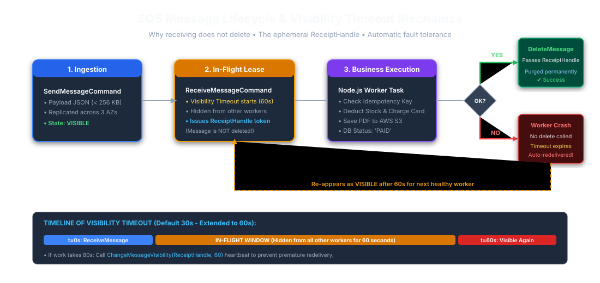
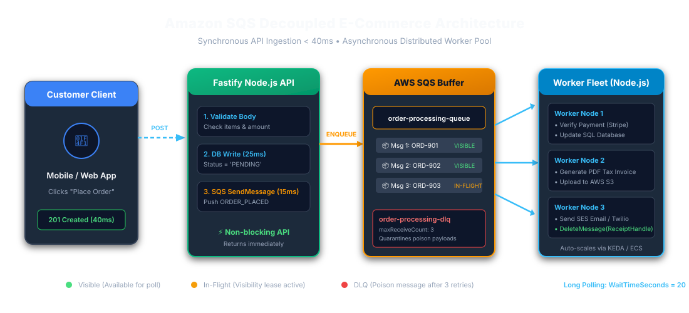
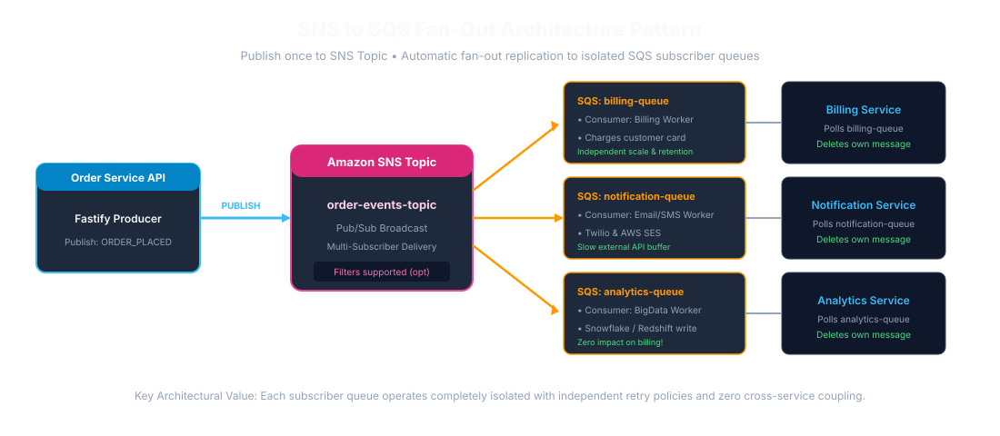
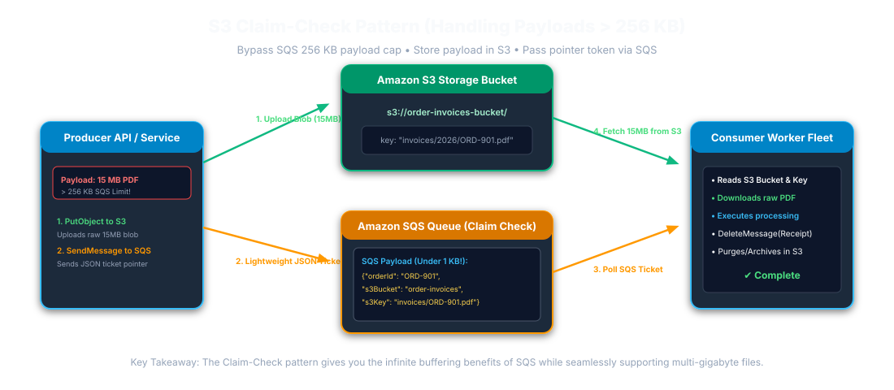

# Amazon SQS (Simple Queue Service) — The Complete Production & Interview Handbook

### Enterprise Architectural Guide for Node.js, Fastify & Distributed Microservices

#### (Real-World E-Commerce Architecture, Complete AWS SQS Methods & Properties Dictionary & In-Depth Marathi Explanations for Every Section)

---

## Table of Contents

1. [Executive Overview & The Core Problem SQS Solves](#1-executive-overview--the-core-problem-sqs-solves)
2. [Core SQS Concepts & Point-Wise Definitions](#2-core-sqs-concepts--point-wise-definitions)
3. [SQS Internal Mechanics & Message Lifecycle](#3-sqs-internal-mechanics--message-lifecycle)
4. [Standard Queue vs. FIFO Queue](#4-standard-queue-vs-fifo-queue)
5. [Amazon SQS vs. Apache Kafka: In-Depth Comparison](#5-amazon-sqs-vs-apache-kafka-in-depth-comparison)
6. [Step-by-Step Guide: How to Setup, Install & Integrate SQS in Node.js (AWS SDK v3)](#6-step-by-step-guide-how-to-setup-install--integrate-sqs-in-nodejs-aws-sdk-v3)
7. [Exhaustive Breakdown: Every SQS Method & Command (Detailed English + Marathi)](#7-exhaustive-breakdown-every-sqs-method--command-detailed-english--marathi)
8. [Exhaustive Breakdown: Every SQS Property & Configuration Attribute (Detailed English + Marathi)](#8-exhaustive-breakdown-every-sqs-property--configuration-attribute-detailed-english--marathi)
9. [Real-World Architecture: E-Commerce Order Fulfillment System](#9-real-world-architecture-e-commerce-order-fulfillment-system)
10. [End-to-End Production Code: Fastify Producer & Long-Polling Worker Consumer](#10-end-to-end-production-code-fastify-producer--long-polling-worker-consumer)
11. [Distributed Duplication, Business Idempotency & Outbox Pattern](#11-distributed-duplication-business-idempotency--outbox-pattern)
12. [Advanced Enterprise SQS Patterns (Senior Interview Hot Topics)](#12-advanced-enterprise-sqs-patterns-senior-interview-hot-topics)
13. [Poison Messages, Dead-Letter Queues (DLQ) & CloudWatch Monitoring](#13-poison-messages-dead-letter-queues-dlq--cloudwatch-monitoring)
14. [Master Interview Questions & Answers (3–5 Years Experience — All 32 Q&As with Marathi)](#14-master-interview-questions--answers-35-years-experience--all-32-qas-with-marathi)
15. [Quick Revision Cheat Sheet](#15-quick-revision-cheat-sheet)

---

## 1. Executive Overview & The Core Problem SQS Solves

### 1.1 What is Amazon SQS?

**Amazon Simple Queue Service (Amazon SQS)** is a fully managed, distributed message queuing service provided by AWS. It enables asynchronous, decoupled communication between microservices, background workers, and distributed systems without requiring services to wait for slow downstream tasks to complete.

---

### 1.2 The Real-World Problem: Synchronous E-Commerce Checkout

Consider a real-world **E-Commerce Application** (like Amazon or Flipkart). When a user clicks **"Place Order"**, multiple downstream operations must execute:

1. Verify inventory and deduct stock.
2. Persist order record in database.
3. Verify payment transaction with the payment gateway.
4. Generate a downloadable PDF tax invoice.
5. Dispatch order confirmation email and SMS to customer.
6. Notify warehouse fulfillment management.

#### The Synchronous Bottleneck (Without SQS)

```
[Customer App / Browser]
            │ (HTTP POST /api/orders - Place Order)
            ▼
   [Fastify API Server]
      ├─► 1. Save Order in Database                  (Takes ~30ms)
      ├─► 2. Call Third-Party Payment Gateway        (Takes ~2,500ms)
      ├─► 3. Generate PDF Tax Invoice                (Takes ~3,500ms)
      ├─► 4. Connect to SMTP & Send Email Receipt    (Takes ~3,000ms)
      ├─► 5. Send SMS via Twilio / SMS Gateway       (Takes ~1,200ms)
      ▼
[Customer Waits 10+ Seconds on Screen!] ──► Timeouts, high cart abandonment, API thread lock!
```

**Consequences of Synchronous Processing:**

- **High Latency:** Customer waits over 10 seconds staring at a loading spinner.
- **Cascading Failures:** If the third-party invoice generator or email SMTP server is slow or down, the Fastify API threads block, memory climbs, and the entire website crashes for all users.
- **No Elastic Buffering:** A sudden traffic burst can exceed downstream capacity. A queue can absorb a bounded backlog, but consumers, retention, quotas, and backpressure still need capacity planning.

---

#### The Asynchronous Solution (With SQS)

```
[Customer App / Browser]
            │ (HTTP POST /api/orders)
            ▼
   [Fastify API Server]
      ├─► 1. Save Order (Status: "PENDING") in Database      (~25ms)
      ├─► 2. Push "ORDER_PLACED" message to Amazon SQS       (~15ms)
      ▼
[Immediate HTTP 201 Created Response after the order/message write succeeds]

                           ▼
              [Amazon SQS: order-processing-queue]
              (Durable AWS Cloud Buffer - Safely Holds Messages)
                           │
         ┌─────────────────┼─────────────────┐
         ▼                 ▼                 ▼
   [Worker Node 1]   [Worker Node 2]   [Worker Node 3]
         │                 │                 │
   ├─ Verify Payment ├─ Create Invoice ├─ Send Email & SMS
   ├─ Update DB      ├─ Upload to S3   ├─ Update DB
   └─ Delete Message └─ Delete Message └─ Delete Message
```

---

> [!NOTE]
>
> ### 🌐 मराठी स्पष्टीकरण (Marathi Explanation)
>
> **Amazon SQS म्हणजे काय आणि त्याची ई-कॉमर्समध्ये गरज का असते?**
> जेव्हा एखादा ग्राहक Amazon किंवा Flipkart वरून वस्तू खरेदी करतो (Place Order), तेव्हा बिल तयार करणे, ईमेल पाठवणे, आणि गोदामात मेसेज पाठवणे ही सर्व कामे करावी लागतात. जर ही कामे API ने थेट केली, तर गिऱ्हाईकाला स्क्रीनवर १० ते १५ सेकंद वाट पाहावी लागेल. जर ईमेल सर्व्हर डाऊन असेल तर ऑर्डर कॅन्सल होईल आणि ॲप क्रॅश होईल.
> **SQS चा फायदा:** Fastify API फक्त ऑर्डर डेटाबेसमध्ये नोंदवतो आणि लगेच SQS रांगेत (Queue) मेसेज टाकून अवघ्या ४० मिलीसेकंदात गिऱ्हाईकाला "Order Placed Successfully!" असा मेसेज दाखवतो. नंतर बॅकग्राउंड वर्कर SQS मधून तो मेसेज घेतात, बिल बनवतात आणि ईमेल पाठवतात. यामुळे ॲप कधीही स्लो होत नाही किंवा क्रॅश होत नाही.

---

## 2. Core SQS Concepts & Point-Wise Definitions

| SQS Concept                 | Architectural Role     | Technical Definition (English)                                                                                                                         |
| :-------------------------- | :--------------------- | :----------------------------------------------------------------------------------------------------------------------------------------------------- |
| **Queue**                   | Storage Container      | A highly available, distributed AWS message buffer that holds messages until consumed or expired. Identified by an HTTPS URL.                          |
| **Producer**                | Message Originator     | The application or microservice that creates and publishes messages into SQS (e.g. Fastify API using `SendMessageCommand`).                            |
| **Consumer (Worker)**       | Task Processor         | A background Node.js service that polls messages using `ReceiveMessageCommand`, executes business tasks, and deletes messages.                         |
| **Message**                 | Unit of Work           | A JSON payload (max size 256 KB) containing task metadata, IDs, timestamps, and optional user-defined Message Attributes.                              |
| **Receipt Handle**          | Ephemeral Delete Token | A temporary unique token returned by SQS _only upon receiving a message_. It is strictly required to delete or update message visibility.              |
| **Visibility Timeout**      | Concurrency Lease      | The duration (0s to 12h, default 30s) during which SQS temporarily hides a received message from other workers so only the active worker processes it. |
| **Message Retention**       | Storage Lifespan       | The maximum duration (1 min to 14 days, default 4 days) an unconsumed message will stay in SQS before being automatically purged by AWS.               |
| **Delivery Delay**          | Initial Pause          | An intentional delay (0 to 15 minutes) before a freshly sent message becomes visible to consumers.                                                     |
| **Dead-Letter Queue (DLQ)** | Error Quarantine       | A secondary queue configured via a Redrive Policy (`maxReceiveCount`) to isolate corrupt or repeatedly failing poison messages.                        |

---

> [!NOTE]
>
> ### 🌐 मराठी स्पष्टीकरण (Marathi Explanation)
>
> 1. **Queue (रांग):** AWS वरील एक सुरक्षित स्टोरेज कंटेनर जिथे मेसेजेस येऊन थांबतात.
> 2. **Producer (पाठवणारा):** आपला Node.js/Fastify API जो ऑर्डरचा मेसेज SQS रांगेत टाकतो.
> 3. **Consumer / Worker (काम करणारा):** बॅकग्राउंडमध्ये चालणारा Node.js कोड जो SQS मधून मेसेज उचलतो आणि काम पूर्ण करतो.
> 4. **Message (मेसेज):** कामाची माहिती असणारा JSON डेटा (जास्तीत जास्त २५६ KB).
> 5. **Receipt Handle (पावती टोकन):** जेव्हा वर्कर मेसेज उचलतो, तेव्हा SQS त्याला एक खास टोकन देते. मेसेज डिलीट करण्यासाठी हे टोकन लागते. (हे `MessageId` पेक्षा वेगळे असते).
> 6. **Visibility Timeout (लपवण्याचा वेळ):** जेव्हा एक वर्कर मेसेजवर काम करत असतो, तेव्हा इतर कोणत्याही वर्करला तो मेसेज दिसू नये म्हणून ठराविक वेळ (उदा. ६० सेकंद) तो लपवला जातो.
> 7. **DLQ (डेड लेटर क्यू):** जर एखादा मेसेज वारंवार फेल होत असेल (उदा. ३ वेळा), तर तो बाजूला एका वेगळ्या रांगेत (DLQ) टाकला जातो जेणेकरून मुख्य सिस्टीम अडकून पडत नाही.

---

## 3. SQS Internal Mechanics & Message Lifecycle



```
[Producer: Fastify API]
          │
          │ 1. SendMessage(orderData)
          ▼
   [Amazon SQS Queue] ◄─────────────────────────────────────────────┐
          │                                                         │
          │ 2. Stores message in "Visible" state                     │
          │                                                         │
          │ 3. ReceiveMessage() with Long Polling (20s)             │
          ▼                                                         │
   [Invisibility Window Begins (Visibility Timeout: 60s)]           │
   (Message is hidden from other workers)                           │
          │                                                         │
          ▼                                                         │
   [Worker Node.js Process]                                         │
          │                                                         │
          ├─► 4. Performs Business Logic & Database Update          │
          │                                                         │
     [Success?]                                                     │
     ├── YES ──► 5. DeleteMessage(ReceiptHandle) ──► Permanently Removed
     │                                                              │
     └── NO (Crash / Error)                                         │
          │                                                         │
          └─► 6. Worker does NOT delete message                     │
              Visibility Timeout expires (60s)                      │
              Message becomes Visible again for Retry ──────────────┘
```

### Critical Rule: Why Does Receiving a Message NOT Delete It?

In Amazon SQS, receiving a message does **not** delete it. SQS temporarily hides the message for the duration of the Visibility Timeout.

- If the worker crashes, runs out of memory, or the server loses power during task execution, the message will **not be lost**.
- Standard queues can occasionally deliver a duplicate even while a message is in its visibility timeout. Visibility timeout reduces concurrent duplicate work; it does not replace idempotent processing.
- Once the visibility timeout expires, SQS automatically makes the message visible again so another healthy worker can pick it up.
- The worker must explicitly invoke `DeleteMessageCommand` using the `ReceiptHandle` only **after** the business logic finishes successfully.

---

> [!NOTE]
>
> ### 🌐 मराठी स्पष्टीकरण (Marathi Explanation)
>
> **मेसेज वाचल्यावर लगेच नष्ट का होत नाही?**
> जर SQS ने वर्करने मेसेज वाचताच तो लगेच डिलीट केला असता आणि नेमका त्याच वेळी सर्व्हर बंद पडला, तर गिऱ्हाईकाची ऑर्डर गायब झाली असती! म्हणून SQS तो मेसेज तात्पुरता लपवून ठेवतो (Visibility Timeout). जोपर्यंत वर्कर काम यशस्वीरीत्या पूर्ण करून SQS ला <code>DeleteMessage</code> सांगत नाही, तोपर्यंत तो मेसेज सुरक्षित राहतो. जर वर्कर क्रॅश झाला तर काही वेळाने तो मेसेज पुन्हा दुसऱ्या वर्करला मिळतो.

---

## 4. Standard Queue vs. FIFO Queue

| Dimension                    | Standard Queue                                                     | FIFO Queue (`.fifo` extension)                                                                                  |
| :--------------------------- | :----------------------------------------------------------------- | :-------------------------------------------------------------------------------------------------------------- |
| **Throughput**               | Scales to high throughput, subject to service quotas and workload. | Depends on queue configuration, batching, and current AWS quotas.                                               |
| **Delivery / Deduplication** | **At-Least-Once Delivery** (Duplicates can occasionally occur).    | Deduplicates producer sends within a 5-minute interval; consumers must still handle repeated processing safely. |
| **Ordering**                 | **Best-Effort Ordering** (May occasionally arrive out of order).   | **Strict First-In-First-Out** preserved per `MessageGroupId`.                                                   |
| **Message Group ID**         | Not supported.                                                     | **Mandatory** (`MessageGroupId`). Allows concurrent processing across different groups!                         |
| **Deduplication ID**         | Not supported.                                                     | Supported via `MessageDeduplicationId` or Content-Based Deduplication.                                          |

> **FIFO note:** Deduplication is a producer-side send safeguard within the five-minute deduplication interval; it does not make consumer side effects exactly-once. Consumers still need idempotency. FIFO throughput depends on queue configuration, batching, and AWS quotas for the Region/account.

---

> [!NOTE]
>
> ### 🌐 हिंदी स्पष्टीकरण
>
> - **Standard Queue (स्टँडर्ड रांग):** अत्यंत वेगवान असते (लाखो मेसेजेस प्रति सेकंद). मेसेज पुढे-मागे होऊ शकतात आणि क्वचित एकापेक्षा जास्त वेळा येऊ शकतात. स्वतंत्र कामांसाठी (उदा. ईमेल पाठवणे) ही उत्तम आहे.
> - **FIFO Queue (क्रमबद्ध कतार):** एक ही `MessageGroupId` वाले संदेश क्रम से प्रोसेस होते हैं। पाँच मिनट की deduplication अवधि में duplicate sends रोके जा सकते हैं, लेकिन consumer के business side effects की exactly-once गारंटी नहीं मिलती। इसलिए payment जैसे कामों में FIFO के साथ idempotency भी लागू करें।

---

## 5. Amazon SQS vs. Apache Kafka: In-Depth Comparison

| Feature                 | Amazon SQS                                                             | Apache Kafka                                                                                   |
| :---------------------- | :--------------------------------------------------------------------- | :--------------------------------------------------------------------------------------------- |
| **Architecture**        | **Distributed Task Queue**                                             | **Distributed Append-Only Commit Log**                                                         |
| **Message Consumption** | Competing Workers pull messages and **delete** them after processing.  | Consumer groups read event streams and independently track **offsets**.                        |
| **Message Deletion**    | Destructive: Message is permanently deleted upon `DeleteMessage`.      | Non-destructive: Messages are saved on disk until topic retention (e.g. 7 days) expires.       |
| **Replayability**       | **No native replay**. Once deleted, it cannot be read again.           | **Full Replay**. Consumers can rewind their offset to re-read past events anytime.             |
| **Management**          | **100% Serverless & Managed by AWS**. Zero ops, zero cluster sizing.   | Requires server management, partition sizing, and cluster monitoring.                          |
| **Best Used For**       | Background asynchronous jobs, decoupled web API tasks, retriable jobs. | Real-time event streaming, event sourcing, big data analytics, multi-system publish-subscribe. |

---

> [!NOTE]
>
> ### 🌐 मराठी स्पष्टीकरण (Marathi Explanation)
>
> - **SQS म्हणजे 'कामाची यादी (Task Queue)':** वर्कर येतो, एक काम उचलतो, काम पूर्ण करतो आणि ती पावती फाडून टाकतो (Delete). काम संपले की मेसेज नष्ट होतो. SQS पूर्णपणे AWS सांभाळते.
> - **Kafka म्हणजे 'डायरी किंवा वही (Event Log)':** घडलेली प्रत्येक घटना वहीत कायमची नोंदवून ठेवली जाते. १० वेगवेगळे ॲप्स एकाच वहीतील नोंदी स्वतंत्रपणे वाचू शकतात. जुने मेसेज हवे तेव्हा पुन्हा वाचता येतात (Replay).

---

## 6. Step-by-Step Guide: How to Setup, Install & Integrate SQS in Node.js (AWS SDK v3)

### Step 1: Install AWS SDK v3

```bash
npm init -y
npm install @aws-sdk/client-sqs dotenv
```

### Step 2: Configure Environment Variables (`.env`)

```ini
AWS_REGION=ap-south-1
SQS_ORDER_QUEUE_URL=https://sqs.ap-south-1.amazonaws.com/123456789012/order-processing-queue
SQS_ORDER_DLQ_URL=https://sqs.ap-south-1.amazonaws.com/123456789012/order-processing-dlq
```

Use the AWS SDK default credential provider chain (for example, an ECS task role, EC2 instance profile, or EKS workload identity) in deployed environments. Keep static credentials out of source control; local development can use an approved local AWS profile.

### Step 3: Create SQS Client Singleton (`config/sqs.js`)

```javascript
import { SQSClient } from '@aws-sdk/client-sqs';
import dotenv from 'dotenv';

dotenv.config();

export const sqsClient = new SQSClient({
  region: process.env.AWS_REGION || 'ap-south-1',
  maxAttempts: 3, // Automatic SDK exponential backoff retry
});
```

---

## 7. Exhaustive Breakdown: Every SQS Method & Command (Detailed English + Marathi)

### 1. `new SQSClient({ region, maxAttempts })`

- **English:** Instantiates AWS SQS Client object. Configures region and exponential backoff retry.
- **मराठी:** हा SQS चा मुख्य कन्स्ट्रक्टर आहे. तो Node.js ॲपला AWS च्या SQS सर्व्हरशी जोडतो.

### 2. `SendMessageCommand({ QueueUrl, MessageBody, DelaySeconds, MessageAttributes })`

- **English:** Enqueues a single JSON message into SQS. Returns immutable `MessageId`.
- **मराठी:** रांगेत नवीन मेसेज पाठवण्यासाठी वापरतात. डेटा JSON स्ट्रिंग स्वरूपात दिला जातो.

### 3. `SendMessageBatchCommand({ QueueUrl, Entries: [...] })`

- **English:** Sends up to 10 messages in one network round-trip. Slashes AWS API costs significantly.
- **मराठी:** एकाच फेरीत १० मेसेजेस पाठवण्यासाठी वापरतात, ज्यामुळे पैसे आणि वेळ दोन्ही वाचतात.

### 4. `ReceiveMessageCommand({ QueueUrl, MaxNumberOfMessages, WaitTimeSeconds, VisibilityTimeout })`

- **English:** Polls available messages from queue. Enables Long Polling when `WaitTimeSeconds > 0`.
- **मराठी:** रांगेतून मेसेज वाचण्यासाठी वापरतात. `WaitTimeSeconds: 20` दिल्यास ते मेसेज येईपर्यंत २० सेकंद थांबते (Long Polling).

### 5. `DeleteMessageCommand({ QueueUrl, ReceiptHandle })`

- **English:** Permanently deletes a processed message from SQS using its ephemeral `ReceiptHandle`.
- **मराठी:** काम पूर्ण झाल्यावर SQS मधून तो मेसेज कायमचा काढून टाकण्यासाठी वापरतात.

### 6. `DeleteMessageBatchCommand({ QueueUrl, Entries: [...] })`

- **English:** Deletes up to 10 processed messages in a single batch request.
- **मराठी:** एकाच वेळी १० मेसेजेस डिलीट करण्यासाठी वापरतात.

### 7. `ChangeMessageVisibilityCommand({ QueueUrl, ReceiptHandle, VisibilityTimeout })`

- **English:** Extends invisibility window for long-running worker tasks.
- **मराठी:** काम संपायला जास्त वेळ लागत असल्यास लपवण्याचा वेळ (Visibility Timeout) वाढवण्यासाठी वापरतात.

### 8. `GetQueueAttributesCommand({ QueueUrl, AttributeNames: ['All'] })`

- **English:** Retrieves queue metadata, backlog counts, and DLQ redrive attributes.
- **मराठी:** रांगेत किती मेसेजेस बाकी आहेत आणि किती प्रोसेस होत आहेत ते तपासण्यासाठी वापरतात.

### 9. `PurgeQueueCommand({ QueueUrl })`

- **English:** Deletes all messages in the SQS queue without deleting the queue itself.
- **मराठी:** रांगेतील सर्व मेसेजेस एका झटक्यात साफ (रिकामे) करण्यासाठी वापरतात.

---

## 8. Exhaustive Breakdown: Every SQS Property & Configuration Attribute (Detailed English + Marathi)

| Property Name             | Data Type          | Technical Purpose (English)                                                          | मराठी सविस्तर स्पष्टीकरण आणि उपयोग                                                      |
| :------------------------ | :----------------- | :----------------------------------------------------------------------------------- | :-------------------------------------------------------------------------------------- |
| `QueueUrl`                | String             | Full HTTPS endpoint URL identifying the target AWS queue.                            | ज्या रांगेत मेसेज पाठवायचा किंवा वाचायचा आहे तिचा HTTPS वेब पत्ता.                      |
| `MessageBody`             | String             | The actual task payload data in stringified JSON format (max 256 KB).                | मेसेजमधील मुख्य मजकूर किंवा डेटा (JSON स्वरूपात).                                       |
| `ReceiptHandle`           | String             | Ephemeral identifier generated on every receive; strictly required to delete.        | मेसेज वाचल्यावर मिळणारे पावती टोकन. मेसेज डिलीट करण्यासाठी हेच टोकन लागते.              |
| `MessageId`               | String             | Immutable system UUID assigned by SQS upon ingestion.                                | मेसेज SQS मध्ये आल्यावर SQS ने दिलेला कायमस्वरूपी युनिक नंबर.                           |
| `WaitTimeSeconds`         | Integer (0–20)     | Duration for Long Polling. SQS holds connection open until message arrives.          | लॉंग पोलिंगचा वेळ (० ते २० सेकंद). रांगेत मेसेज येईपर्यंत थांबण्याची सुविधा.            |
| `VisibilityTimeout`       | Integer (0–43200s) | Duration (in seconds) the message stays hidden from other workers while in-flight.   | मेसेज उचलल्यावर इतर वर्कर्सपासून तो किती सेकंद लपवून ठेवायचा हा वेळ (डीफॉल्ट ३० सेकंद). |
| `MaxNumberOfMessages`     | Integer (1–10)     | Maximum number of messages retrieved in a single `ReceiveMessage` call.              | एका वेळी जास्तीत जास्त किती मेसेजेस उचलायचे (१ ते १० पर्यंत).                           |
| `DelaySeconds`            | Integer (0–900s)   | Delivery delay applied to freshly sent messages before becoming visible (0–15 mins). | मेसेज पाठवल्यावर सुरुवातीला किती सेकंद थांबवून ठेवायचे तो वेळ (० ते १५ मिनिटे).         |
| `MessageGroupId`          | String             | Mandatory for FIFO queues. Preserves strict sequential order within the group.       | FIFO रांगेसाठी आवश्यक. ज्या मेसेजचा ग्रुप आयडी सारखा असेल ते क्रमाने चालतात.            |
| `MessageDeduplicationId`  | String             | Token used by FIFO queues to prevent duplicate sends within a 5-minute window.       | FIFO मध्ये ५ मिनिटांच्या आत आलेला डुप्लिकेट मेसेज थांबवणारा टोकन.                       |
| `ApproximateReceiveCount` | String (Integer)   | System attribute counting how many times a message has been delivered to workers.    | हा मेसेज आतापर्यंत किती वेळा वर्करने वाचण्याचा प्रयत्न केला त्याची संख्या.              |

---

## 9. Real-World Architecture: E-Commerce Order Fulfillment System



### The E-Commerce Pipeline Workflow:

1. **User Checkout:** Customer clicks "Place Order" on mobile app / website.
2. **Fastify API (Producer):**
   - Validates cart items and customer profile.
   - Saves order record with status `"PENDING"` in database.
   - Enqueues `ORDER_PLACED` message into `order-processing-queue`.

- Returns `HTTP 201 Created` after the required durable writes succeed; actual latency depends on database, queue, and network performance.

3. **SQS Buffering:** SQS retains messages safely across AWS availability zones.
4. **Order Worker Daemon (Consumer):**
   - Long-polls SQS (`WaitTimeSeconds: 20`).
   - Verifies idempotency key to prevent double charging.
   - Performs payment verification, generates PDF invoice, and updates database status to `"PAID"`.
   - Calls `DeleteMessageCommand` using `ReceiptHandle`.
5. **Dead-Letter Queue (DLQ):** SQS can redrive a message after its configured receive count is reached without deletion. Choose the count for the workload; SQS does not directly observe application-level failures.

---

## 10. End-to-End Production Code: Fastify Producer & Long-Polling Worker Consumer

### 10.1 Fastify API Order Producer Route (`routes/order.js`)

```javascript
import { SendMessageCommand } from '@aws-sdk/client-sqs';
import { sqsClient } from '../config/sqs.js';

export async function orderRoutes(fastify, options) {
  fastify.post('/api/orders', async (request, reply) => {
    const { customerId, items, totalAmount } = request.body;

    if (!customerId || !totalAmount) {
      return reply.status(400).send({ error: 'Missing required order fields' });
    }

    const orderNumber = `ORD-${Date.now()}`;
    const idempotencyKey = `ORDER_IDEMP_${orderNumber}`;

    // 1. Prepare SQS message payload
    const orderPayload = {
      orderNumber,
      customerId,
      items,
      totalAmount,
      idempotencyKey,
      createdAt: new Date().toISOString(),
    };

    // 2. Publish task to Amazon SQS
    const command = new SendMessageCommand({
      QueueUrl: process.env.SQS_ORDER_QUEUE_URL,
      MessageBody: JSON.stringify(orderPayload),
      MessageAttributes: {
        EventType: { DataType: 'String', StringValue: 'ORDER_PLACED' },
        CustomerId: { DataType: 'String', StringValue: String(customerId) },
      },
    });

    await sqsClient.send(command);

    // 3. Return after the required durable writes succeed; latency depends on the workload
    return reply.status(201).send({
      message: 'Order placed successfully! Processing in background.',
      orderNumber,
      status: 'PENDING',
    });
  });
}
```

---

**Production consistency note:** This producer snippet focuses on publishing and omits the database write for brevity. If the order record and SQS message must be committed reliably together, use a transactional outbox and an idempotent publisher/consumer; a database write followed by `SendMessage` is a dual-write risk.

### 10.2 Background Worker Consumer with Graceful Shutdown (`workers/orderWorker.js`)

```javascript
import { ReceiveMessageCommand, DeleteMessageCommand } from '@aws-sdk/client-sqs';
import { sqsClient } from '../config/sqs.js';

const queueUrl = process.env.SQS_ORDER_QUEUE_URL;
let isShuttingDown = false;

async function fulfillOrder(order) {
  console.log(`[Worker] Fulfilling order ${order.orderNumber}...`);
  // Simulate payment verification, PDF invoice generation & email receipt
  await new Promise((resolve) => setTimeout(resolve, 150));
  console.log(`[Worker] Order ${order.orderNumber} successfully fulfilled!`);
}

async function startWorker() {
  console.log('🚀 SQS Order Worker listening on queue...');

  while (!isShuttingDown) {
    try {
      const response = await sqsClient.send(
        new ReceiveMessageCommand({
          QueueUrl: queueUrl,
          MaxNumberOfMessages: 1,
          WaitTimeSeconds: 20, // Long Polling: 20s hold
          VisibilityTimeout: 60, // Set above expected processing time; extend for long jobs
        })
      );

      const messages = response.Messages ?? [];
      for (const message of messages) {
        try {
          const order = JSON.parse(message.Body);
          await fulfillOrder(order);

          // Delete from SQS only after fulfillment succeeds!
          await sqsClient.send(
            new DeleteMessageCommand({
              QueueUrl: queueUrl,
              ReceiptHandle: message.ReceiptHandle,
            })
          );
          console.log(`[Worker] SQS Message deleted: ${message.MessageId}`);
        } catch (taskErr) {
          console.error(`[Worker] Error on message ${message.MessageId}:`, taskErr.message);
          // Do NOT delete message; allow SQS to retry after visibility timeout
        }
      }
    } catch (pollErr) {
      console.error('[Worker] Network polling error:', pollErr.message);
      await new Promise((res) => setTimeout(res, 2000));
    }
  }

  console.log('Worker daemon stopped cleanly.');
}

process.on('SIGTERM', () => {
  isShuttingDown = true;
});
process.on('SIGINT', () => {
  isShuttingDown = true;
});

startWorker();
```

---

## 11. Distributed Duplication, Business Idempotency & Outbox Pattern

### Why Duplicates Occur in Standard SQS

Amazon SQS Standard Queues guarantee **At-Least-Once Delivery**. A duplicate delivery happens if:

1. Worker receives order message.
2. Worker finishes fulfillment (payment verified, invoice saved).
3. Network connection blips before Worker's `DeleteMessage` call reaches SQS.
4. Visibility timeout expires (60s). SQS redelivers the exact same message to another worker!

### The Solution: Database Idempotency

Ensure every message includes a deterministic `idempotencyKey` (e.g. `ORDER_IDEMP_ORD-12345`). In your database, store this key in a table with a `UNIQUE` constraint index. If a duplicate message arrives, the database rejects the duplicate insert, preventing double billing.

---

> [!NOTE]
>
> ### 🌐 मराठी स्पष्टीकरण (Marathi Explanation)
>
> **डुप्लिकेट मेसेज आणि आयडेंपोटन्सी (Idempotency) म्हणजे काय?**
> समजा वर्करने ग्राहकाचे पैसे कापले, पण SQS ला 'Delete' मेसेज पाठवण्याआधीच इंटरनेट बंद झाले. तर SQS ला वाटेल की काम झाले नाही, आणि SQS तोच मेसेज पुन्हा पाठवेल!
> **उपाय:** आपण डेटाबेसमध्ये `idempotencyKey` युनिक (Unique) ठेवतो. जर तोच मेसेज पुन्हा आला, तर डेटाबेस सांगतो की "ही ऑर्डर आधीच झाली आहे!" आणि वर्कर पैसे पुन्हा न कापता शांतपणे SQS चा मेसेज डिलीट करतो. याला **Idempotency** म्हणतात.

---

## 12. Advanced Enterprise SQS Patterns (Senior Interview Hot Topics)





### 12.1 The SNS + SQS Fan-Out Pattern (Pub/Sub Multi-Subscriber Architecture)

- **The Problem:** Amazon SQS is a point-to-point queue. If 3 different microservices (Billing Service, Notification Service, Analytics Service) all need a copy of the `ORDER_PLACED` event, you **cannot** have them read from the same SQS queue because the first worker that processes the message deletes it!
- **The Solution (Fan-Out):** The Fastify API publishes **once** to an **Amazon SNS Topic**. Three separate SQS queues subscribe to that SNS Topic. SNS automatically replicates and fans out duplicate copies to all 3 SQS queues simultaneously. Each service consumes from its own independent queue at its own pace!

```
[Fastify API] ──► (Publish Event) ──► [Amazon SNS Topic: OrderEvents]
                                             │
                       ┌─────────────────────┼─────────────────────┐
                       ▼                     ▼                     ▼
             [Billing SQS Queue]   [Notification Queue]   [Analytics SQS Queue]
                       │                     │                     │
                       ▼                     ▼                     ▼
               (Billing Worker)      (Email Worker)        (Data Pipeline)
```

---

### 12.2 Handling Payloads > 256 KB: The S3 Claim-Check Pattern

- **The Constraint:** Amazon SQS has a strict hard message size ceiling of **256 KB**. What if your application needs to queue a 10 MB order receipt image or large batch payload?
- **The Solution (Claim Check):**
  1. The producer uploads the large payload (> 256 KB) to an **Amazon S3 Bucket**.
  2. The producer puts a lightweight JSON message into SQS containing the S3 bucket name and object key (the "claim check ticket").
  3. The consumer worker retrieves the SQS message, downloads the full 10 MB payload from S3, processes it, and deletes the SQS message and S3 object.
     _(AWS provides the official Amazon SQS Extended Client Library to automate this transparently)._

---

### 12.3 Consumer Autoscaling Mechanics (CloudWatch Backlog & KEDA)

- **Senior Interview Question:** _"How do you autoscale your Node.js worker containers based on queue depth?"_
- **The Formula:** Do not scale purely on CPU or Memory! Scale based on **Backlog per Worker**:
  $$\text{Backlog Per Worker} = \frac{\text{ApproximateNumberOfMessagesVisible}}{\text{Running Worker Task Count}}$$
  If acceptable latency is 10 seconds and each worker processes 5 msgs/sec, target 50 messages per worker.
- **On AWS ECS:** Use CloudWatch Metric Math + Target Tracking Auto Scaling.
- **On Kubernetes (EKS):** Use **KEDA (Kubernetes Event-driven Autoscaling)** with the `aws-sqs` trigger. When SQS visible messages exceed the threshold, KEDA scales worker pods from 1 to 50 within seconds!

---

### 12.4 AWS Security & PrivateLink VPC Endpoints

- **In-Transit Encryption:** Enforced via Queue Policy checking `"aws:SecureTransport": "true"`.
- **At-Rest Encryption:** Handled via AWS KMS Customer-Managed Keys (`SSE-KMS`) or default SQS keys (`SSE-SQS`).
- **PrivateLink (VPC Interface Endpoint):** Routes traffic between your private VPC subnets and Amazon SQS privately across the AWS internal network backbone without ever traversing the public internet.

---

### 12.5 SQS Billing & Cost Optimization Math

- **Pricing Unit:** SQS bills $0.40 per 1,000,000 requests (with 1M free requests/month). Each 64 KB of payload counts as 1 request.
- **Cost Saving 1 (Long Polling):** Long polling (`WaitTimeSeconds: 20`) can reduce empty receives and worker wake-ups. Actual request and cost savings depend on traffic, queue configuration, message sizes, and poller count; avoid promising a fixed percentage.
- **Cost Saving 2 (Batching):** Using `SendMessageBatch` (10 msgs per call) and `DeleteMessageBatch` cuts billable API requests by **90%**!

---

> [!NOTE]
>
> ### 🌐 मराठी स्पष्टीकरण (Marathi Explanation)
>
> 1. **SNS to SQS Fan-Out (एकाच मेसेजच्या अनेक प्रती):** SQS मध्ये एक मेसेज एकाच वर्करला मिळतो. पण जर एकाच ऑर्डरची माहिती बिलिंग, ईमेल आणि ॲनालिटिक्स या तिन्ही विभागांना हवी असेल, तर आधी मेसेज **SNS** मध्ये पाठवला जातो. SNS आपोआप तो मेसेज तिन्ही वेगवेगळ्या SQS रांगेत वाटून देतो (Fan-Out).
> 2. **S3 Claim-Check (मोठे मेसेजेस पाठवणे):** SQS मध्ये जास्तीत जास्त २५६ KB चाच मेसेज बसतो. जर १० MB ची फाईल किंवा फोटो असेल, तर ती फाईल आधी **Amazon S3** मध्ये सेव्ह केली जाते आणि SQS मध्ये फक्त त्या फाईलची लिंक (टोकन) पाठवली जाते. वर्कर ती लिंक वाचून S3 मधून फाईल डाऊनलोड करतो.
> 3. **ऑटो-स्केलिंग (कामगारांची संख्या वाढवणे):** रांगेत किती मेसेजेस पेंडिंग आहेत ते पाहून Kubernetes (KEDA) किंवा AWS ECS आपोआप नवीन वर्कर सर्व्हर्स सुरू करते.

---

## 13. Poison Messages, Dead-Letter Queues (DLQ) & CloudWatch Monitoring

### 13.1 Poison Messages

A **poison message** is an unprocessable payload (such as corrupted JSON or referencing an invalid account) that crashes the worker every time it is picked up. Without a DLQ, it repeats in an infinite crash loop.

### 13.2 Dead-Letter Queue (DLQ) Redrive Policy

Configure `maxReceiveCount` according to the workload. SQS moves a message to the DLQ after it has been received the configured number of times without being deleted; SQS cannot determine whether application processing itself failed. Alert, inspect, and redrive DLQ messages deliberately.

- **Cost Saving 1 (Long Polling):** Long polling (`WaitTimeSeconds: 20`) can reduce empty receives and worker wake-ups. Actual request and cost savings depend on traffic, queue configuration, message sizes, and poller count; avoid promising a fixed percentage.

### 13.3 CloudWatch Metrics to Monitor

- `ApproximateAgeOfOldestMessage`: Shows how long the oldest unconsumed task has been waiting. (Top SLA metric).
- `ApproximateNumberOfMessagesVisible`: Queue backlog size. Used for autoscaling worker pods.
- `DLQ ApproximateNumberOfMessagesVisible`: Must be 0. If > 0, triggers an urgent engineering alert!

---

> [!NOTE]
>
> ### 🌐 मराठी स्पष्टीकरण (Marathi Explanation)
>
> - **Poison Message (विषारी मेसेज):** असा मेसेज ज्यामध्ये चुकीचा डेटा आहे (उदा. चुकीचा JSON). तो प्रत्येक वेळी वर्करचा कोड क्रॅश करतो.
> - **DLQ (Dead-Letter Queue):** ३ वेळा प्रयत्न करूनही जो मेसेज फेल होतो, SQS त्याला बाजूला DLQ रांगेत पाठवतो, जेणेकरून बाकीच्या चांगल्या ऑर्डर्स वेळेवर पूर्ण होतात.
> - **CloudWatch मॉनिटरिंग:** AWS चे एक टूल जे रांगेत किती मेसेजेस पेंडिंग आहेत आणि काम वेळेवर होत आहे की नाही यावर लक्ष ठेवते.

---

## 14. Master Interview Questions & Answers (3–5 Years Experience — All 32 Q&As with Marathi)

#### Q01. What is Amazon SQS, and how does it fit into an E-Commerce backend?

- **English Answer:** Amazon SQS is a fully managed message queue that decouples microservices. In E-Commerce, when an order is placed, Fastify saves the order as `PENDING` and enqueues a message to SQS, immediately returning HTTP 201 to the customer. Background workers asynchronously process payments, invoices, and emails without blocking customer checkout.
- **मराठी स्पष्टीकरण:** Amazon SQS ही AWS ची मेसेज रांग सेवा आहे. ई-कॉमर्समध्ये ऑर्डर केल्यावर Fastify API तात्काळ रिस्पॉन्स देऊन मेसेज SQS मध्ये टाकतो आणि बॅकग्राउंड वर्कर बिल बनवणे आणि ईमेल पाठवण्याचे काम करतात, ज्यामुळे सर्वर कधीही स्लो होत नाही.

#### Q02. Explain the internal architecture and message flow of Amazon SQS.

- **English Answer:** SQS follows a Producer–Queue–Consumer architecture: 1) Producer calls `SendMessage`; 2) SQS replicates across AZs; 3) Consumer calls `ReceiveMessage` with Long Polling; 4) Message hidden during Visibility Timeout; 5) Consumer processes task; 6) Consumer calls `DeleteMessage` with `ReceiptHandle`.
- **मराठी स्पष्टीकरण:** Producer मेसेज पाठवतो, SQS तो सुरक्षित रांगेत ठेवतो. वर्करने मेसेज घेतल्यावर तो तात्पुरता लपवला जातो. काम पूर्ण झाल्यावरच वर्कर पावती टोकन (ReceiptHandle) देऊन तो मेसेज कायमचा डिलीट करतो.

#### Q03. What is the difference between Amazon SQS and Apache Kafka?

- **English Answer:** SQS is a managed Task Queue where workers pull and delete tasks after completion. Kafka is an append-only commit log where consumer groups track offsets. SQS deletes messages upon acknowledgment; Kafka retains records for days, enabling full replayability.
- **मराठी स्पष्टीकरण:** SQS हे काम झाल्यावर मेसेज डिलीट करते (Task Queue). Kafka मेसेज वहीसारखा कायमस्वरूपी सेव्ह ठेवतो (Event Log) जेणेकरून जुने मेसेज पुन्हा वाचता येतात (Replay).

#### Q04. Difference between Standard and FIFO Queues?

- **English Answer:** Standard queues scale to high throughput and provide at-least-once delivery with best-effort ordering. FIFO queues preserve order per `MessageGroupId` and deduplicate sends within a five-minute interval; throughput depends on queue configuration and current AWS quotas.
- **हिंदी स्पष्टीकरण:** Standard queue में संदेश क्रम से बाहर आ सकते हैं और दोबारा deliver हो सकते हैं। FIFO queue एक ही `MessageGroupId` के संदेश क्रम से process करती है; पाँच मिनट की deduplication duplicate sends घटाती है, लेकिन consumer processing की exactly-once guarantee नहीं है।

#### Q05. What is "At-Least-Once Delivery," and why do duplicates happen?

- **English Answer:** Guarantees messages are delivered at least once. Duplicates happen if a worker commits a task, but crashes before calling `DeleteMessage`. SQS visibility timeout expires and redelivers the message. Handled via database idempotency.
- **मराठी स्पष्टीकरण:** प्रत्येक मेसेज किमान एकदा नक्की पोहोचणार. जर वर्करने काम केले पण मेसेज डिलीट करण्याआधी इंटरनेट गेले, तर SQS तोच मेसेज पुन्हा पाठवतो. म्हणून कोडमध्ये Idempotency असणे आवश्यक आहे.

#### Q06. What is Visibility Timeout?

- **English Answer:** The window (0s–12h; default 30s) during which SQS hides an in-flight message so other workers cannot receive it.
- **मराठी स्पष्टीकरण:** वर्करने मेसेज उचलल्यावर दुसऱ्या कोणाला दिसू नये म्हणून तो जितका वेळ लपवून ठेवला जातो त्याला Visibility Timeout म्हणतात (डीफॉल्ट ३० सेकंद).

#### Q07. What happens if a worker crashes after receiving a message?

- **English Answer:** If a message is not deleted before its visibility timeout expires, it can become visible for redelivery. Standard queues are at-least-once; consumers must be idempotent, and retention/DLQ configuration still matters.
- **मराठी स्पष्टीकरण:** वर्कर क्रॅश झाला तरी काही अडचण येत नाही. वेळ संपल्यावर तो मेसेज पुन्हा रांगेत दिसतो आणि दुसरा वर्कर काम पूर्ण करतो.

#### Q08. What is Long Polling, and why is it essential?

- **English Answer:** Setting `WaitTimeSeconds: 20` enables long polling and can reduce empty receives and worker wake-ups. Cost savings depend on the workload; it does not eliminate empty responses in every case.
- **मराठी स्पष्टीकरण:** रांगेत मेसेज येईपर्यंत २० सेकंद थांबून राहणे याला Long Polling म्हणतात. यामुळे रिकाम्या फेऱ्या टळतात आणि AWS चे बिल ८०% वाचते.

#### Q09. What is a Dead-Letter Queue (DLQ)?

- **English Answer:** An isolated queue for messages that fail repeatedly beyond `maxReceiveCount`, stopping poison messages from burning CPU.
- **मराठी स्पष्टीकरण:** ३ वेळा फेल होणारे चुकीचे मेसेजेस बाजूला काढून ठेवणारी रांग म्हणजे DLQ, जेणेकरून मुख्य सिस्टीम अडकून पडत नाही.

#### Q10. What is MaxReceiveCount?

- **English Answer:** Threshold of failed receive attempts before SQS automatically transfers the message to the DLQ.
- **मराठी स्पष्टीकरण:** मेसेज किती वेळा अयशस्वी झाल्यावर DLQ मध्ये पाठवायचा ती संख्या (उदा. ३ वेळा).

#### Q11. Retrying vs. DLQ?

- **English Answer:** Retry is for temporary transient failures; DLQ isolates permanent poison payloads.
- **मराठी स्पष्टीकरण:** Retry तात्पुरत्या अडचणींसाठी (उदा. नेटवर्क स्लो), DLQ कायमच्या चुकीच्या डेटासाठी असते.

#### Q12. Message Retention vs Visibility Timeout?

- **English Answer:** Retention is total storage lifespan (14 days max). Visibility timeout is the in-flight processing window (30s default).
- **मराठी स्पष्टीकरण:** Retention म्हणजे मेसेज SQS मध्ये किती दिवस साठवून राहील (१४ दिवस). Visibility म्हणजे वर्करने मेसेज घेतल्यावर तो किती वेळ लपवला जाईल (३० सेकंद).

#### Q13. Why is ReceiptHandle required instead of MessageId to delete?

- **English Answer:** SQS generates a new ReceiptHandle on every receive. It proves the caller holds the active processing lease, preventing race conditions.
- **मराठी स्पष्टीकरण:** प्रत्येक वेळी मेसेज वाचताना SQS नवीन पावती (ReceiptHandle) देते, त्यावरून सिद्ध होते की हाच वर्कर सध्या काम करत आहे.

#### Q14. How do you implement SQS in Node.js?

- **English Answer:** Use `@aws-sdk/client-sqs`: initialize `SQSClient`, send with `SendMessageCommand`, poll with `ReceiveMessageCommand`, and delete with `DeleteMessageCommand`.
- **मराठी स्पष्टीकरण:** AWS SDK v3 चे पॅकेज वापरून क्लायंट बनवला जातो, SendMessage ने पाठवला जातो आणि Delete ने डिलीट केला जातो.

#### Q15. Error handling in SQS workers?

- **English Answer:** Wrap in `try/catch`. On transient error, do NOT delete message; allow visibility timeout to expire for auto-retry.
- **मराठी स्पष्टीकरण:** तात्पुरती एरर आल्यास मेसेज डिलीट करू नये, SQS आपोआप थोड्या वेळाने पुन्हा प्रयत्न करेल.

#### Q16. Graceful Shutdown in Node.js SQS Worker?

- **English Answer:** Catch `SIGTERM`, set shutdown flag to stop polling, await in-flight tasks, then exit cleanly.
- **मराठी स्पष्टीकरण:** सर्व्हर बंद होताना चालू असलेले काम पूर्ण होऊ देणे आणि नवीन मेसेज घेणे थांबवून सुरक्षित बाहेर पडणे.

#### Q17. Concurrency control in Node.js SQS Worker?

- **English Answer:** Fetch at most 10 messages per batch and use concurrency limiters (`p-limit`) to prevent downstream resource exhaustion.
- **मराठी स्पष्टीकरण:** डेटाबेस क्रॅश होऊ नये म्हणून एकाच वेळी मर्यादित कामे (उदा. ५ ते १०) केली जातात.

#### Q18. What is MessageGroupId in FIFO SQS?

- **English Answer:** Enforces strict sequence for messages with the same group ID, while allowing parallel processing across different groups.
- **मराठी स्पष्टीकरण:** FIFO मध्ये सारख्या ग्रुपचे मेसेजेस क्रमाने चालतात, पण वेगवेगळ्या ग्रुपचे मेसेजेस एकाच वेळी पॅरलल चालतात.

#### Q19. MessageDeduplicationId in FIFO SQS?

- **English Answer:** Unique token suppressing duplicate sends within a 5-minute deduplication window.
- **मराठी स्पष्टीकरण:** FIFO मध्ये ५ मिनिटांच्या आत आलेला डुप्लिकेट मेसेज थांबवणारा टोकन.

#### Q20. What is Idempotency, and why is it mandatory?

- **English Answer:** Ensuring repeated execution produces the same business outcome. Essential because SQS standard queues deliver at least once.
- **मराठी स्पष्टीकरण:** एकाच मेसेजवर कितीही वेळा प्रक्रिया झाली तरी दुबार पैसे न कापणे किंवा दुबार ऑर्डर न होणे म्हणजे Idempotency.

#### Q21. Designing SQS for 50,000 orders in a flash sale?

- **English Answer:** Fastify creates PENDING order and enqueues to SQS. Horizontally scaled workers consume with long polling and idempotent writes.
- **मराठी स्पष्टीकरण:** फ्लॅश सेलमध्ये सर्व ऑर्डर्स SQS मध्ये साठवून वर्कर हळूहळू सुरक्षितपणे डेटाबेसमध्ये सेव्ह करतात.

#### Q22. Critical CloudWatch Metrics for SQS?

- **English Answer:** `ApproximateAgeOfOldestMessage` (latency), `ApproximateNumberOfMessagesVisible` (backlog), and DLQ visible messages.
- **मराठी स्पष्टीकरण:** सर्वात जुना मेसेज किती वेळ अडकला आहे आणि रांगेत किती मेसेजेस बाकी आहेत हे तपासणे.

#### Q23. Handling long-running tasks exceeding Visibility Timeout?

- **English Answer:** Use `ChangeMessageVisibilityCommand` periodically as a heartbeat to extend the visibility window.
- **मराठी स्पष्टीकरण:** काम संपायला वेळ लागत असेल तर SQS कडून अजून वेळ मागून घेणे (ChangeMessageVisibility).

#### Q24. Preventing duplicates across distributed worker pods?

- **English Answer:** Enforce `UNIQUE` constraint on `idempotencyKey` in the database. Catch duplicate collision and discard safely.
- **मराठी स्पष्टीकरण:** डेटाबेसमध्ये युनिक की वापरणे जेणेकरून डुप्लिकेट मेसेज आला तरी डेटाबेस एरर देऊन तो थांबवतो.

#### Q25. What is a "Poison Message"?

- **English Answer:** A corrupt payload causing perpetual worker crashes. Mitigated via schema validation and Dead-Letter Queue.
- **मराठी स्पष्टीकरण:** खराब डेटा असलेला मेसेज जो प्रत्येक वेळी सिस्टीम क्रॅश करतो. याला DLQ मध्ये टाकले जाते.

#### Q26. Delivery Delay vs Visibility Timeout?

- **English Answer:** Delay postpones initial delivery when sent. Visibility timeout hides a message after it has been received.
- **मराठी स्पष्टीकरण:** Delay सुरुवातीला मेसेज थांबवून ठेवतो. Visibility Timeout मेसेज वर्करने घेतल्यावर इतरांपासून लपवतो.

#### Q27. Solving Dual-Write Consistency between DB and SQS?

- **English Answer:** Use Transactional Outbox Pattern: save order and outbox record in same database transaction; background daemon publishes to SQS.
- **मराठी स्पष्टीकरण:** एकाच ट्रान्झॅक्शनमध्ये ऑर्डर आणि आउटबॉक्स टेबल सेव्ह करणे, जेणेकरून डेटा कधीही गहाळ होत नाही.

#### Q28. Ensuring DeleteMessage happens ONLY after successful processing?

- **English Answer:** Place `DeleteMessageCommand` immediately after the resolved business transaction. If the transaction throws, execution jumps to `catch`, leaving the message in SQS for redelivery.
- **मराठी स्पष्टीकरण:** डेटाबेस ट्रान्झॅक्शन यशस्वी झाल्यावरच शेवटी DeleteMessage चालवणे.

#### Q29. How would you structure an E-Commerce Order Fulfillment worker?

- **English Answer:** SQS poller &rarr; payload validation &rarr; idempotency check &rarr; payment verification & invoice generation &rarr; status update &rarr; SQS deletion.
- **मराठी स्पष्टीकरण:** मेसेज घेणे, डेटा तपासणे, पेमेंट तपासणे, बिल बनवणे, आणि शेवटी SQS मेसेज डिलीट करणे.

#### Q30. Securing SQS in production?

- **English Answer:** IAM Least Privilege, IAM Roles for ECS/K8s, KMS Server-Side Encryption, enforce HTTPS, and VPC Endpoints.
- **मराठी स्पष्टीकरण:** पासवर्ड न ठेवता IAM Roles वापरणे, डेटा एन्क्रिप्शन चालू ठेवणे आणि प्रायव्हेट नेटवर्क वापरणे.

#### Q31. Queue has 100,000 pending messages and growing. How to troubleshoot?

- **English Answer:** Check oldest message age, inspect database CPU and connection saturation, scale worker pods horizontally, and verify batch processing.
- **मराठी स्पष्टीकरण:** डेटाबेसवर लोड आलाय का तपासणे, वर्कर क्रॅश होत नाहीये ना पाहणे, आणि नवीन वर्कर सर्व्हर वाढवणे.

#### Q32. Testing SQS consumer in Node.js?

- **English Answer:** Unit test with `aws-sdk-client-mock` asserting DeleteMessage is only called on success. Integration test with LocalStack.
- **मराठी स्पष्टीकरण:** युनिट टेस्टिंगसाठी `aws-sdk-client-mock` आणि लोकल टेस्टिंगसाठी Docker मध्ये LocalStack वापरणे.

---

## 15. Quick Revision Cheat Sheet

- **Standard SQS:** Unlimited throughput, at-least-once delivery.
- **FIFO SQS:** Strict order per `MessageGroupId`, 5-min deduplication.
- **Long Polling:** Consider `WaitTimeSeconds: 20` to reduce empty receives; measure cost and latency for the workload.
- **ReceiptHandle:** Required to delete. Never delete using `MessageId`.
- **Fan-Out:** Use SNS Topic fronting SQS Queues for 1-to-many publish-subscribe.
- **Large Payloads (>256KB):** Use S3 Claim-Check Pattern.
- **Autoscaling:** Scale workers on Backlog per Task (`VisibleMessages / WorkerCount`) via KEDA / ECS.
- **Idempotency:** Enforce at the business/database layer with unique keys.
- **DLQ:** Configure `maxReceiveCount` for the workload; it counts receives before redrive, not application failures observed directly by SQS.

### Hindi Interview Perspective

- **Delivery semantics:** Standard queues में at-least-once delivery मानें। FIFO की पाँच-मिनट deduplication consumer side effects को exactly-once नहीं बनाती; business idempotency फिर भी ज़रूरी है।
- **Visibility timeout:** इसे expected processing time के अनुसार रखें और long-running work में extend करें। यह message loss का पूर्ण समाधान या duplicate-free lease नहीं है।
- **Database + queue consistency:** Order record और SQS publish के बीच dual-write failure समझाएँ; transactional outbox और idempotent consumer का उपयोग बताएं।
- **Backlog / DLQ:** Queue depth के साथ oldest-message age, in-flight work, consumer throughput और DLQ alarms देखें। Redrive से पहले failure कारण समझें।
