# Apache Kafka - Complete Interview & Conceptual Guide

---

## 📑 Table of Contents (Topic Index)
1. [Problem Statement: System Architecture Before Kafka](#1-problem-statement-system-architecture-before-kafka)
   - 1.1 [Real-World Scenario: Placing an Order on Amazon](#11-real-world-scenario-placing-an-order-on-amazon)
   - 1.2 [The Beginner Approach: Synchronous System Architecture](#12-the-beginner-approach-synchronous-system-architecture)
   - 1.3 [Critical Bottlenecks of Synchronous Systems](#13-critical-bottlenecks-of-synchronous-systems)
   - 1.4 [मराठीत स्पष्टीकरण (Marathi Summary)](#14-मराठीत-स्पष्टीकरण-marathi-summary)
2. [Evolution of Asynchronous Processing (Before Kafka)](#2-evolution-of-asynchronous-processing-before-kafka)
   - 2.1 [Option 1: In-Memory Background Threads / ThreadPoolExecutor](#21-option-1-in-memory-background-threads--threadpoolexecutor)
   - 2.2 [Option 2: Traditional Message Queues (RabbitMQ, ActiveMQ) & Point-to-Point](#22-option-2-traditional-message-queues-rabbitmq-activemq--point-to-point)
   - 2.3 [Why Traditional Message Queues Break at Large Scale](#23-why-traditional-message-queues-break-at-large-scale)
   - 2.4 [मराठीत स्पष्टीकरण (Marathi Summary)](#24-मराठीत-स्पष्टीकरण-marathi-summary)
3. [What is Apache Kafka?](#3-what-is-apache-kafka)
   - 3.1 [Formal Technical Definition](#31-formal-technical-definition)
   - 3.2 [Core Architecture: The Distributed Append-Only Commit Log](#32-core-architecture-the-distributed-append-only-commit-log)
   - 3.3 [Three Primary Capabilities](#33-three-primary-capabilities)
   - 3.4 [Real-World Example with Kafka (Amazon Order Decoupled)](#34-real-world-example-with-kafka-amazon-order-decoupled)
   - 3.5 [मराठीत स्पष्टीकरण (Marathi Summary)](#35-मराठीत-स्पष्टीकरण-marathi-summary)
4. [Why Was Kafka Created? (Origins & Problems Solved)](#4-why-was-kafka-created-origins--problems-solved)
   - 4.1 [The LinkedIn Origin Story](#41-the-linkedin-origin-story)
   - 4.2 [Key Problems Kafka Solved](#42-key-problems-kafka-solved)
5. [Summary Comparison Table](#5-summary-comparison-table)
6. [Kafka Core Components: The Producer](#6-kafka-core-components-the-producer)
   - 6.1 [What is a Producer in Kafka?](#61-what-is-a-producer-in-kafka)
   - 6.2 [What Does the Producer Send? (Events, Records, Messages)](#62-what-does-the-producer-send-events-records-messages)
   - 6.3 [Components of a Kafka Record (Key, Value, Timestamp, Headers)](#63-components-of-a-kafka-record-key-value-timestamp-headers)
   - 6.4 [Why Key is Critical & Partition Selection (Hashing)](#64-why-key-is-critical--partition-selection-hashing)
   - 6.5 [Producer Internals & Visual Architecture](#65-producer-internals--visual-architecture)
   - 6.6 [Acknowledgment (ACKS) & Partition Leaders](#66-acknowledgment-acks--partition-leaders)
   - 6.7 [Idempotent Producer (Preventing Duplicates)](#67-idempotent-producer-preventing-duplicates)
   - 6.8 [Producer Performance: Batching, Retries & Compression](#68-producer-performance-batching-retries--compression)
   - 6.9 [Producer Delivery Guarantees](#69-producer-delivery-guarantees)
   - 6.10 [Best Production Configuration for Producer](#610-best-production-configuration-for-producer)
   - 6.11 [मराठीत स्पष्टीकरण (Marathi Summary)](#611-मराठीत-स्पष्टीकरण-marathi-summary)
7. [Topics, Partitions & Offsets Deep Dive](#7-topics-partitions--offsets-deep-dive)
   - 7.1 [What is a Topic?](#71-what-is-a-topic)
   - 7.2 [Why Topics Alone Are Not Enough? (The Scaling Problem)](#72-why-topics-alone-are-not-enough-the-scaling-problem)
   - 7.3 [What is a Partition?](#73-what-is-a-partition)
   - 7.4 [What is an Offset?](#74-what-is-an-offset)
   - 7.5 [Hot Partitions: Causes & Strategies](#75-hot-partitions-causes--strategies)
   - 7.6 [Message Retention Policies](#76-message-retention-policies)
   - 7.7 [मराठीत स्पष्टीकरण (Marathi Summary)](#77-मराठीत-स्पष्टीकरण-marathi-summary)
8. [Kafka Consumers & Consumer Groups](#8-kafka-consumers--consumer-groups)
   - 8.1 [What is a Consumer? (The PULL Model)](#81-what-is-a-consumer-the-pull-model)
   - 8.2 [What is a Consumer Group? (The Golden Rule)](#82-what-is-a-consumer-group-the-golden-rule)
   - 8.3 [Consumer Failure & Automatic Rebalancing](#83-consumer-failure--automatic-rebalancing)
   - 8.4 [Offset Management & Commit Strategies](#84-offset-management--commit-strategies)
   - 8.5 [Consumer Error Handling: Retry Topics & Dead Letter Queue (DLQ)](#85-consumer-error-handling-retry-topics--dead-letter-queue-dlq)
   - 8.6 [मराठीत स्पष्टीकरण (Marathi Summary)](#86-मराठीत-स्पष्टीकरण-marathi-summary)
9. [Cluster Architecture: Brokers, Replication, ZooKeeper & KRaft](#9-cluster-architecture-brokers-replication-zookeeper--kraft)
   - 9.1 [Kafka Broker & Cluster](#91-kafka-broker--cluster)
   - 9.2 [Partition Replication (Leaders, Followers & ISR)](#92-partition-replication-leaders-followers--isr)
   - 9.3 [Metadata Management: ZooKeeper vs. Modern KRaft Mode](#93-metadata-management-zookeeper-vs-modern-kraft-mode)
   - 9.4 [Systems That Can Act as Kafka Producers & Consumers](#94-systems-that-can-act-as-kafka-producers--consumers)
   - 9.5 [मराठीत स्पष्टीकरण (Marathi Summary)](#95-मराठीत-स्पष्टीकरण-marathi-summary)
10. [End-to-End Message Flow Lifecycle (The Full Journey)](#10-end-to-end-message-flow-lifecycle-the-full-journey)
    - 10.1 [Lifecycle Overview & Architecture Diagram](#101-lifecycle-overview--architecture-diagram)
    - 10.2 [Step-by-Step Flow (Steps 1 through 7)](#102-step-by-step-flow-steps-1-through-7)
    - 10.3 [मराठीत स्पष्टीकरण (Marathi Summary)](#103-मराठीत-स्पष्टीकरण-marathi-summary)
11. [Architectural Decisions & Performance: Why is Kafka So Fast?](#11-architectural-decisions--performance-why-is-kafka-so-fast)
    - 11.1 [When to Use Kafka: Message Queue vs. Streaming Platform](#111-when-to-use-kafka-message-queue-vs-streaming-platform)
    - 11.2 [Why is Kafka Extremely Fast? (4 Architectural Secrets)](#112-why-is-kafka-extremely-fast-4-architectural-secrets)
    - 11.3 [Latency vs. Throughput](#113-latency-vs-throughput)
    - 11.4 [Traditional Database vs. Apache Kafka](#114-traditional-database-vs-apache-kafka)
    - 11.5 [मराठीत स्पष्टीकरण (Marathi Summary)](#115-मराठीत-स्पष्टीकरण-marathi-summary)
12. [Advanced Consumer Concepts: Consumer Lag & Modern Rebalance Protocols](#12-advanced-consumer-concepts-consumer-lag--modern-rebalance-protocols)
    - 12.1 [Consumer Lag: Definition, Formula, Monitoring & Remediation](#121-consumer-lag-definition-formula-monitoring--remediation)
    - 12.2 [Rebalance Protocols: Eager vs. Incremental Cooperative Rebalancing](#122-rebalance-protocols-eager-vs-incremental-cooperative-rebalancing)
    - 12.3 [Static Membership (`group.instance.id`) for Rolling Deployments](#123-static-membership-groupinstanceid-for-rolling-deployments)
    - 12.4 [मराठीत स्पष्टीकरण (Marathi Summary)](#124-मराठीत-स्पष्टीकरण-marathi-summary)
13. [Advanced Storage: Log Compaction vs. Log Deletion](#13-advanced-storage-log-compaction--log-deletion)
    - 13.1 [Log Deletion Policy (`cleanup.policy=delete`)](#131-log-deletion-policy-cleanuppolicydelete)
    - 13.2 [Log Compaction Policy (`cleanup.policy=compact`) & Tombstones](#132-log-compaction-policy-cleanuppolicycompact--tombstones)
    - 13.3 [Real-World Use Cases: Database CDC & State Stores](#133-real-world-use-cases-database-cdc--state-stores)
    - 13.4 [मराठीत स्पष्टीकरण (Marathi Summary)](#134-मराठीत-स्पष्टीकरण-marathi-summary)
14. [Exactly-Once Semantics (EOS) & Kafka Transactions](#14-exactly-once-semantics-eos--kafka-transactions)
    - 14.1 [The Read-Process-Write Distributed Dilemma](#141-the-read-process-write-distributed-dilemma)
    - 14.2 [Transactional Producer & Consumer Setup](#142-transactional-producer--consumer-setup)
    - 14.3 [Transaction Coordinator & Two-Phase Commit Internals](#143-transaction-coordinator--two-phase-commit-internals)
    - 14.4 [मराठीत स्पष्टीकरण (Marathi Summary)](#144-मराठीत-स्पष्टीकरण-marathi-summary)
15. [Kafka Ecosystem: Schema Registry, Connect & Streams](#15-kafka-ecosystem-schema-registry-connect--streams)
    - 15.1 [Schema Registry & Avro/Protobuf Data Governance](#151-schema-registry--avroprotobuf-data-governance)
    - 15.2 [Kafka Connect: No-Code Integration & CDC (Debezium)](#152-kafka-connect-no-code-integration--cdc-debezium)
    - 15.3 [Kafka Streams: Lightweight Real-Time Event Processing](#153-kafka-streams-lightweight-real-time-event-processing)
    - 15.4 [मराठीत स्पष्टीकरण (Marathi Summary)](#154-मराठीत-स्पष्टीकरण-marathi-summary)
16. [Essential Production & Interview CLI Commands](#16-essential-production--interview-cli-commands)
    - 16.1 [Topic Administration Commands (`kafka-topics.sh`)](#161-topic-administration-commands-kafka-topicssh)
    - 16.2 [Console Producer & Consumer Commands](#162-console-producer--consumer-commands)
    - 16.3 [Consumer Group Lag & Offset Reset Commands (`kafka-consumer-groups.sh`)](#163-consumer-group-lag--offset-reset-commands-kafka-consumer-groupssh)
    - 16.4 [मराठीत स्पष्टीकरण (Marathi Summary)](#164-मराठीत-स्पष्टीकरण-marathi-summary)
17. [End-to-End Apache Kafka Integration in Node.js (KafkaJS Complete Guide)](#17-end-to-end-apache-kafka-integration-in-nodejs-kafkajs-complete-guide)
    - 17.1 [Installation & Project Setup (`package.json`)](#171-installation--project-setup-packagejson)
    - 17.2 [Singleton Client Configuration (`client.js`)](#172-singleton-client-configuration-clientjs)
    - 17.3 [Topic & Cluster Administration (`admin.js`)](#173-topic--cluster-administration-adminjs)
    - 17.4 [High-Performance Production Producer (`producer.js`)](#174-high-performance-production-producer-producerjs)
    - 17.5 [Resilient Consumer & DLQ Redirection (`consumer.js`)](#175-resilient-consumer--dlq-redirection-consumerjs)
    - 17.6 [High-Throughput Batch Processing (`eachBatch`)](#176-high-throughput-batch-processing-eachbatch)
    - 17.7 [Dedicated Dead Letter Queue (DLQ) Inspector (`dlq.js`)](#177-dedicated-dead-letter-queue-dlq-inspector-dlqjs)
    - 17.8 [Step-by-Step Execution Guide](#178-step-by-step-execution-guide)
    - 17.9 [मराठीत स्पष्टीकरण (Marathi Summary - Node.js Architecture)](#179-मराठीत-स्पष्टीकरण-marathi-summary---nodejs-architecture)
18. [Complete Quick Recap & Ultimate Interview Cheat Sheet](#18-complete-quick-recap--ultimate-interview-cheat-sheet)
19. [Top 36 Most Frequently Asked Production & Scenario-Based Kafka Interview Questions](#19-top-36-most-frequently-asked-production--scenario-based-kafka-interview-questions-with-deep-technical-answers--marathi-insights)
    - Category 1: [Core Architecture, Storage & Internals (Q1 – Q8)](#-category-1-core-architecture-storage--internals)
    - Category 2: [Producer Deep-Dive, Guarantees & Serialization (Q9 – Q15)](#-category-2-producer-deep-dive-guarantees--serialization)
    - Category 3: [Consumers, Consumer Groups & Rebalancing (Q16 – Q23)](#-category-3-consumers-consumer-groups--rebalancing)
    - Category 4: [Production Resilience, Failures & Design Patterns (Q24 – Q30)](#-category-4-production-resilience-failures--design-patterns)
    - Category 5: [Real-World System Design, Security & Golden Production Checklist (Q31 – Q36)](#-category-5-real-world-system-design-security--golden-production-checklist)

---

## 1. Problem Statement: System Architecture Before Kafka

### 1.1 Real-World Scenario: Placing an Order on Amazon
Imagine a user clicking the **"Place Order"** button on Amazon. To fulfill this single action, the backend system needs to perform multiple tasks:
1. **Save Order**: Insert order details into the Orders Database.
2. **Update Inventory**: Deduct product quantity from the Warehouse / Inventory Database.
3. **Send Confirmation Email**: Request the Email Service to dispatch a receipt.
4. **Send SMS**: Trigger the SMS Gateway to send delivery tracking information.
5. **Notify Warehouse**: Alert the logistics/packing station.
6. **Generate Invoice**: Call the billing service to prepare a PDF invoice.
7. **Update Analytics**: Push event metrics to user-behavior analysis pipelines.

---

### 1.2 The Beginner Approach: Synchronous System Architecture
In a naive synchronous setup, the Order Service calls all downstream services one by one over HTTP/REST or RPC in a single execution thread:

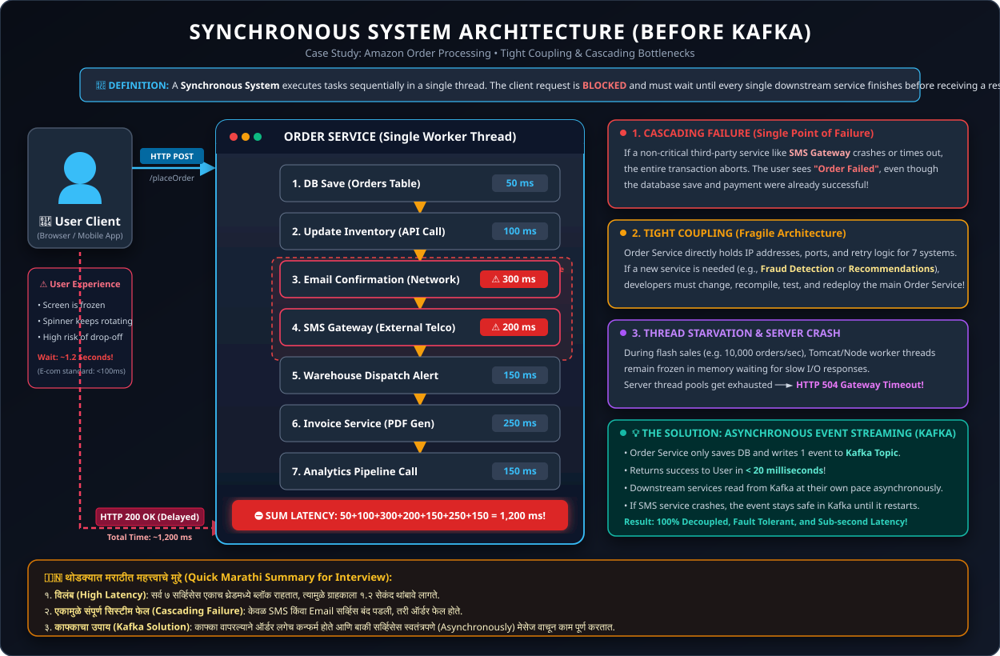

> **Definition**: A **Synchronous Architecture** is a communication model where tasks and network calls are executed in a sequential, blocking chain on a single thread. The client/caller request is blocked and must wait until every single downstream service finishes processing before receiving a response.

#### 📌 Point-by-Point Explanation:
- **Sequential Execution**: All operations and downstream network calls are executed in a strict, linear order on a single thread.
- **Client Thread Blocking**: The client/caller thread is blocked and kept waiting in memory until every single downstream service finishes.
- **Cumulative Latency**: The total response time equals the sum of all downstream latencies ($T_{\text{total}} = T_{\text{DB}} + T_{\text{Inventory}} + T_{\text{Email}} + \dots$).
- **Cascading Vulnerability**: If any single downstream service crashes or times out, the entire transaction fails or hangs.

**How it works:**
- The client API request blocks and waits for downstream service #1, then #2, up to #7.
- Only when all 7 tasks succeed does the client receive a 200 OK response.

---

### 1.3 Critical Bottlenecks of Synchronous Systems

1. **High Latency (User Waits Too Long):**
   - Total latency equals the sum of all individual response times ($50 + 100 + 300 + 200 + 150 + 250 + 150 = 1200\text{ ms}$).
   - Any single slow downstream service directly increases the latency felt by the end user.
2. **Cascading Failure (Single Point of Failure):**
   - If a non-essential service (like SMS or Analytics) is down, the entire transaction either fails or throws an unhandled error to the user.
3. **Tight Coupling (Fragile System):**
   - The Order Service must maintain network addresses, authentication, timeout configs, and retry mechanisms for every single downstream service.
   - If a new service needs order information (e.g., Fraud Detection or Recommendations), the Order Service code must be modified and redeployed.
4. **Thread Starvation & Resource Exhaustion:**
   - Server web workers remain blocked waiting for I/O. Under high concurrent traffic (e.g., Amazon Big Billion Days / Flash Sales), thread pools fill up rapidly, leading to `HTTP 504 Gateway Timeout` errors.

---

### 1.4 मराठीत स्पष्टीकरण (Marathi Summary)

> **समस्या (Problem): आधीची Synchronous (एकामागून एक चालणारी) पद्धत**
> - **काय घडायचे?**: जेव्हा ग्राहक Amazon वर ऑर्डर देतो, तेव्हा Order Service ला एकामागून एक अनेक कामे करावी लागतात — Database मध्ये सेव्ह करणे, Inventory कमी करणे, Email पाठवणे, SMS करणे आणि Analytics अपडेट करणे.
> - **अडचणी (Problems)**:
>   1. **खूप जास्त वेळ (High Latency)**: जोपर्यंत सर्व ७ सर्व्हिसेसचे काम संपत नाही, तोपर्यंत युझरला स्क्रीनवर "Order Placed" दिसत नाही.
>   2. **एकामुळे सर्व बंद (Cascading Failure)**: जर केवळ SMS किंवा Email सर्व्हिस बंद पडली, तरी संपूर्ण ऑर्डर फेल होते.
>   3. **टाईट कपलिंग (Tight Coupling)**: Order Service ला बाकी सर्व सर्व्हिसेसची थेट माहिती ठेवावी लागते. नवीन एखादी सर्व्हिस जोडायची असेल तर पुन्हा Order Service चा कोड बदलावा लागतो.

---

## 2. Evolution of Asynchronous Processing (Before Kafka)

### 2.1 Option 1: In-Memory Background Threads / ThreadPoolExecutor

> **Definition**: **In-Memory Background Processing** is an asynchronous model where the main API request thread handles only the critical data write, offloads non-critical downstream operations into an internal queue inside application server RAM (JVM Heap), and immediately returns an acknowledgment to the user.

#### 📌 Point-by-Point Explanation:
- **Thread Separation**: The main API request thread is decoupled from downstream non-critical background jobs.
- **Immediate User Response**: The API thread writes to DB and immediately returns HTTP 200 OK to the user in ~50ms.
- **Internal RAM Queue**: Secondary tasks (Email, SMS, Analytics) are pushed into an in-memory queue (`BlockingQueue` in JVM Heap).
- **In-Process Workers**: A local thread pool (`ThreadPoolExecutor` / Worker Threads) polls the in-memory queue and executes tasks asynchronously within the same process.

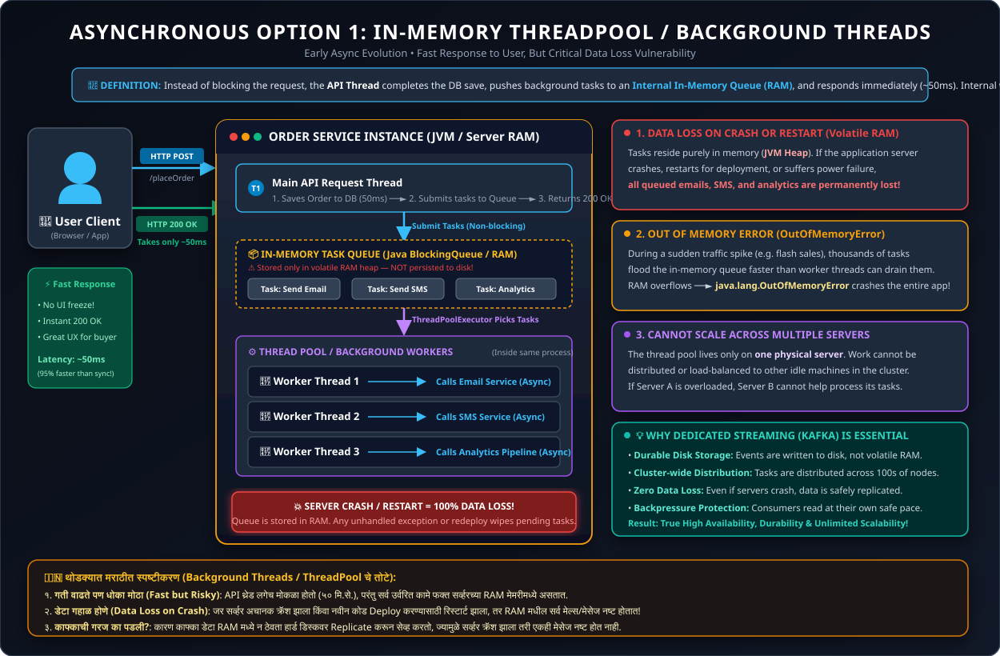

#### Fatal Flaws of this Approach:
1. **Data Loss on Crash or Restart:**
   - Tasks live in RAM memory (JVM heap). If the server crashes, restarts, or runs out of memory (`OutOfMemoryError`), all queued emails, SMS, and analytics tasks are permanently lost.
2. **Cannot Scale Across Multiple Machines:**
   - Background threads belong only to that single server instance. Work cannot be balanced or shared across other cluster machines.
3. **Memory Exhaustion (OOM):**
   - Under heavy bursts of traffic, an unbounded in-memory task queue consumes all server RAM, crashing the main Order Service.

---

### 2.2 Option 2: Traditional Message Queues (RabbitMQ, ActiveMQ) & Point-to-Point

> **Definition**: A **Traditional Message Queue** (such as RabbitMQ or ActiveMQ) is a dedicated middleware broker that provides point-to-point asynchronous messaging by temporarily holding messages in queues and immediately deleting each message as soon as a single consumer acknowledges receipt.

#### 📌 Point-by-Point Explanation:
- **External Broker Architecture**: A dedicated message-broker server positioned between producers and consumers to eliminate in-memory RAM volatility.
- **Point-to-Point Queue Delivery**: Messages are pushed into a named queue (FIFO), and each message is consumed by exactly one worker.
- **Destructive Reading**: As soon as the consumer sends an acknowledgment (ACK), the broker immediately purges/deletes the message from storage.
- **Transient State Machine**: The broker actively tracks message receipts, consumer acknowledgments, and queue states in RAM, causing heavy overhead under massive volumes.

To prevent in-memory data loss, companies adopted dedicated message queues:
```
[Order Service] ──► [RabbitMQ Queue] ──► [Consumer: Email Service]
```
- **Point-to-Point Pattern:** Producers place messages in a queue; one consumer pulls and acknowledges the message.
- **Message Deletion:** Once a consumer acknowledges receipt, the message is immediately deleted from the queue.

---

### 2.3 Why Traditional Message Queues Break at Large Scale

1. **Destructive Reads (No Replayability):**
   - Once a message is consumed and removed from the queue, other systems cannot read it later. If you introduce a new Fraud Detection service tomorrow, it cannot read historical orders.
2. **Performance Degradation Under Queue Buildup:**
   - Traditional brokers (like RabbitMQ) manage complex state machines, acknowledgments, message prioritization, and transient indexing in memory.
   - When millions of messages pile up faster than consumers can process them, memory spikes and throughput drops dramatically.
3. **Poor Support for Millions of Concurrent Events:**
   - They were designed for enterprise transaction queues (thousands of messages/sec), not massive real-time event streaming (millions of events/sec from user clicks, device logs, telemetry).

---

### 2.4 मराठीत स्पष्टीकरण (Marathi Summary)

> **पर्याय १: Application मधील Background Threads (In-Memory)**
> - **कसे चालते?**: मेन API थ्रेड ऑर्डर सेव्ह करून लगेच रिस्पॉन्स देतो आणि बाकी कामे Background Threads कडे सोपवतो.
> - **तोटा**: डेटा फक्त Server च्या RAM मध्ये असतो. सर्व्हर क्रॅश झाला किंवा रिस्टार्ट झाला, तर सर्व उर्वरित ऑर्डर्स/मेल्स कायमचे नष्ट होतात (Data Loss).
>
> **पर्याय २: जुने Message Queues (उदा. RabbitMQ / ActiveMQ)**
> - **कसे चालते?**: मेसेज एका Queue मध्ये जातो आणि Consumer तो वाचतो.
> - **तोटा**:
>   1. मेसेज एकदा वाचला की तो Queue मधून कायमचा **Delete** होतो (त्यामुळे जुना डेटा पुन्हा तपासता येत नाही).
>   2. कोट्यवधी (Millions) मेसेज एकदम आले की सिस्टीम संथ होते आणि क्रॅश होते.

---

## 3. What is Apache Kafka?

### 3.1 Formal Technical Definition
> **Definition**: **Apache Kafka** is an open-source, distributed, partitioned, replicated, commit-log-based **event streaming platform**. It enables applications to publish, store, process, and subscribe to continuous streams of event data at massive scale with ultra-low latency, high fault tolerance, and guaranteed durability.

#### 📌 Point-by-Point Explanation: What is Apache Kafka?
- **1. Distributed Architecture**: Runs as an elastic cluster across multiple servers (**Brokers**), distributing compute, storage, and network load.
- **2. Event Streaming Platform**: Captures, stores, and routes continuous real-time streams of events (orders, clicks, logs) as they happen.
- **3. Append-Only Commit Log**: Stores records sequentially in immutable, append-only disk files rather than transient memory queues.
- **4. Partitioned for Parallelism**: Splits data topics into multiple **Partitions** so producers and consumers can write and read simultaneously in parallel.
- **5. Replicated for Zero Data Loss**: Automatically replicates partition copies across different physical brokers to survive hardware crashes.
- **6. Publish-Subscribe Decoupled Model**: Producers publish messages to Topics; multiple distinct Consumer Groups subscribe and consume independently at their own speed.
- **7. Replayable & Durable**: Retains data safely on disk for a configured retention period (e.g. 7 days, 30 days, or forever), allowing consumers to re-read or replay historical events.

- **Initial Origin**: Developed in 2010 by engineers at **LinkedIn** (led by Jay Kreps, Neha Narkhede, and Jun Rao).
- **Open Source**: Donated to the **Apache Software Foundation** in 2011; it is now a top-level Apache project used by over 80% of Fortune 100 companies.

---

### 3.2 Core Architecture: The Distributed Append-Only Commit Log

> **Definition**: A **Distributed Append-Only Commit Log** is an immutable, ordered sequence of record events physically written to persistent disk storage, where new records are strictly appended to the tail, identified by an incremental offset, and never deleted upon read.

#### 📌 Point-by-Point Explanation:
- **Immutable Records**: Once an event record is written to disk, it is permanent and cannot be modified or edited in place.
- **Sequential Append**: New records are always written strictly to the end of the log file, maximizing sequential disk write performance.
- **Offset Indexing**: Every single message within a partition receives a sequential, monotonically increasing 64-bit integer called an **Offset**.
- **Non-Destructive Reading**: Consuming a message does **not** delete it. The data remains stored on disk according to the topic's retention policy.
- **Independent Offset Tracking**: Each consumer group maintains and commits its own offset pointer, allowing multiple services to read the same data stream at completely different speeds.

Unlike traditional message queues that delete messages after consumption, **Kafka acts as a distributed, append-only disk commit log**:

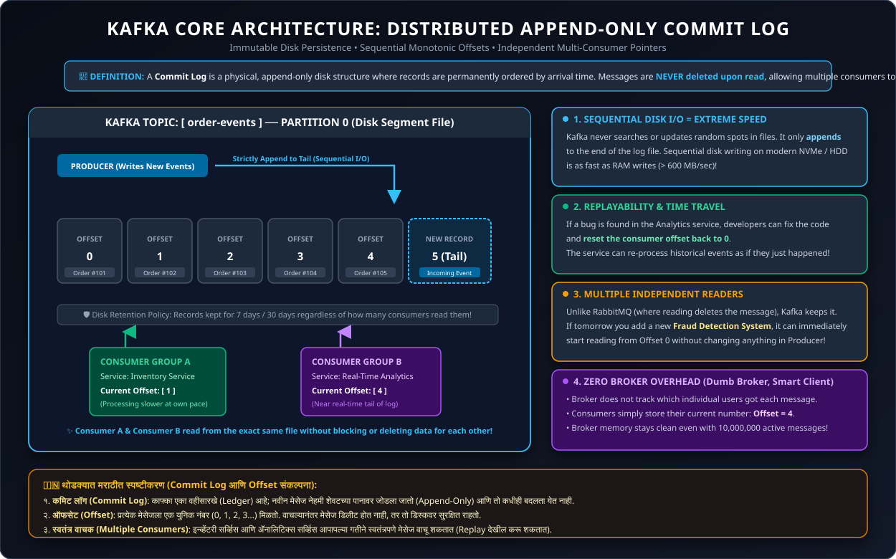

- Every record written to Kafka is appended to the end of a physical file on disk with a sequential ID called an **Offset**.
- **Immutable & Persistent**: Records are never changed or immediately deleted upon reading. They persist for a configured retention period (e.g., 7 days, 30 days, or indefinitely).
- **Consumers Track Their Own Position**: Each consumer maintains its own offset. Multiple distinct applications can read the exact same message stream at their own pace without interfering with each other.

---

### 3.3 Three Primary Capabilities

| Capability | What it Does | Description |
| :--- | :--- | :--- |
| **1. Publish & Subscribe (Produce / Consume)** | Message Exchange | Allows applications to publish (produce) streams of events to topics and subscribe (consume) to them continuously in real time. |
| **2. Distributed & Durable Storage** | Persistence & Replication | Stores streams of records safely on disk across a cluster of servers (Brokers) with multi-node replication for zero data loss. |
| **3. Stream Processing** | Real-Time Transformation | Allows real-time filtering, joining, aggregating, and analyzing of event streams on the fly as they occur (via Kafka Streams API / Flink). |

---

### 3.4 Real-World Example with Kafka (Amazon Order Decoupled)

With Kafka, the Amazon Order system becomes completely decoupled:

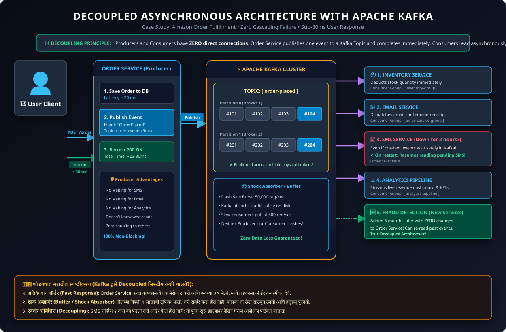

**Workflow:**
1. User clicks "Buy Now".
2. Order Service writes order to DB and publishes an event `OrderPlacedEvent` to Kafka topic `order-placed`.
3. Order Service immediately responds to user: **"Order Placed Successfully" (Response time: < 30ms)**.
4. Downstream services read independently from the Kafka topic:
   - **Inventory Service** deducts stock.
   - **Email Service** sends confirmation email.
   - **SMS Service** triggers text update.
   - **Analytics Service** tracks conversion rates.
5. **Resilience**: If the SMS service goes down for 2 hours, the order is **not** cancelled! Once the SMS service recovers, it resumes reading from its last saved offset and sends the pending SMS messages.

---

### 3.5 मराठीत स्पष्टीकरण (Marathi Summary)

> **काफ्का (Apache Kafka) म्हणजे नक्की काय?**
> - **व्याख्या (Definition)**: काफ्का हे एक **Distributed Event Streaming Platform** आहे. हे प्रचंड प्रमाणात येणारा रिअल-टाइम डेटा अतिशय वेगाने, सुरक्षितपणे साठवण्यासाठी आणि एका ठिकाणाहून दुसऱ्या ठिकाणी पाठवण्यासाठी वापरले जाते.
> - **हे कसे काम करते? (Commit Log Concept)**:
>   - काफ्का एका वहीसारखे (Notebook / Ledger) काम करते, जिथे प्रत्येक नवीन मेसेज शेवटच्या पानावर लिहिला जातो (Append-Only Log).
>   - जुन्या सिस्टीमसारखा मेसेज वाचल्यावर लगेच डिलीट होत नाही; तो डिस्कवर कायम टिकून राहतो.
> - **फायदा (Example)**:
>   - Amazon Order Service फक्त एक मेसेज काफ्कामध्ये टाकते (`OrderPlaced`) आणि युझरला लगेच मोकळे करते.
>   - ईमेल, मेसेज आणि ॲनालिटिक्स सर्व्हिसेस आपापल्या वेळेनुसार काफ्कामधून तो डेटा वाचून काम पूर्ण करतात.
>   - एखादी सर्व्हिस बंद असली तरी ऑर्डर फेल होत नाही!

---

## 4. Why Was Kafka Created? (Origins & Problems Solved)

### 4.1 The LinkedIn Origin Story
Around 2010, LinkedIn was experiencing exponential user growth. Every user action (profile views, connection clicks, likes, log messages, page loads) generated an event.

- **The Spaghetti Architecture:**
  - Before Kafka, every service had custom point-to-point connections with other services and databases.
  - Metrics went to Graphite, activity logs to Hadoop batch jobs, search data to Lucene, and messages went through ActiveMQ.
  - Adding a single new consumer required modifying every producer service.
- **Scale Failure:**
  - ActiveMQ and RabbitMQ could not handle LinkedIn's requirement of **billions of events per day**.
  - Databases could not handle the write-heavy throughput.
- **The Solution:** LinkedIn designed Kafka as a centralized, high-throughput streaming backbone.

---

### 4.2 Key Problems Kafka Solved

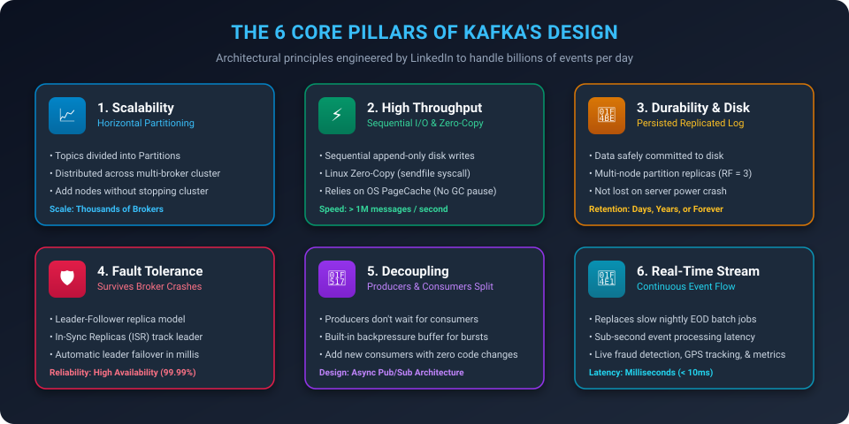

#### 1. Massive Scalability (Horizontal Scaling via Partitioning)
- Kafka divides Topics into **Partitions**.
- Partitions are distributed across multiple servers (Brokers).
- If traffic doubles, you simply add more brokers and partitions to spread the load across the cluster.

#### 2. Extremely High Throughput + Ultra-Low Latency
Kafka handles millions of records per second on commodity hardware using distinct performance optimizations:
- **Sequential Disk I/O:** Random disk access is slow, but sequential disk writes are as fast as RAM. Kafka only appends to the end of log files.
- **OS PageCache:** Kafka relies on the operating system kernel cache instead of keeping heavy objects inside the JVM heap (avoiding GC overhead).
- **Zero-Copy Optimization (`sendfile` system call):** Kafka transfers data directly from the OS disk buffer to the network socket without copying data into user space.

#### 3. Durability (Data Persisted to Disk & Replicated)
- Unlike purely in-memory queues, Kafka writes every event directly to non-volatile disk storage.
- Every partition has multiple copies called **Replicas** spread across different physical servers.

#### 4. High Fault Tolerance (Survives Broker Failures)
- Partitions operate with a **Leader-Follower** model:
  - One broker is the **Leader** for reads and writes.
  - Multiple **Followers** continuously replicate the leader's data.
- If the Leader broker crashes, Kafka automatically promotes an in-sync follower (ISR) to become the new leader in milliseconds. No data is lost.

#### 5. Complete Decoupling & Backpressure Buffering
- **Decoupling:** Producers know nothing about who consumes the data. They only know the Topic name.
- **Backpressure / Buffer:** If producers suddenly dump 100,000 orders/sec during a sale, slow consumers (like an external banking gateway) are not overwhelmed. The events sit safely buffered in Kafka, and consumers pull data at their own sustainable processing rate.

#### 6. Real-Time Streaming vs. Batch Processing
- Old enterprise data warehouses processed data in daily or hourly batches (EOD batch jobs).
- Kafka enables real-time stream processing where events are acted upon within milliseconds of their occurrence (crucial for fraud detection, live location tracking, and dynamic pricing).

---

### 4.3 मराठीत स्पष्टीकरण (Marathi Summary)

> **काफ्का का तयार करण्यात आला? (LinkedIn ची गरज व उपाय)**
> 1. ** प्रचंड वेग आणि क्षमता (High Throughput & Speed)**:
>    - LinkedIn वर दर सेकंदाला लाखो इव्हेंट्स (Clicks, Views, Messages) येत होते. जुनी सिस्टीम (RabbitMQ/ActiveMQ) हे हाताळू शकत नव्हती. काफ्का दर सेकंदाला लाखो मेसेज अगदी सहज हाताळतो.
> 2. **डेटा गहाळ न होणे (Durability & Disk Storage)**:
>    - काफ्का सर्व डेटा हार्ड डिस्कवर सुरक्षित सेव्ह करतो आणि त्याच्या एकापेक्षा जास्त कॉपीज (Replicas) वेगवेगळ्या सर्व्हर्सवर ठेवतो.
> 3. **फॉल्ट टॉलरन्स (Fault Tolerance - सर्व्हर बंद पडल्यास)**:
>    - एखादा काफ्का सर्व्हर (Broker) अचानक क्रॅश झाला तरी दुसऱ्या सर्व्हरवर त्याचा बॅकअप लगेच लीडर बनतो; सिस्टीम थांबत नाही.
> 4. **सिस्टीम वेगळी करणे (Decoupling & Buffer)**:
>    - Producer ला Consumer बद्दल काहीही माहिती असण्याची गरज नसते.
>    - जर अचानक खूप मोठी ट्रॅफिक आली, तरी Consumer क्रॅश होत नाही; कारण काफ्का एका बफर (Buffer) सारखे काम करतो आणि Consumer आपल्या गतीने डेटा वाचू शकतो.

---

## 5. Summary Comparison Table

| Feature | Traditional Sync REST API | Traditional MQ (RabbitMQ) | Apache Kafka |
| :--- | :--- | :--- | :--- |
| **Communication Style** | Synchronous (Request-Response) | Asynchronous Point-to-Point | Asynchronous Event-Driven Log |
| **Throughput** | Low to Moderate | Moderate (~10k - 50k msgs/sec) | Ultra-High (> 1 Million+ msgs/sec) |
| **Data Retention** | None (Transient) | Deleted immediately upon consumption | Retained on disk by retention policy (Days/Months/Infinite) |
| **Multiple Consumers** | No (Must call each service individually) | Fan-out requires separate queue for each | Native: Multiple consumer groups read same topic independently |
| **Replayability** | No | No (once read, message is gone) | Yes (can reset consumer offset to re-read past events) |
| **Primary Use Case** | Immediate UI interactions | Task queues, complex routing, transaction delivery | Real-time analytics, event streaming, log aggregation, decoupling microservices |

---

## 6. Kafka Core Components: The Producer

### 6.1 What is a Producer in Kafka?

> **Definition**: In Apache Kafka, a **Producer** is a client application or component that creates, serializes, and publishes (sends) streams of data (events/records) to one or more Kafka topics in real time.

#### 📌 Point-by-Point Explanation:
- **Client Application Role**: A Producer is any client software application, microservice, or background daemon that creates, formats, and publishes data (events/messages) to Kafka topics.
- **Data Publisher / Origin**: It acts as the primary **Data Source / Sender** that ingests raw business actions into the streaming pipeline.
- **Cluster Agnostic**: The producer interacts with the Kafka cluster via the Kafka Producer Client API (available in Java, Python, Go, Node.js, C#, etc.).
- **Decoupled Operation**: The producer does not know, care, or wait for downstream consumers. It only publishes to a designated Topic.

#### Real-World Example: Zomato Food Delivery System
In an e-commerce / food delivery platform like Zomato or Swiggy, multiple distinct producers publish events concurrently:
1. **Order Service Producer**: Publishes event `{"orderId": 801, "status": "PLACED"}` to topic `order-events`.
2. **Rider Tracking Producer**: GPS sensors in the delivery partner's mobile app emit coordinates `{"riderId": 44, "lat": 18.5204, "lng": 73.8567}` every 3 seconds to topic `rider-locations`.
3. **Payment Gateway Producer**: Publishes event `{"txnId": "TXN_999", "status": "SUCCESS"}` to topic `payment-events`.
4. **Notification Service Producer**: Triggers real-time SMS/Push notifications based on incoming order updates.

> **Key Takeaway**: Kafka supports **thousands of independent producers publishing concurrently** to different or same topics without interference or thread contention.

#### 🇮🇳 थोडक्यात मराठीत स्पष्टीकरण (What is a Producer?):
> - **Producer म्हणजे काय?**: काफ्कामध्ये डेटा किंवा मेसेज **पाठवणारा घटक (Data Sender)** म्हणजे Producer.
> - **उदाहरण (Zomato)**: जेव्हा तुम्ही जेवण ऑर्डर करता, डिलिव्हरी बॉयचे लाईव्ह लोकेशन अपडेट होते, किंवा ऑनलाईन पेमेंट होते — तेव्हा प्रत्येक सर्व्हिस स्वतंत्रपणे काफ्कामध्ये इव्हेंट्स पाठवते.
> - **अनेक Producers एकाच वेळी (Multiple Producers)**: काफ्का एकाच वेळी शेकडो वेगवेगळ्या सर्व्हिसेसकडून कोट्यवधी इव्हेंट्स विनाअडथळा स्वीकारू शकतो.

---

### 6.2 What Does the Producer Send? (Events, Records, Messages)

In Kafka terminology, the terms **Event**, **Record**, and **Message** are used interchangeably:

> **Definition**: An **Event (or Record/Message)** in Kafka is an immutable statement of fact representing an action that occurred in the business domain, packaged with a key, a value payload, a timestamp, and optional headers.

#### 📌 Point-by-Point Explanation:
- **Fact Representation**: An event represents a statement of fact that something significant happened in the business domain (e.g., *"Customer placed order #101"*).
- **Immutable State**: An event captures a state at a specific point in time and cannot be altered retrospectively.
- **Self-Contained Data Structure**: In Node.js / KafkaJS, each event is packaged as a `{ key, value, partition, headers }` message object before transmission.

```json
{
  "topic": "order-events",
  "key": "user_101",
  "value": {
    "orderId": 5001,
    "item": "Mechanical Keyboard",
    "amount": 2999.00,
    "status": "ORDER_CREATED"
  },
  "timestamp": 1779607200000,
  "headers": [
    { "key": "traceId", "value": "x-trace-abc-123" },
    { "key": "sourceApp", "value": "checkout-web" }
  ]
}
```

---

### 6.3 Components of a Kafka Record (Key, Value, Timestamp, Headers)

Every Kafka `ProducerRecord` consists of 4 core fields:

| Field Name | Data Type | Required? | Primary Purpose |
| :--- | :--- | :--- | :--- |
| **`Key`** | Any type (String, Long, JSON, Avro) | **Optional** (nullable) | Determines the **Target Partition** via mathematical hashing. Enforces strict message ordering. |
| **`Value`** | Any type (String, JSON, Avro, Protobuf) | **Required** (or null for tombstone) | The **actual business payload** containing the transaction details. |
| **`Timestamp`** | Int64 (Epoch Milliseconds) | **Optional** (Auto-assigned) | Records when the event occurred (`CreateTime`) or when it was written to disk (`LogAppendTime`). |
| **`Headers`** | Key-Value byte pairs | **Optional** | Carries transport metadata such as HTTP tracing IDs, security tokens, or schema version IDs without touching the business payload. |

---

### 6.4 Why Key is Critical & Partition Selection (Hashing)

> **Definition**: A **Record Key** is an optional identifier attached to an event used by Kafka's partitioner to deterministically map the message to a specific partition via mathematical hashing, guaranteeing strict chronological ordering for that specific key.

#### 📌 Point-by-Point Explanation:
- **Partition Routing**: The primary function of the Key is to decide **which partition** within a topic will store the record.
- **Ordering Guarantee**: Kafka guarantees message ordering **ONLY inside a single partition**. Messages across different partitions are consumed out of order!
- **Consistent Hashing**: If two messages share the exact same key, Kafka guarantees they will ALWAYS be routed to the exact same partition.

#### How Kafka Selects a Partition with Key (Formula):
When a key is provided, Kafka's default partitioner uses the **MurmurHash2** algorithm:
$$\text{Partition ID} = |\text{MurmurHash2}(\text{Key})| \pmod{\text{Number of Partitions}}$$

> **Example**:
> - Topic `match-events` has **3 Partitions** (0, 1, 2).
> - Message 1: Key = `"match_id_1"` ──► $|\text{hash}("match\_id\_1")| \pmod 3 = \mathbf{1}$
> - Message 2: Key = `"match_id_1"` ──► $|\text{hash}("match\_id\_1")| \pmod 3 = \mathbf{1}$
> - **Result**: All events for Match #1 (`MATCH_STARTED`, `SCORE_UPDATE`, `MATCH_ENDED`) arrive in Partition 1 in strict chronological order!

#### What Happens Without a Key (`key == null`)?
If no key is supplied:
1. **Modern Kafka (v2.4+) - Sticky Partitioner**:
   - Groups records into batches and fills one partition at a time until `batch.size` is reached, then rotates to the next partition.
   - **Advantage**: Drastically reduces network round-trips and improves throughput.
2. **Older Kafka (< v2.4) - Round Robin**:
   - Rotates messages one by one across partitions ($P_0 \to P_1 \to P_2 \to P_0$).
   - **Trade-off**: When keys are omitted, Kafka distributes load evenly, but **per-entity message ordering is lost**.

#### 🇮🇳 थोडक्यात मराठीत स्पष्टीकरण (Record Components & Key चे महत्त्व):
> - **Value**: हा मुख्य बिझनेस मेसेज असतो (उदा. ऑर्डर नंबर, किंमत).
> - **Key चे महत्त्व (Most Important)**: काफ्कामध्ये **Ordering ची गॅरंटी फक्त एका Partition मध्येच** असते.
>   - जर तुम्ही Key दिली (उदा. `user_101`), तर त्या युझरचे सर्व मेसेज नेहमी एकाच Partition मध्ये जातील आणि क्रमाने प्रोसेस होतील.
> - **Key न दिल्यास काय होते?**: काफ्का मेसेज वेगवेगळ्या partitions मध्ये विभागून टाकतो; त्यामुळे ट्रॅफिक समान वाटले जाते पण क्रम (Ordering) बदलू शकतो.

---

### 6.5 Producer Internals & Visual Architecture

The complete journey of a record inside the Kafka Producer:

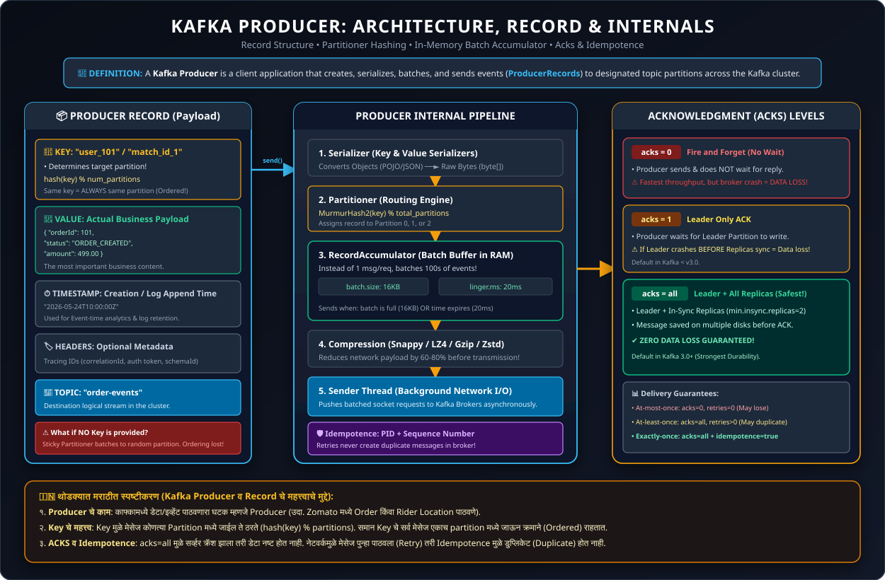

#### Point-Wise Pipeline Steps:
1. **`producer.send(record)`**: The application invokes the send method.
2. **Serializers**: In Node.js / KafkaJS, JavaScript objects and JSON are converted into binary Buffers (`Buffer.from(...)` or `JSON.stringify(...)`).
3. **Partitioner**: Calculates the target partition using `MurmurHash2(key)` or the Sticky Partitioner.
4. **RecordAccumulator (Batch Buffer)**: Instead of sending 1 record across the network, records are grouped into in-memory batches organized per partition.
5. **Sender Thread**: A separate background I/O thread flushes memory batches over TCP sockets to the appropriate Broker partition leaders.

---

### 6.6 Acknowledgment (ACKS) & Partition Leaders

#### What is a Partition Leader vs. Replica?
- In a Kafka cluster, every partition has **1 Leader Broker** and multiple **Follower Replicas**.
- **Leader**: Handles 100% of client read and write requests.
- **Followers (Replicas)**: Passively replicate data from the leader. If the leader dies, a follower becomes the new leader.

```
                  ┌───────────────────────────────┐
                  │      PRODUCER CLIENT          │
                  └──────────────┬────────────────┘
                                 │
                     1. Write    ▼
                  ┌───────────────────────────────┐
                  │    BROKER 1: LEADER PARTITION │
                  └──────────────┬────────────────┘
                                 │
        2. Replication           │ 2. Replication
        ┌────────────────────────┴────────────────────────┐
        ▼                                                 ▼
┌───────────────────────────────┐ ┌───────────────────────────────┐
│  BROKER 2: FOLLOWER REPLICA   │ │  BROKER 3: FOLLOWER REPLICA   │
└───────────────────────────────┘ └───────────────────────────────┘
```

#### The 3 ACK Levels:

| ACK Level | Meaning | How it Works | Pros | Cons / Risk |
| :--- | :--- | :--- | :--- | :--- |
| **`acks = 0`** | **Fire and Forget** | Producer sends the record and **never waits** for any response from the broker. | Highest possible throughput; zero network latency wait. | **Extreme Data Loss Risk**: If the broker crashes or network drops, the message is permanently lost without notice. |
| **`acks = 1`** *(Default in Kafka < v3.0)* | **Leader Only** | Producer waits for confirmation that the **Leader Partition** wrote the record to its local disk log. | Balanced throughput and moderate reliability. | **Data Loss on Failover**: If the Leader crashes *before* follower replicas finish copying the data, the message is lost. |
| **`acks = all`** *(or `acks = -1`)* *(Default in Kafka 3.0+)* | **Leader + In-Sync Replicas** | Producer waits until the **Leader AND all In-Sync Replicas (ISR)** confirm write to disk. | **Zero Data Loss Guaranteed**: Even if the Leader broker immediately burns down, an up-to-date replica takes over. | Slightly higher latency per request (mitigated by batching). |

> 💡 **Production Best Practice**: Combine `acks = all` with broker configuration `min.insync.replicas = 2` to guarantee true high availability.

#### 🇮🇳 थोडक्यात मराठीत स्पष्टीकरण (ACKs चे ३ प्रकार):
> - **acks = 0 (Fire & Forget)**: मेसेज पाठवून लगेच विसरून जाणे; ब्रोकरकडून कोणत्याही पावतीची (ACK) वाट न पाहणे. (अतिवेगवान, पण सर्व्हर क्रॅश झाल्यास डेटा लॉस १००%).
> - **acks = 1 (फक्त Leader)**: केवळ लीडर सर्व्हरने डेटा सेव्ह केला की पावती मिळते. (चांगला वेग, पण रेप्लिका sync होण्यापूर्वी लीडर क्रॅश झाल्यास धोका).
> - **acks = all / -1 (सर्व Replicas)**: लीडर आणि बॅकअप सर्व्हर्स दोघांनी डेटा सुरक्षित लिहिल्यावरच पावती मिळते. (डेटा गहाळ होण्याचा धोका शून्य — 100% Zero Data Loss).

---

### 6.7 Idempotent Producer (Preventing Duplicates)

> **Definition**: An **Idempotent Producer** (`enable.idempotence = true`) is a Kafka producer mode that prevents duplicate records on the broker by assigning a unique Producer ID (PID) and sequential sequence numbers to every message, ensuring that network retries never result in duplicate writes to a partition.

#### 📌 Point-by-Point Explanation:
- **Automatic Deduplication**: Even if transient network failures cause the producer to resend an already-persisted message, the broker recognizes the duplicate sequence number and discards it.
- **Single Partition Scope**: Idempotence guarantees exactly-once write semantics per partition without needing manual application-level deduplication code.
- **Zero Overhead**: Deduplication is performed natively by the broker log manager at the protocol level with negligible CPU impact.

#### Why Do Duplicate Messages Occur?
Consider this classic distributed network failure scenario:
1. Producer sends message `{"payment": 500}` to Broker.
2. Broker successfully writes the message to Partition 0.
3. Broker attempts to send an ACK back to the Producer, but a **temporary network glitch drops the packet**.
4. The Producer experiences a timeout, assumes the message failed, and **retries sending the exact same payment message**.
5. Result without Idempotence: **Duplicate payment entered into Kafka!**

```
Producer                     Broker (Partition 0)
   │                                │
   ├─── 1. Send Payment ($500) ────►│ (Written to disk!)
   │                                │
   │◄── 2. Network Drops ACK ───X───┤
   │    (Timeout occurs!)           │
   │                                │
   ├─── 3. Retries Payment ($500) ─►│ (DUPLICATE RECORD CREATED! ❌)
```

#### How the Idempotent Producer Solves Duplicates:
Since Kafka 3.0, the producer parameter `enable.idempotence = true` is enabled by default.
- **Producer ID (PID)**: Each producer is assigned a unique 64-bit ID during initialization via the cluster.
- **Sequence Number**: Every message sent by a producer to a partition is tagged with an incremental integer: $0, 1, 2, 3 \dots$
- **Broker Deduplication**:
  - When the broker receives a message, it verifies the sequence number against its latest stored offset.
  - If it receives Sequence #2 again, the broker acknowledges it but **discards the duplicate body**.
  - **Result: Exactly one copy is stored on disk!**

```
Producer (PID: 9021)         Broker (Partition 0)
   │                                │
   ├─── Send (PID=9021, Seq=0) ────►│ (Stored: Seq 0 ✔)
   │◄── ACK dropped ────────────X───┤
   │                                │
   ├─── Retry (PID=9021, Seq=0) ───►│ (Detected duplicate Seq 0! Discards body, returns ACK ✔)
```

---

### 6.8 Producer Performance: Batching, Retries & Compression

Kafka achieves millions of events/sec through 3 producer-side optimizations:

#### 1. Smart Batching (`batch.size` & `linger.ms`)
- **`batch.size`** *(default: 16384 bytes / 16KB)*: Maximum size of memory allocated per partition batch. Once full, the batch is sent immediately.
- **`linger.ms`** *(default: 0ms, recommended in prod: 5ms - 20ms)*: Instructs the producer to wait up to $N$ milliseconds before sending to let more incoming records accumulate into the current batch.
- **Benefit**: Sending 1 network request containing 200 records uses **90% less CPU and bandwidth** than sending 200 separate network calls.

#### 2. Automatic Retry Mechanism
- **`retries`** *(default: Integer.MAX_VALUE)*: How many times the producer will attempt to resend records upon transient network errors or broker leader elections.
- **`delivery.timeout.ms`** *(default: 120,000ms / 2 mins)*: The hard upper limit on the total time allowed for a record to be acknowledged before throwing an exception to the calling code.
- **`retry.backoff.ms`** *(default: 100ms)*: The backoff interval between retry attempts.

#### 3. Payload Compression (`compression.type`)
- By default, messages are sent uncompressed (`none`).
- Producers can compress batches before network transit using:
  - **`lz4`** *(Recommended)*: Extremely fast compression/decompression with minimal CPU overhead.
  - **`snappy`**: Optimized for CPU efficiency and high throughput.
  - **`gzip`**: Highest compression ratio (best for bandwidth constraints), but uses more CPU.
  - **`zstd`**: Enterprise-grade balance developed by Meta.
- **Benefit**: Reduces network bandwidth and disk consumption by **60% to 80%**.

---

### 6.9 Producer Delivery Guarantees

Kafka producers can be tuned to meet 3 delivery semantics:

| Guarantee Level | Producer Configuration | Duplicate Risk | Data Loss Risk | Typical Use Case |
| :--- | :--- | :--- | :--- | :--- |
| **At Most Once** | `acks = 0`<br>`retries = 0` | **No Duplicates** | **Possible Data Loss** | IoT sensor temperature logs, website mouse hover telemetry. |
| **At Least Once** | `acks = 1` or `all`<br>`retries > 0`<br>`enable.idempotence = false` | **Duplicates Possible** | **Zero Data Loss** | General logging, notification alerts where duplicates are acceptable. |
| **Exactly Once (EOS)** | `acks = all`<br>`enable.idempotence = true`<br>`max.in.flight.requests <= 5` | **Zero Duplicates** | **Zero Data Loss** | Financial ledger transactions, payments, inventory adjustments. |

---

### 6.10 Best Production Configuration for Producer

```properties
# Reliability: Zero Data Loss
acks=all
min.insync.replicas=2

# Idempotence: Deduplication on retries
enable.idempotence=true
max.in.flight.requests.per.connection=5
retries=2147483647

# High Throughput: Batching & Compression
batch.size=32768
linger.ms=20
compression.type=lz4
```

---

### 6.11 मराठीत स्पष्टीकरण (Marathi Summary - Producer)

> **काफ्का Producer बद्दल मुलाखतीसाठी महत्त्वाचे मुद्दे (Key Takeaways):**
> 1. **Producer चे काम**: काफ्कामध्ये इव्हेंट्स पाठवणे. Producer ला Consumer बद्दल काहीही माहिती नसते; तो फक्त Topic मध्ये मेसेज टाकतो.
> 2. **Key आणि Ordering**: काफ्का केवळ एका Partition मध्येच ऑर्डरची हमी देतो. त्यामुळे एकाच ग्राहकाचे किंवा ऑर्डरचे सर्व इव्हेंट्स एकाच Partition मध्ये जाण्यासाठी **Key देणे अनिवार्य असते** (`hash(key) % partitions`).
> 3. **Idempotence (डुप्लिकेट रोखणे)**: नेटवर्क फेल्युअरमुळे Producer ने एकापेक्षा जास्त वेळा मेसेज पाठवला तरी काफ्का Sequence Number तपासून **केवळ एकच कॉपी सेव्ह करतो** (`enable.idempotence=true`).
> 4. **Batching व Compression**: १-१ मेसेज पाठवण्याऐवजी शेकडो मेसेज एकत्र (Batch) करून `lz4` किंवा `snappy` ने compress करून पाठवले जातात, ज्यामुळे काफ्काला प्रचंड वेग मिळतो.
> 5. **Delivery Guarantees**: पैशांचे व्यवहार किंवा महत्त्वाच्या ऑर्डर्ससाठी नेहमी **`acks=all` + `enable.idempotence=true` (Exactly-Once)** वापरले जाते.

---

## 7. Topics, Partitions & Offsets Deep Dive

### 7.1 What is a Topic?

> **Definition**: A **Topic** in Apache Kafka is a logical category, named channel, or virtual folder where records of a specific event type are continuously published and stored.

#### 📌 Point-by-Point Explanation:
- **Logical Category**: Topics represent domain-specific streams (e.g., all customer clicks, or all bank transactions).
- **Multi-Producer & Multi-Consumer**: Multiple distinct producer applications can publish to the same topic, and multiple independent consumer groups can read from it simultaneously.
- **Append Stream**: Topics act as continuous, unbounded feeds of real-time data.

#### Real-World Example (Zomato):
- `order-status`: Stores order lifecycle events (`CREATED`, `ACCEPTED`, `DELIVERED`).
- `rider-updates`: Stores delivery partner live coordinates every 3 seconds.
- `hotel-updates`: Stores restaurant menu availability and surge statuses.
- `payment-events`: Stores transaction gateway receipts.

---

### 7.2 Why Topics Alone Are Not Enough? (The Scaling Problem)

Imagine a high-scale system where **10 million users** generate thousands of orders per second:
- **Single File Bottleneck**: If a topic stored all messages in a single monolithic file on one server, disk I/O would saturate instantly.
- **No Consumer Parallelism**: A single file cannot be read concurrently by multiple workers without lock contention.
- **Hardware Limit**: A single machine cannot store multi-terabyte streams or provide 100,000+ network ops/sec.

> 💡 **The Kafka Solution**: Kafka divides every Topic into smaller, distributed units called **Partitions**!

---

### 7.3 What is a Partition?

> **Definition**: A **Partition** is the physical, append-only, ordered commit-log file on disk that represents a subset division of a Kafka topic. It is Kafka's fundamental unit of parallelism and scalability.

#### 📌 Point-by-Point Explanation:
- **Physical Disk Division**: While a Topic is a logical concept, a Partition is an actual directory of segment files on a Broker's disk.
- **Append-Only & Immutable**: New messages are appended to the tail of the partition. Existing messages can never be modified or updated.
- **Horizontal Scaling**: A topic's partitions are distributed across different physical brokers in the cluster.
- **Scalability Rule**: **More Partitions = Higher Parallelism and Greater Cluster Throughput!**

---

### 7.4 What is an Offset?

> **Definition**: An **Offset** is a unique, sequential, monotonically increasing 64-bit integer assigned to each record within a partition, representing its precise position in the commit log.

#### 📌 Point-by-Point Explanation:
- **Partition-Specific Identity**: Offsets start at `0` and increment sequentially (`0, 1, 2, 3...`). An offset is meaningful **ONLY inside its own partition** (Offset 5 in Partition 0 is unrelated to Offset 5 in Partition 1).
- **Ordering Rule**: **Kafka guarantees message ordering ONLY within a partition, NOT across the entire topic!**
- **Consumer Progress Tracking**: Offsets enable consumers to bookmark which messages have been processed and where to resume reading after a crash.

---

### 7.5 Hot Partitions: Causes & Strategies

> **Definition**: A **Hot Partition** is an architectural bottleneck where an uneven key distribution causes one partition to receive a disproportionate majority of traffic, overloading a single broker and consumer worker.

#### Common Cause:
If an e-commerce platform partitions data by `vendor_id` or `ad_id`, and one vendor (e.g., Apple during an iPhone launch) receives 90% of all orders, Partition 2 becomes overwhelmed while Partitions 0 and 1 sit idle.

#### 📌 Strategies to Prevent & Resolve Hot Partitions:
1. **Compound Keys (Recommended)**:
   - Combine the primary key with another dimension: `vendor_id + "_" + user_id` or `ad_id + "_" + region`.
   - Distributes the viral entity across multiple partitions while keeping localized ordering.
2. **Key Salting**:
   - Append a random integer or timestamp suffix: `ad_id + "_" + random(1, 4)`.
   - Breaks heavy traffic across 4 partitions evenly.
3. **Random Partitioning (When Order is Unimportant)**:
   - Omit the key (`key = null`). The Sticky Partitioner distributes batches across all partitions equally.
4. **Backpressure / Throttling**:
   - Temporarily throttle the producer send rate to allow overloaded consumers to drain the lag.

---

### 7.6 Message Retention Policies

Kafka does not store messages permanently like a traditional database. It purges records based on configurable retention limits:

| Retention Parameter | Configuration Meaning | Default Value | Production Tip |
| :--- | :--- | :--- | :--- |
| **`log.retention.ms`** / **`hours`** | How long a record is kept on disk before deletion. | `604800000 ms` (7 Days) | Set to 24-48 hours for high-volume logs; 30+ days for financial audits. |
| **`log.retention.bytes`** | Maximum byte size per partition before oldest segments are pruned. | `-1` (Unlimited) | Protects disks from running out of capacity during high bursts. |
| **Log Compaction** | Keeps the **latest known value** for each key forever (e.g. user profile state). | Disabled (`delete`) | Used for state stores, KTables, and CDC changelog topics. |

---

### 7.7 मराठीत स्पष्टीकरण (Marathi Summary - Topics & Partitions)

> - **Topic (कॅटेगरी/फोल्डर)**: संबंधित मेसेजचा ग्रुप (उदा. `order-events` किंवा `rider-updates`).
> - **Partition (विभाजन)**: प्रचंड ट्रॅफिक आल्यास सिस्टीम स्लो होऊ नये म्हणून टॉपिकचे तुकडे केले जातात. जितके जास्त Partitions, तितका जास्त वेग (Parallel Processing).
> - **Offset (क्रमांक)**: प्रत्येक Partition मध्ये मेसेजला ०, १, २, ३ असा अनुक्रमांक मिळतो. **ऑर्डरची हमी केवळ एका Partition मध्येच असते**, पूर्ण टॉपिकमध्ये नाही!
> - **Hot Partition**: एकाच की वर (उदा. व्हायरल जाहिरात) जास्त लोड आल्यास एकच Partition ओव्हरलोड होतो; यावर उपाय म्हणजे Compound Key (Key + Region) वापरणे.

---

## 8. Kafka Consumers & Consumer Groups

### 8.1 What is a Consumer? (The PULL Model)

> **Definition**: A **Consumer** is a client application or microservice that subscribes to Kafka topics and continuously pulls (fetches) and processes streams of records from partition commit logs.

#### 📌 Point-by-Point Explanation:
- **PULL Architecture (Not Push)**: Kafka brokers **never push** data to consumers. Consumers actively send fetch requests to pull batches of records when they have compute capacity.
- **Consumer Protection**: The PULL model acts as built-in backpressure protection. A slow consumer is never overwhelmed by a sudden burst from producers.
- **Offset Tracking**: Consumers maintain their read position (`current_offset`) and periodically commit it back to Kafka.

---

### 8.2 What is a Consumer Group? (The Golden Rule)

> **Definition**: A **Consumer Group** is a cooperative set of one or more consumers working together under a shared `group.id` to read and process records from a topic in parallel.

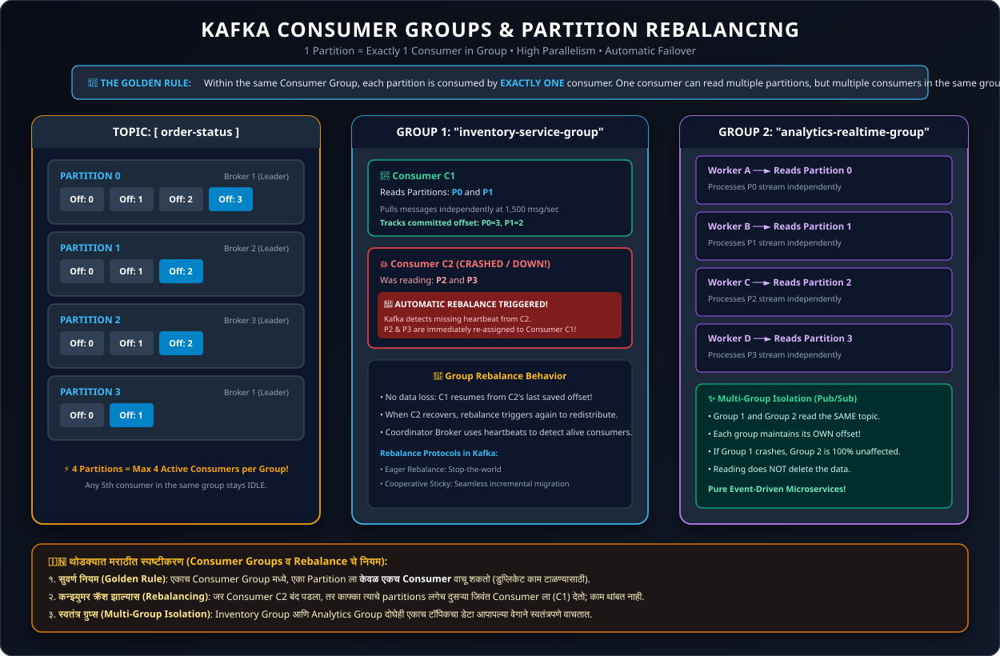

#### 📌 The Golden Partition Rule:
$$\mathbf{1\text{ Partition}} \longleftrightarrow \mathbf{\text{Exactly } 1\text{ Consumer in a Group}}$$

- **No Duplication within Group**: Two consumers in the *same* group will never read the same partition simultaneously.
- **Work Sharing**:
  - If a topic has **4 Partitions** and the group has **2 Consumers**, each consumer processes **2 Partitions**.
  - If the group scales to **4 Consumers**, each consumer gets **1 Partition** (Maximum parallelism).
  - If the group scales to **5 Consumers**, the 5th consumer remains **IDLE** as a standby spare!
- **Multi-Group Pub/Sub**: Distinct Consumer Groups (e.g., `inventory-group` and `analytics-group`) read the same partitions completely independently without interfering with each other.

---

### 8.3 Consumer Failure & Automatic Rebalancing

#### What Happens When a Consumer Dies?
1. **Heartbeat Loss**: Each consumer periodically transmits background heartbeats (`heartbeat.interval.ms = 3000`) to the Group Coordinator broker.
2. **Session Timeout**: If no heartbeat arrives within `session.timeout.ms` (e.g., 45,000ms), the coordinator marks the consumer dead.
3. **Consumer Rebalance Triggered**:
   - The coordinator revokes partition ownership from the dead consumer.
   - The unassigned partitions are immediately redistributed among the remaining live consumers.
   - Live consumers resume processing from the **last committed offset**—ensuring zero data loss!

---

### 8.4 Offset Management & Commit Strategies

Kafka tracks consumer group progress in a dedicated internal compacted topic named **`__consumer_offsets`**:

| Commit Strategy | Setting | How it Works | Pros | Cons / Risk |
| :--- | :--- | :--- | :--- | :--- |
| **Automatic Commit** | `enable.auto.commit = true`<br>`auto.commit.interval.ms = 5000` | Consumer automatically commits offsets periodically every 5 seconds in the background. | Simplest to implement; zero code boilerplate. | **Duplicate Processing Risk**: If consumer crashes after processing but before the 5-second commit timer fires. |
| **Manual Synchronous Commit** | `enable.auto.commit = false`<br>`consumer.commitSync()` | Client code explicitly blocks until the broker confirms the offset write. | Reliable; guarantees processing before commit. | Lower throughput; thread blocks waiting for commit response. |
| **Manual Asynchronous Commit** | `enable.auto.commit = false`<br>`consumer.commitAsync()` | Client code triggers non-blocking offset commit over network. | High throughput; non-blocking. | Potential retry ordering issues on network drop. |

---

### 8.5 Consumer Error Handling: Retry Topics & Dead Letter Queue (DLQ)

Unlike traditional queues, Kafka partitions cannot skip a single poisoned message. If record #10 fails, the consumer cannot simply advance its offset without custom handling:

```
[Main Topic: orders] ──► [Consumer Worker] ──► Processing Fails!
                              │
                              ├── (Retry 3x with backoff) ──► [Retry Topic: orders-retry]
                              │
                              └── (Permanent Failure) ────► [Dead Letter Queue: orders-dlq]
```

1. **Main Topic**: Ingests normal real-time traffic.
2. **Retry Topic**: Transient failures (e.g., downstream payment gateway 503) are diverted here with exponential backoff delay.
3. **Dead Letter Queue (DLQ)**: Permanently corrupted records (e.g., malformed JSON) are routed to a DLQ for developer inspection without blocking real-time traffic.

---

### 8.6 मराठीत स्पष्टीकरण (Marathi Summary - Consumers)

> - **PULL पद्धत**: काफ्का मेसेज ढकलत (Push) नाही; तर Consumer आपल्या क्षमतेनुसार ब्रोकरकडून डेटा ओढून (Pull) घेतो.
> - **सुवर्ण नियम (Golden Rule)**: एका ग्रुपमधील एका Partition ला **फक्त एकच Consumer** वाचू शकतो. ४ Partitions असल्यास जास्तीत जास्त ४ Consumers एकाच वेळी काम करू शकतात.
> - **Rebalancing**: एखादा Consumer क्रॅश झाल्यास काफ्का त्याचे काम लगेच दुसऱ्या Consumer कडे सोपवतो.
> - **DLQ (Dead Letter Queue)**: खराब किंवा एरर देणारा मेसेज DLQ मध्ये पाठवला जातो, जेणेकरून बाकी सिस्टीम अडकून (Block) पडत नाही.

---

## 9. Cluster Architecture: Brokers, Replication, ZooKeeper & KRaft

### 9.1 Kafka Broker & Cluster

> **Definition**: A **Kafka Broker** is an independent server process in a Kafka cluster responsible for receiving messages from producers, appending them to physical disk commit logs, serving fetch requests to consumers, and managing replication.

#### 📌 Point-by-Point Explanation:
- **Default Port**: Brokers listen on TCP port **`9092`** by default.
- **Cluster**: A group of multiple cooperating brokers working together under a single cluster identity.
- **Controller Role**: One broker in the cluster is elected as the **Cluster Controller**, responsible for partition leader election, broker health monitoring, and topic metadata propagation.

---

### 9.2 Partition Replication (Leaders, Followers & ISR)

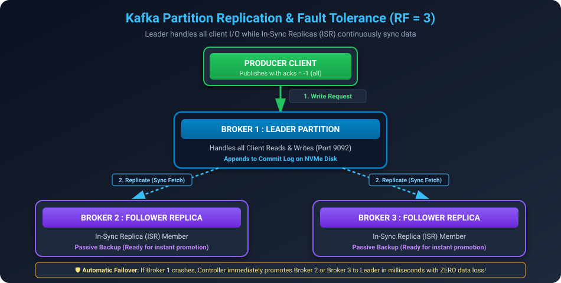

To prevent data loss when servers suffer hardware failures, Kafka replicates partitions across multiple physical brokers:

#### 📌 Point-Wise Roles:
- **Leader Replica**: One broker acts as the active Leader for a partition. All producer writes and consumer reads go directly to the Leader.
- **Follower Replicas**: Passive brokers that continuously fetch and mirror the leader's commit log.
- **In-Sync Replicas (ISR)**: The set of follower replicas that are fully caught up with the leader's latest write offset within `replica.lag.time.max.ms` (default: 30,000ms).
- **Automatic Failover**: If the Leader crashes, the Controller instantly promotes one of the ISR members to become the new Leader in milliseconds!

> **Replication Factor (RF) Rule**:
> - $\text{RF} = 3$ means 1 Leader + 2 Followers across 3 distinct brokers.
> - The cluster can tolerate $(\text{RF} - 1) = 2$ broker failures without data loss!

---

### 9.3 Metadata Management: ZooKeeper vs. Modern KRaft Mode

| Architectural Dimension | Apache ZooKeeper (Older Kafka < v3.x) | Modern KRaft Mode (Kafka v3.3+ / 4.0+) |
| :--- | :--- | :--- |
| **Architecture** | Requires running a **separate external cluster** of ZooKeeper nodes (Quorum). | **Self-contained inside Kafka**. No external software required! |
| **Default Port** | TCP **`2181`** | Internal Raft quorum on broker ports (e.g. `9093`). |
| **Controller Failover** | Slow (seconds/minutes): ZooKeeper had to push entire metadata states on crash. | **Instantaneous (< 10 milliseconds)**: Metadata is stored in a dedicated internal metadata topic. |
| **Partition Scalability** | Limited to ~200,000 partitions per cluster due to ZooKeeper memory bottlenecks. | **Millions of partitions** per cluster. |
| **Operational Overhead** | Complex: Two distinct distributed systems to configure, secure, and maintain. | Simple: Single binary, unified security, and streamlined ops. |

---

### 9.4 Systems That Can Act as Kafka Producers & Consumers

Kafka acts as the central nervous system connecting diverse enterprise technologies:
1. **Relational & NoSQL Databases**: MySQL, PostgreSQL, MongoDB (via Debezium / Kafka Connect CDC).
2. **Microservices & REST APIs**: Node.js, Spring Boot, Go, Python FastAPI services.
3. **Log Aggregators & Telemetry**: Fluentd, Logstash, Prometheus metrics, Datadog agents.
4. **Message Queues**: Ingestion gateways from legacy RabbitMQ or IBM MQ.
5. **Stream Processing Engines**: Apache Flink, Apache Spark Streaming, Kafka Streams.
6. **IoT & Edge Devices**: Connected vehicles, smart meters, telemetry sensors via MQTT gateways.
7. **Cloud Data Warehouses**: Snowflake, AWS S3, Google BigQuery, ClickHouse.

---

### 9.5 मराठीत स्पष्टीकरण (Marathi Summary - Brokers & KRaft)

> - **Broker (सर्व्हर)**: काफ्का चालणारा मुख्य सर्व्हर (Default Port: 9092). अनेक Brokers एकत्र येऊन Cluster बनतो.
> - **Replication (बॅकअप)**: डेटा सुरक्षित राहण्यासाठी एकाच partition चे ३ सर्व्हर्सवर बॅकअप (Leader + 2 Followers) असतात. Leader बंद पडल्यास Follower लगेच Leader बनतो.
> - **ZooKeeper vs KRaft**:
>   - जुन्या काफ्कामध्ये सर्व्हर्स मॅनेज करण्यासाठी स्वतंत्र **ZooKeeper (Port: 2181)** लागायचे.
>   - नवीन काफ्कामध्ये **KRaft** तंत्रज्ञान आल्यामुळे ZooKeeper ची गरज पूर्णपणे संपली आहे; काफ्का आता स्वतःच सर्व मॅनेज करतो!

---

## 10. End-to-End Message Flow Lifecycle (The Full Journey)

### 10.1 Lifecycle Overview & Architecture Diagram

The full end-to-end journey of an event from producer creation to consumer offset commit:

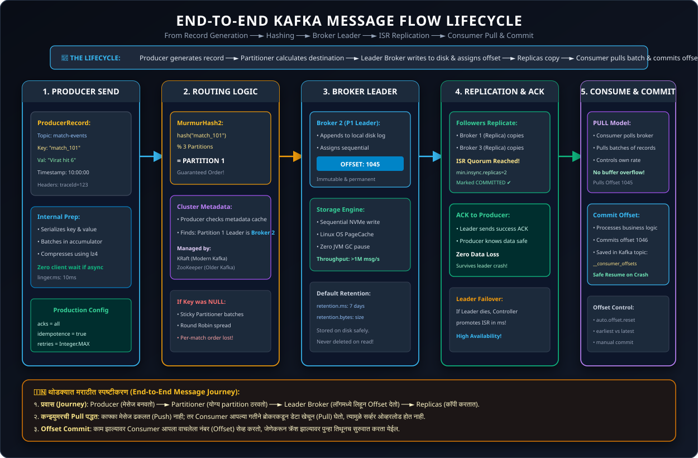

---

### 10.2 Step-by-Step Flow (Steps 1 through 7)

```
[Producer: send()] ──► [Partitioner: MurmurHash2] ──► [Leader Broker: Append Log]
                                                              │
                                                        Replication (ISR)
                                                              │
[Producer: ACK] ◄── [Committed Quorum] ◄──────────────────────┘
                          │
                   Consumer Pull
                          │
[Consumer: fetch()] ──► [Process Business Logic] ──► [Commit Offset to __consumer_offsets]
```

1. **Step 1: Record Creation & Send**:
   - The application creates a `ProducerRecord(topic, key, value)`.
   - Key and Value are serialized into raw bytes.
2. **Step 2: Partition Selection**:
   - The Partitioner hashes the key: $|\text{MurmurHash2}(\text{key})| \pmod{\text{num\_partitions}}$.
   - All events with matching keys are routed to the exact same partition.
3. **Step 3: Direct Broker Dispatch**:
   - Producer checks its local cluster metadata cache (coordinated by KRaft) to find the Leader Broker hosting the target partition.
   - Batched records are sent directly to the Leader over a TCP socket.
4. **Step 4: Disk Append & Offset Assignment**:
   - The Leader Broker appends the record sequentially to the local partition segment file on disk.
   - The record receives its unique, incremental **Offset**.
5. **Step 5: ISR Replication & Commitment**:
   - In-Sync Follower Replicas pull the record from the Leader and write it to their own disks.
   - Once `min.insync.replicas` acknowledge the write, the message is marked **Committed**.
6. **Step 6: Acknowledgment to Producer**:
   - The Leader dispatches an ACK response back to the Producer based on the `acks` configuration (`acks=all`).
7. **Step 7: Consumer Pull & Offset Commit**:
   - The Consumer assigned to that partition issues a `fetch()` pull request.
   - The Consumer executes business logic and commits the new offset to the internal topic `__consumer_offsets`.

---

### 10.3 मराठीत स्पष्टीकरण (Marathi Summary - Lifecycle)

> 1. Producer मेसेज बनवतो आणि Serializer द्वारे बाईट्समध्ये रूपांतरित करतो.
> 2. Partitioner फॉर्म्युला वापरून partition ठरवतो (`hash(key) % partitions`).
> 3. मेसेज थेट Leader Broker कडे जातो आणि डिस्कवर सेव्ह होऊन त्याला **Offset** मिळतो.
> 4. Followers तो मेसेज आपापल्या डिस्कवर कॉपी करतात (Replication).
> 5. Producer ला 'Success ACK' मिळते.
> 6. Consumer स्वतःहून डेटा खेचून (Pull) घेतो, प्रोसेस करतो आणि आपला नवीन Offset सेव्ह करतो.

---

## 11. Architectural Decisions & Performance: Why is Kafka So Fast?

### 11.1 When to Use Kafka: Message Queue vs. Streaming Platform

| Architectural Need | Use as a Traditional Message Queue | Use as a Real-Time Event Streaming Platform |
| :--- | :--- | :--- |
| **Core Goal** | Asynchronous background jobs, worker offloading, strict point-to-point ordering. | Continuous real-time stream transformation, continuous aggregation, complex event processing. |
| **Consumption Style** | Task workers pull jobs, complete them, and move to the next item. | Events flow like a continuous waterfall; consumers process on the fly in real time. |
| **Real-World Examples** | • **Amazon Order Checkout**: Confirm instantly, email/invoice in background.<br>• **Cricket Ball-by-Ball Feed**: Ball 1, Ball 2, Ball 3 must process in strict sequence. | • **Uber / Ola Live Ride Tracking**: Real-time driver GPS to calculate ETA & dynamic surge pricing.<br>• **Zomato Live Status**: Order broadcasted to app, restaurant, and rider simultaneously. |
| **Best Alternatives** | RabbitMQ, AWS SQS (for lightweight, low-volume queueing). | Apache Flink, Spark Streaming (paired with Kafka). |

---

### 11.2 Why is Kafka Extremely Fast? (4 Architectural Secrets)

Kafka routinely outperforms traditional databases and message brokers by processing **over 1 million messages per second per node** due to four engineering optimizations:

```
┌────────────────────────────────────────────────────────────────────────┐
│                     KAFKA'S 4 SPEED SECRETS                            │
├──────────────────────┬──────────────────────┬──────────────────────────┤
│ 1. Sequential Disk   │ 2. Linux Zero-Copy   │ 3. OS PageCache          │
│    I/O (NVMe speed)  │    (sendfile syscall)│    (Bypasses JVM Heap)   │
├──────────────────────┴──────────────────────┴──────────────────────────┤
│ 4. End-to-End Batching & Compression (Snappy/LZ4)                      │
└────────────────────────────────────────────────────────────────────────┘
```

#### 1. Sequential Disk Writes (NVMe / Disk Speed)
- **Random Disk Access is Slow**: Traditional relational databases jump across disk sectors to update B-Tree indexes (slow random I/O: 100-200 ops/sec on HDD).
- **Sequential Writes are Fast**: Kafka only appends to the end of log files. Sequential disk I/O on modern NVMe SSDs reaches **> 600 MB/sec**, rivaling RAM write speeds!

#### 2. Linux Zero-Copy Mechanism (`sendfile` system call)
In standard Java network applications, transmitting file data over a network requires **4 data copies and 4 context switches**:
```
Standard Path:  Disk ──► OS Buffer ──► JVM Heap ──► Socket Buffer ──► NIC (Network Card)
```
Kafka utilizes the Linux kernel **Zero-Copy** system call (`sendfile`):
```
Zero-Copy Path: Disk ──► OS PageCache ─────────────────────────────► NIC (Network Card)
```
- Data never enters user-space JVM memory! The CPU does zero copying of payload bytes.

#### 3. Operating System PageCache
- Instead of caching messages inside JVM heap memory (which causes devastating Java Garbage Collection stop-the-world pauses), Kafka relies entirely on the Linux OS PageCache.
- All free server RAM is automatically utilized as a high-speed disk cache.

#### 4. End-to-End Batching & Compression
- Producers, brokers, and consumers all process records in compressed batches (`lz4` / `snappy`), amortizing TCP network overhead over hundreds of events at a time.

---

### 11.3 Latency vs. Throughput

| Metric | Definition | Real-World Measurement | Optimization Focus |
| :--- | :--- | :--- | :--- |
| **Throughput** | **Volume**: Total data or number of messages processed in a given time window. | Messages/sec (e.g., `1,000,000 msgs/sec`) or MB/sec. | Maximized by larger batches (`batch.size=32KB`, `linger.ms=20ms`), compression, and multiple partitions. |
| **Latency** | **Delay**: Time taken for a single message to travel from Producer to Consumer. | Milliseconds (e.g., `5 ms` delivery time). | Minimized by immediate dispatch (`linger.ms=0`, `acks=1`), uncompressed records, and low consumer poll intervals. |

> 💡 **Interview Analogy**: Throughput is the **width of a highway** (how many cars pass per hour); Latency is the **speed limit** (how fast one car reaches the destination).

---

### 11.4 Traditional Database vs. Apache Kafka

| Feature | Traditional Database (RDBMS / NoSQL) | Apache Kafka |
| :--- | :--- | :--- |
| **Primary Purpose** | Long-term state storage and complex querying (`SELECT`, `JOIN`). | High-speed real-time event streaming and pipeline integration. |
| **Write Model** | Random disk writes (updates in-place, modifies indexes). | Strictly append-only sequential log writes. |
| **Throughput** | Moderate (~1,000 to 20,000 writes/sec). | Ultra-High (> 1,000,000 writes/sec per cluster). |
| **Data Retention** | Permanent storage until explicitly deleted. | Time-bound stream buffer (e.g. 7 days retention). |
| **Query Flexibility** | Rich SQL, indexes, ad-hoc queries. | Simple sequential read by offset (no SQL indexing out of the box). |

---

### 11.5 मराठीत स्पष्टीकरण (Marathi Summary - Performance)

> **काफ्का इतका वेगवान का आहे? (Speed Secrets)**:
> 1. **Sequential Disk Writes**: रँडम जागी न लिहिता, काफ्का वहीच्या पानांप्रमाणे फक्त शेवटी (Append) लिहितो, ज्यामुळे हार्ड डिस्कचा वेग RAM इतकाच मिळतो.
> 2. **Zero-Copy Mechanism**: डेटा Java Memory मध्ये कॉपी न करता थेट हार्ड डिस्कवरून नेटवर्क कार्डकडे (NIC) पाठवला जातो, ज्यामुळे CPU वर लोड येत नाही.
> 3. **PageCache**: काफ्का RAM मधील कॅशे वापरतो, ज्यामुळे Java Garbage Collection चा कोणताही अडथळा येत नाही.
> 4. **Batching**: एक-एक मेसेज पाठवण्याऐवजी हजारो मेसेज एकत्र पाठवले जातात.

---

## 12. Advanced Consumer Concepts: Consumer Lag & Modern Rebalance Protocols

### 12.1 Consumer Lag: Definition, Formula, Monitoring & Remediation

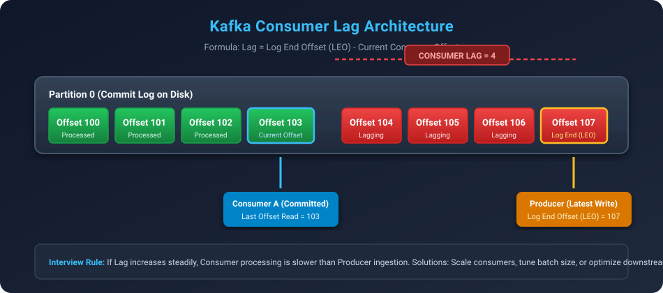

> **Definition**: **Consumer Lag** is a primary performance metric in Apache Kafka representing the delay between the production of messages and their consumption, measured as the numerical difference between the highest committed offset by the producer (Log End Offset - LEO) and the current committed offset read by the consumer group in a partition.

$$\text{Consumer Lag} = \text{Log End Offset (LEO)} - \text{Current Consumer Offset}$$

#### 📌 Point-by-Point Explanation:
- **Log End Offset (LEO)**: The offset of the very next record that the producer will write into the partition log on disk.
- **Current Consumer Offset**: The position up to which the consumer application has processed and successfully committed its progress.
- **Why Lag Occurs**:
  1. **Sudden Ingestion Spike**: Producer volume temporarily surges faster than normal (e.g., Flash sale or marketing notification campaign).
  2. **Heavy Processing / Blocking Downstream I/O**: Consumer performs slow database writes, calls third-party REST APIs, or executes complex transformations per record.
  3. **JVM Garbage Collection Pauses**: Long GC "stop-the-world" cycles pause consumer threads, preventing them from calling `.poll()`.
- **How to Monitor Consumer Lag**:
  - **Kafka CLI**: Run `kafka-consumer-groups.sh --describe --group <group-name>` (shows `CURRENT-OFFSET`, `LOG-END-OFFSET`, and `LAG`).
  - **Open-Source Tools**: Confluent Control Center, LinkedIn's **Burrow**, Kafka Exporter + **Prometheus & Grafana** dashboards.
- **Production Remediation Strategies**:
  1. **Scale Consumers Horizontally**: Add more consumer instances to the group (up to the total number of partitions).
  2. **Tune Batch & Fetch Parameters**: Increase `max.poll.records` (e.g., 500) and optimize `fetch.min.bytes` to reduce network roundtrips.
  3. **Asynchronous Worker Thread Pool**: Inside the consumer, poll records quickly and offload expensive CPU/DB work to an internal worker thread pool (maintaining manual offset tracking).

---

### 12.2 Rebalance Protocols: Eager vs. Incremental Cooperative Rebalancing

> **Definition**: A **Consumer Group Rebalance** is a distributed coordination process where Kafka reallocates partition ownership among active consumers in a group whenever a consumer joins, crashes, leaves, or new partitions are added.

#### 📌 Point-by-Point Explanation:

| Feature | 1. Eager Rebalance Protocol (Legacy) | 2. Incremental Cooperative Rebalancing (Kafka 2.4+) |
| :--- | :--- | :--- |
| **Mechanism** | **"Stop-the-World"**: All consumers surrender *all* assigned partitions simultaneously. | **Incremental Handover**: Only partitions that need to migrate between consumers are revoked; others keep working. |
| **System Impact** | Active processing freezes across the entire group until the rebalance election finishes. | Zero downtime! Unaffected consumers process uninterrupted. |
| **Assignor Strategy** | `RangeAssignor`, `RoundRobinAssignor`. | `CooperativeStickyAssignor` (Default in modern Kafka). |
| **Recovery Time** | Slow (seconds to minutes in large clusters). | Milliseconds (virtually unnoticeable in production). |

```properties
# Enable Incremental Cooperative Rebalancing in consumer properties
partition.assignment.strategy=org.apache.kafka.clients.consumer.CooperativeStickyAssignor
```

---

### 12.3 Static Membership (`group.instance.id`) for Rolling Deployments

> **Definition**: **Static Membership** is a Kafka consumer configuration that assigns a persistent, unique identifier (`group.instance.id`) to a consumer pod/node, allowing it to restart or redeploy without triggering an immediate partition rebalance.

#### 📌 Point-by-Point Explanation:
- **The Problem in Cloud / Kubernetes**: When deploying a new Docker container or rolling restart in Kubernetes, a pod terminates and restarts. The Group Coordinator detects the leave and triggers an expensive rebalance across all running pods.
- **The Solution**: By configuring `group.instance.id=pod-01`, Kafka grants the consumer a grace period (`session.timeout.ms=45000`).
- **Zero Rebalance**: If the pod restarts within 45 seconds, the Group Coordinator recognizes its static ID and preserves its existing partition assignments without disrupting any peers!

```properties
# Kubernetes Consumer Pod Config
group.id=order-processing-group
group.instance.id=order-consumer-pod-1
session.timeout.ms=45000
```

---

### 12.4 मराठीत स्पष्टीकरण (Marathi Summary - Consumer Lag & Rebalancing)

> **कन्झ्युमर लॅग आणि रिबॅलन्सिंग**:
> - **Consumer Lag म्हणजे काय?**: Producer ने Partition मध्ये शेवटी लिहिलेला मेसेज (LEO) आणि Consumer ने सध्या वाचलेला मेसेज (Current Offset) यातील फरकाला **Lag** म्हणतात. जर Lag सतत वाढत असेल, तर Consumer काम करण्यात मागे पडत आहे असा अर्थ होतो.
> - **Lag कसा कमी करायचा?**: Partitions इतकी Consumers ची संख्या वाढवा, बॅच साईझ सुधारा, किंवा Consumer कोडमधील डेटाबेस कॉल्स ऑप्टिमाइझ करा.
> - **Cooperative Rebalancing**: जुन्या काफ्कामध्ये एक कन्झ्युमर जरी बंद पडला तरी सर्वांचे काम थांबायचे (Stop-the-world). नवीन **CooperativeStickyAssignor** मुळे फक्त ज्याचे पार्टिशन हलवायचे आहे तेवढेच हलवले जाते, बाकी सर्वांचे काम अविरत सुरू राहते.
> - **Static Membership (`group.instance.id`)**: Kubernetes मध्ये ॲप रिस्टार्ट किंवा डिप्लॉय होताना विनाकारण रिबॅलन्स होऊ नये म्हणून प्रत्येक पॉडला फिक्स ID दिला जातो.

---

## 13. Advanced Storage: Log Compaction vs. Log Deletion

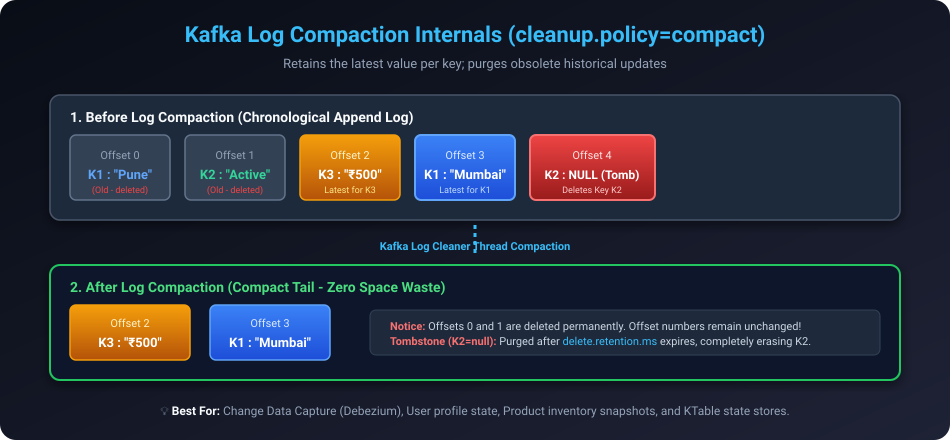

### 13.1 Log Deletion Policy (`cleanup.policy=delete`)

> **Definition**: **Log Deletion** is the default retention mechanism in Kafka where older log segments are permanently deleted from disk once they exceed configured time limits (`retention.ms`) or total segment size limits (`retention.bytes`).

#### 📌 Point-by-Point Explanation:
- **Default Behavior**: Standard for high-volume transient event streams (e.g., GPS coordinates, clickstream data).
- **Time Threshold (`retention.ms`)**: Kafka scans log segments and deletes records older than the threshold (default: 7 days / 168 hours).
- **Size Threshold (`retention.bytes`)**: Purges older segments when partition storage exceeds disk space limits.

---

### 13.2 Log Compaction Policy (`cleanup.policy=compact`) & Tombstones

> **Definition**: **Log Compaction** is a retention policy where Kafka guarantees to retain at least the last known (most recent) value for each record key within a topic partition log, purging older superseded updates for that same key.

#### 📌 Point-by-Point Explanation:
- **Key-Centric Retention**: Requires every message to have a non-null **Record Key**.
- **Log Cleaner Thread**: A background broker thread scans the partition log and keeps only the latest record for each key.
- **Offset Integrity**: Log compaction **never changes offsets**. Historical offsets for obsolete keys simply become sparse/empty gaps.
- **Tombstone Records (Hard Deletes)**:
  - If a producer sends a record with an existing `Key` and `Value = null`, Kafka treats this as a **Tombstone**.
  - During compaction, the tombstone acts as a deletion marker. After `delete.retention.ms` (default 24 hours), both the key and the tombstone are permanently eradicated from disk.

```properties
# Topic Configuration for Log Compaction
cleanup.policy=compact
delete.retention.ms=86400000
segment.ms=604800000
min.cleanable.dirty.ratio=0.5
```

---

### 13.3 Real-World Use Cases: Database CDC & State Stores

1. **Change Data Capture (CDC with Debezium)**: Replicating a MySQL table into Kafka. You only care about the current state of row `customer_id=101`, not its 50 past address changes.
2. **KTable State Stores**: Caching current account balances or product catalog prices in memory for instant lookup.

---

### 13.4 मराठीत स्पष्टीकरण (Marathi Summary - Log Compaction)

> **Log Compaction म्हणजे काय?**:
> - **Delete Policy**: ठराविक दिवस (उदा. ७ दिवस) झाले की जुने मेसेज डिलीट करणे.
> - **Compact Policy**: जुना मेसेज डिलीट न करता, **प्रत्येक Key चा फक्त सर्वात शेवटचा (Latest) व्हॅल्यू असलेला मेसेज सेव्ह ठेवणे**.
> - **Tombstone Record**: जर एखाद्या Key चा मेसेज कायमचा काढून टाकायचा असेल, तर व्हॅल्यू `null` (`value=null`) पाठवली जाते. काफ्का त्या Key ला डिस्कवरून नष्ट करतो.
> - **उपयोग**: Database मधून डेटा काफ्कामध्ये आणताना (CDC) ग्राहकाचा सध्याचा पत्ता किंवा प्रॉडक्टचा चालू भाव साठवण्यासाठी हे वापरतात.

---

## 14. Exactly-Once Semantics (EOS) & Kafka Transactions

### 14.1 The Read-Process-Write Distributed Dilemma

In distributed streaming architectures, applications frequently consume records from an input topic, transform them, and publish results to an output topic (**Read-Process-Write pattern**):

```
[Input Topic A] ──► [Stream Worker Service] ──► [Output Topic B]
                           │
                           ▼ (Must commit offset back to Topic A)
```

#### The Failure Scenario:
1. Worker consumes event from Topic A (Offset 50).
2. Worker computes business logic and successfully produces transformed record to Topic B.
3. Before the worker can commit Offset 50 to Topic A, **the worker crashes**!
4. When the worker restarts, it re-reads Offset 50 from Topic A and publishes to Topic B **again**, causing a duplicate transaction (e.g., charging a customer twice!).

---

### 14.2 Transactional Producer & Consumer Setup

> **Definition**: **Kafka Transactions** enable atomic writes across multiple partitions and topics, guaranteeing that downstream consumers only read messages that were part of an entirely successful, committed transaction (**Exactly-Once Semantics**).

#### 📌 Point-by-Point Explanation:
- **Atomic Operations**: Publishing to Output Topic B and committing consumer offsets to `__consumer_offsets` succeed or fail together as a single atomic unit.
- **Producer Config**: Set a stable `transactional.id` and enable idempotence.
- **Consumer Config**: Set `isolation.level=read_committed`. The consumer skips aborted transactions and uncommitted in-flight batches.

#### Node.js (KafkaJS) Transactional API Workflow:
```javascript
// Node.js (KafkaJS) Transactional Workflow (Exactly-Once Semantics - EOS)
const { Kafka } = require('kafkajs');

const kafka = new Kafka({
  clientId: 'order-transaction-service',
  brokers: ['localhost:9092']
});

// 1. Initialize Producer with a persistent transactionalId and idempotence
const producer = kafka.producer({
  transactionalId: 'order-txn-producer-01',
  maxInFlightRequests: 1,
  idempotent: true
});

async function processOrderAtomically(consumer, message) {
  await producer.connect();

  // 2. Start a new atomic transaction
  const transaction = await producer.transaction();

  try {
    const orderPayload = JSON.parse(message.value.toString());
    const transformedOrder = {
      ...orderPayload,
      status: 'PROCESSED',
      processedAt: new Date().toISOString()
    };

    // 3. Send transformed record to destination topic inside transaction
    await transaction.send({
      topic: 'orders-processed',
      messages: [
        {
          key: message.key,
          value: JSON.stringify(transformedOrder)
        }
      ]
    });

    // 4. Atomically commit consumer offset within the exact same transaction
    await transaction.sendOffsets({
      consumerGroupId: 'order-consumer-group',
      topics: [
        {
          topic: message.topic,
          partitions: [
            {
              partition: message.partition,
              offset: (parseInt(message.offset, 10) + 1).toString()
            }
          ]
        }
      ]
    });

    // 5. Commit Transaction (Atomic Success: Message + Offset committed together!)
    await transaction.commit();
    console.log(`[EOS Committed] Order ${orderPayload.orderId} processed exactly once.`);
  } catch (error) {
    // 6. Abort on failure (Rollback: Neither message nor offset are committed)
    await transaction.abort();
    console.error(`[EOS Aborted] Error processing order: ${error.message}`);
    throw error;
  }
}
```

---

### 14.3 Transaction Coordinator & Two-Phase Commit Internals

- **Transaction Coordinator**: A specialized Kafka broker component managing state via the internal topic `__transaction_state`.
- **Control Markers**: When `commitTransaction()` is called, the coordinator writes a special binary commit marker into the partition. Consumers configured with `read_committed` read up to the marker only when it is marked valid.

---

### 14.4 मराठीत स्पष्टीकरण (Marathi Summary - Transactions)

> **Kafka Transactions (EOS) काय आहेत?**:
> - **समस्या**: एका टॉपिकमधून मेसेज वाचून प्रक्रिया करून दुसऱ्या टॉपिकमध्ये टाकताना मध्येच सर्व्हर बंद पडला, तर तोच मेसेज पुन्हा प्रोसेस होऊन डुप्लिकेट व्यवहार (उदा. दोनदा बँक खात्यातून पैसे कापणे) होऊ शकतो.
> - **उपाय (Transactions)**: `initTransactions()`, `beginTransaction()`, आणि `commitTransaction()` वापरून मेसेज लिहिणे आणि ऑफसेट कमिट करणे एकाच वेळी यशस्वी (Atomic) होते.
> - **Consumer Isolation Level**: कन्झ्युमरमध्ये `isolation.level=read_committed` ठेवल्यास, रोलबॅक (कॅन्सल) झालेले मेसेजेस कन्झ्युमर अजिबात वाचत नाही.

---

## 15. Kafka Ecosystem: Schema Registry, Connect & Streams

### 15.1 Schema Registry & Avro/Protobuf Data Governance

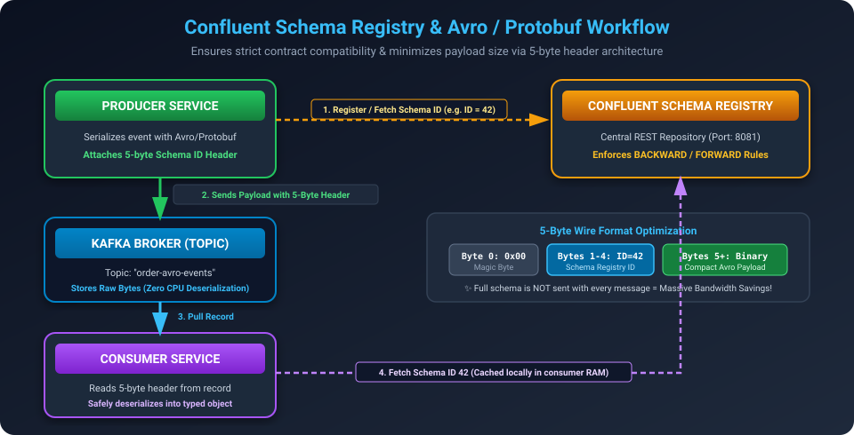

> **Definition**: **Confluent Schema Registry** is a centralized RESTful service for storing, serving, and validating Avro, JSON Schema, and Protobuf schemas, guaranteeing forward and backward data compatibility between decoupled producers and consumers.

#### 📌 Point-by-Point Explanation:
- **The Problem with Plain JSON**: A producer might rename a field (`userId` $\to$ `customer_id`) or change data types. Downstream consumers crash with `NullPointerException` or parsing failures in production.
- **How Schema Registry Works**:
  1. Schemas are defined in Apache Avro (`.avsc`) or Protobuf format.
  2. The Producer registers the schema with Schema Registry and receives a unique **4-byte Schema ID**.
  3. The Producer prepends a **5-byte header** (Magic Byte `0x0` + 4-byte Schema ID) to the message payload, drastically reducing wire payload size because schema definitions aren't sent with every message!
  4. The Consumer reads the 5-byte header, fetches the matching schema from registry cache, and safely deserializes the data.
- **Compatibility Modes**:
  - `BACKWARD` (Default): New consumer can read data produced by older producers.
  - `FORWARD`: Old consumer can read data produced by newer producers.
  - `FULL`: Both backward and forward compatible.

---

### 15.2 Kafka Connect: No-Code Integration & CDC (Debezium)

> **Definition**: **Kafka Connect** is a free, open-source framework for scalably and reliably streaming data between Apache Kafka and external datastores (databases, key-value stores, search indexes, and object storage) using reusable, configuration-driven plugins without writing custom code.

#### 📌 Point-by-Point Explanation:
- **Source Connectors**: Ingest data **into Kafka** from external sources.
  - *Example*: **Debezium CDC (Change Data Capture)** tails MySQL / PostgreSQL binlogs in real time and streams every `INSERT`, `UPDATE`, and `DELETE` row event directly to a Kafka topic in sub-second latency!
- **Sink Connectors**: Export data **from Kafka** into downstream storage.
  - *Example*: Stream Kafka events directly into Elasticsearch for full-text search, Snowflake / BigQuery for analytics, or AWS S3 for data lakes.

---

### 15.3 Kafka Streams: Lightweight Real-Time Event Processing

> **Definition**: **Kafka Streams** is a lightweight, client-side Java/Scala library for building real-time streaming applications and microservices that transform, aggregate, and enrich records directly from Kafka topics without requiring heavyweight external cluster infrastructure (like Apache Spark or Flink).

#### Core Concepts:
- **KStream (Fact Stream)**: Represents an unbounded stream of individual record events (e.g., all taxi booking attempts).
- **KTable (Current State)**: Represents the latest materialized state view of records keyed by their primary key (like a changelog table).
- **Windowing Aggregations**:
  1. **Tumbling Window**: Fixed-size, non-overlapping windows (e.g., count orders every 5 minutes: `00:00-00:05`, `00:05-00:10`).
  2. **Hopping (Sliding) Window**: Fixed-size, overlapping windows (e.g., 5-minute window advancing every 1 minute).
  3. **Session Window**: Dynamic windows based on periods of user activity followed by inactivity.

---

### 15.4 मराठीत स्पष्टीकरण (Marathi Summary - Ecosystem)

> **इकोसिस्टम टूल्स (Schema Registry, Connect, Streams)**:
> - **Schema Registry (Avro)**: प्रोड्युसरने पाठवलेला डेटा कोणत्या स्वरूपात (Schema) आहे हे तपासून पाहते. JSON मध्ये फील्ड बदलल्यास कन्झ्युमर क्रॅश होऊ नये म्हणून Schema Registry कंपॅटिबिलिटी तपासते.
> - **Kafka Connect (Debezium)**: कोणताही कोड न लिहिता MySQL / Postgres डेटाबेसमधील बदल थेट काफ्कामध्ये आणण्यासाठी (Source Connector) आणि काफ्कामधून डेटा Elasticsearch किंवा S3 मध्ये टाकण्यासाठी (Sink Connector) वापरतात.
> - **Kafka Streams**: वेगळे क्लस्टर (Spark/Flink) न उभारता, साध्या Java ॲप्लिकेशनमध्ये रिअल-टाइम डेटा फिल्टर, जॉइन आणि विंडोइंग (उदा. मागील ५ मिनिटांतील एकूण ऑर्डर्स मोजणे) करण्यासाठी ही लायब्ररी वापरतात.

---

## 16. Essential Production & Interview CLI Commands

Hands-on Kafka commands frequently tested in DevOps, SRE, and Backend Engineering interviews:

### 16.1 Topic Administration Commands (`kafka-topics.sh`)

```bash
# 1. Create a Topic with 3 Partitions and Replication Factor of 3
kafka-topics.sh --bootstrap-server localhost:9092 \
  --create --topic order-events \
  --partitions 3 \
  --replication-factor 3

# 2. Describe Topic (Check Partition Leaders, Replicas, and ISR)
kafka-topics.sh --bootstrap-server localhost:9092 \
  --describe --topic order-events

# Output Example:
# Topic: order-events  PartitionCount: 3  ReplicationFactor: 3
#   Partition: 0  Leader: 1  Replicas: 1,2,3  Isr: 1,2,3
#   Partition: 1  Leader: 2  Replicas: 2,3,1  Isr: 2,3,1
#   Partition: 2  Leader: 3  Replicas: 3,1,2  Isr: 3,1,2

# 3. Increase Partitions to 6 (Note: Partitions can only be increased, NEVER decreased!)
kafka-topics.sh --bootstrap-server localhost:9092 \
  --alter --topic order-events \
  --partitions 6
```

---

### 16.2 Console Producer & Consumer Commands

```bash
# 1. Start Console Producer with Custom Keys (Key Separator = :)
kafka-console-producer.sh --bootstrap-server localhost:9092 \
  --topic order-events \
  --property "parse.key=true" \
  --property "key.separator=:"
# Input: user_101:{"orderId": 501, "amount": 1200}

# 2. Start Console Consumer (Read all messages from the beginning)
kafka-console-consumer.sh --bootstrap-server localhost:9092 \
  --topic order-events \
  --from-beginning \
  --property "print.key=true" \
  --property "print.timestamp=true"
```

---

### 16.3 Consumer Group Lag & Offset Reset Commands (`kafka-consumer-groups.sh`)

```bash
# 1. Inspect Consumer Group Status and Consumer Lag
kafka-consumer-groups.sh --bootstrap-server localhost:9092 \
  --describe --group order-processing-group

# Output Table:
# GROUP                   TOPIC         PARTITION  CURRENT-OFFSET  LOG-END-OFFSET  LAG   CONSUMER-ID     HOST
# order-processing-group  order-events  0          1250            1300            50    consumer-pod-1  /10.0.1.5
# order-processing-group  order-events  1          840             840             0     consumer-pod-2  /10.0.1.6
# order-processing-group  order-events  2          2100            2150            50    consumer-pod-3  /10.0.1.7

# 2. Reset Consumer Offsets to Earliest (Re-read all historical data)
kafka-consumer-groups.sh --bootstrap-server localhost:9092 \
  --group order-processing-group \
  --reset-offsets --to-earliest \
  --topic order-events \
  --execute

# 3. Shift Offsets Backwards by 100 records (Rewind to debug a bug)
kafka-consumer-groups.sh --bootstrap-server localhost:9092 \
  --group order-processing-group \
  --reset-offsets --shift-by -100 \
  --topic order-events \
  --execute
```

---

### 16.4 मराठीत स्पष्टीकरण (Marathi Summary - CLI Commands)

> **महत्त्वाचे CLI कमांड्स**:
> - **`kafka-topics.sh --describe`**: टॉपिकमध्ये किती Partitions आहेत, Leader कोण आहे, आणि ISR कोण आहे हे तपासण्यासाठी. (पार्टिशन्स फक्त वाढवता येतात, कधीही कमी करता येत नाहीत).
> - **`kafka-consumer-groups.sh --describe`**: **Consumer Lag** तपासण्यासाठीची सर्वात महत्त्वाची कमांड.
> - **Offset Reset (`--to-earliest` / `--shift-by`)**: बग आल्यास जुने मेसेज पुन्हा वाचण्यासाठी कन्झ्युमरचा ऑफसेट मागे नेण्याची कमांड.

---

## 17. End-to-End Apache Kafka Integration in Node.js (KafkaJS Guide)

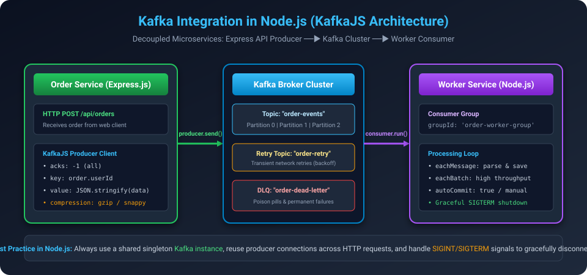

> **Definition**: **KafkaJS** is the modern, open-source Apache Kafka client for Node.js written in 100% pure JavaScript with zero native dependencies (no C++ bindings or `librdkafka` compilation required), featuring full `async/await` promise support for Producers, Consumer Groups, and Admin Cluster APIs.

#### 📌 Architecture Overview:
Instead of scattering code across unreferenced places, this section provides the complete, production-ready, and interview-ready architecture for all 5 essential microservice components:
- **`package.json`** — Dependency definitions and pre-configured execution scripts.
- **`client.js`** — Centralized singleton Kafka client with network timeouts, retry policies, and connection handling.
- **`admin.js`** — Programmatic topic creation, partition scaling, and metadata inspection.
- **`producer.js`** — High-reliability producer with `acks=-1 (all)`, deterministic key hashing, and GZIP compression.
- **`consumer.js`** — Resilient Consumer Group worker with heartbeat management and graceful shutdown.
- **`dlq.js`** — Dedicated Dead Letter Queue worker for poison-pill isolation and alerting.

---

### 17.1 Installation & Project Setup (`package.json`)

To run Apache Kafka in Node.js, install `kafkajs` (the modern pure JavaScript Kafka client) along with `express` for HTTP APIs:

```bash
# Initialize npm and install dependencies
npm init -y
npm install kafkajs express dotenv
```

#### Complete `package.json` with Production NPM Scripts:
```json
{
  "name": "kafka-nodejs-production",
  "version": "1.0.0",
  "description": "Production-grade Apache Kafka Node.js integration with complete explanations for Interview & System Design",
  "main": "client.js",
  "scripts": {
    "admin": "node admin.js",
    "producer": "node producer.js",
    "consumer": "node consumer.js",
    "dlq": "node dlq.js"
  },
  "dependencies": {
    "kafkajs": "^2.2.4",
    "express": "^4.19.2",
    "dotenv": "^16.4.5"
  }
}
```

---

### 17.2 Singleton Client Configuration (`client.js`)

> 🚨 **Golden Interview Rule**: Always export a single, shared Kafka client instance across your entire Node.js project. Never instantiate new Kafka clients inside route handlers or database callbacks!

#### Complete `client.js` Code:
```javascript
// client.js - Centralized Kafka Client Singleton Instance
const { Kafka, logLevel } = require('kafkajs');

const kafka = new Kafka({
  // 1. Client Identifier (used in server-side request logging & quota metrics)
  clientId: 'ecommerce-core-service',

  // 2. Initial Bootstrap Brokers (Cluster metadata will discover the rest automatically)
  brokers: (process.env.KAFKA_BROKERS || 'localhost:9092').split(','),

  // 3. Connection & Network Timeouts
  connectionTimeout: 5000, // 5 seconds: TCP handshake timeout
  requestTimeout: 30000,    // 30 seconds: Maximum time to await broker response

  // 4. Exponential Backoff Retry Policy for Network Outages
  retry: {
    maxRetryTime: 30000,    // Stop retrying if total retry time exceeds 30 seconds
    initialRetryTime: 300,  // Initial backoff wait: 300ms
    factor: 0.2,            // Randomization jitter to prevent thundering herd
    multiplier: 2,          // Exponential factor: 300ms -> 600ms -> 1200ms...
    retries: 8              // Maximum consecutive retry attempts
  },

  // 5. Logging Level
  logLevel: logLevel.INFO

  // 6. Security Configuration (Enable in Cloud / Production e.g. AWS MSK, Confluent Cloud):
  // ssl: true,
  // sasl: {
  //   mechanism: 'plain', // or 'scram-sha-256' | 'scram-sha-512'
  //   username: process.env.KAFKA_USERNAME,
  //   password: process.env.KAFKA_PASSWORD
  // }
});

module.exports = kafka;
```

#### All Available Kafka Client Configuration Options:
| Config Parameter | Type | Default Value | Production Value / Interview Explanation |
| :--- | :--- | :--- | :--- |
| **`clientId`** | `String` | `'kafkajs'` | Logical name of this service (e.g. `'ecommerce-core-service'`). Appears in broker logs and JMX metrics. |
| **`brokers`** | `Array[String]` | *(Required)* | Array of initial bootstrap brokers: `['localhost:9092']` or AWS MSK endpoints. Kafka automatically discovers the remaining brokers via metadata! |
| **`connectionTimeout`**| `Number (ms)` | `1000` (1s) | TCP socket handshake timeout. Set to `5000` (5s) to survive cloud network jitter. |
| **`requestTimeout`** | `Number (ms)` | `30000` (30s) | Maximum time client waits for an acknowledgment from broker before timing out. |
| **`retry.retries`** | `Number` | `5` | Maximum consecutive retry attempts on network drop before failing. |
| **`retry.initialRetryTime`** | `Number (ms)` | `300` | Initial wait before first retry; doubles on each retry (Exponential Backoff). |
| **`logLevel`** | `Enum` | `INFO` | `NOTHING`, `ERROR`, `WARN`, `INFO`, `DEBUG`. Set to `WARN` or `ERROR` in high-throughput production. |
| **`ssl`** | `Boolean / Object` | `false` | Set `true` or pass TLS certificates (`ca`, `cert`, `key`) for encrypted cloud connections. |
| **`sasl`** | `Object` | `undefined` | Authentication mechanism: `plain`, `scram-sha-256`, `scram-sha-512`, or AWS MSK IAM. |

---

### 17.3 Topic & Cluster Administration (`admin.js`)

The Admin Client allows developers and CI/CD pipelines to manage cluster topology programmatically without shell scripts.

#### Complete `admin.js` Code:
```javascript
// admin.js - Programmatic Topic & Cluster Administrator
const kafka = require('./client');

async function setupKafkaCluster() {
  // 1. Instantiate the Admin Client
  const admin = kafka.admin({
    retry: { retries: 5 }
  });

  try {
    console.log('⏳ [Step 1] Connecting Kafka Admin Client to cluster...');
    await admin.connect();
    console.log('✅ [Step 1] Admin Client connected successfully!\n');

    // 2. Define Topics with Partitions, Replication Factor, and Retention Configurations
    console.log('🛠️ [Step 2] Creating required topics programmatically...');
    const created = await admin.createTopics({
      validateOnly: false,    // false = execute immediately; true = dry-run validation
      waitForLeaders: true,   // true = wait until leader partitions are fully elected across brokers
      timeout: 10000,         // 10 seconds timeout
      topics: [
        {
          topic: 'order-events',
          numPartitions: 3,         // 3 Partitions enable up to 3 parallel consumers in a group!
          replicationFactor: 1,     // In production multi-broker cluster: Set to 3
          configEntries: [
            // cleanup.policy: 'delete' (time/size retention) or 'compact' (keep latest key)
            { name: 'cleanup.policy', value: 'delete' },
            // retention.ms: 7 days retention (604,800,000 ms)
            { name: 'retention.ms', value: '604800000' },
            // min.insync.replicas: Minimum ISR needed to acknowledge writes when acks=all
            { name: 'min.insync.replicas', value: '1' }
          ]
        },
        {
          // Dedicated Dead Letter Queue topic for corrupted / unprocessable records
          topic: 'order-dead-letter-queue',
          numPartitions: 1,
          replicationFactor: 1,
          configEntries: [
            // Keep DLQ messages for 14 days (1,209,600,000 ms) for deep debugging
            { name: 'retention.ms', value: '1209600000' }
          ]
        }
      ]
    });

    if (created) {
      console.log('🎉 [Step 2] Successfully created topics: ["order-events", "order-dead-letter-queue"]');
    } else {
      console.log('ℹ️ [Step 2] Topics already exist in cluster. Skipping creation.');
    }

    // 3. Verify Active Topics in Cluster
    console.log('\n📋 [Step 3] Fetching list of all topics in cluster...');
    const allTopics = await admin.listTopics();
    const userTopics = allTopics.filter(name => !name.startsWith('__'));
    console.log('   Active User Topics:', userTopics);

    // 4. Fetch Deep Topic Metadata (Partitions, Leader, Replicas, ISR)
    console.log('\n🔍 [Step 4] Inspecting partition metadata for "order-events"...');
    const metadata = await admin.fetchTopicMetadata({ topics: ['order-events'] });
    const orderTopic = metadata.topics[0];

    orderTopic.partitions.forEach(partition => {
      console.log(`   👉 Partition ${partition.partitionId} | Leader Broker: ${partition.leader} | Replicas: [${partition.replicas}] | In-Sync Replicas (ISR): [${partition.isr}]`);
    });

    console.log('\n✅ [Summary] Topic infrastructure is production-ready!');

  } catch (error) {
    console.error('❌ Error during Admin cluster setup:', error);
  } finally {
    // 5. Always disconnect the Admin Client
    console.log('\n🔌 [Step 5] Disconnecting Admin Client...');
    await admin.disconnect();
    console.log('👋 Admin client disconnected cleanly.');
  }
}

// Run the script
setupKafkaCluster();
```

#### All Available Admin Methods & Options:
| Method | Parameters & Options | Interview & Architecture Purpose |
| :--- | :--- | :--- |
| **`admin.connect()`** | None | Establishes connection with the Kafka cluster controller. |
| **`admin.createTopics()`** | `topics: [...]`<br>`waitForLeaders: true`<br>`validateOnly: false`<br>`timeout: 10000` | Creates topics with partition count, replication factor, and topic configs. `waitForLeaders: true` ensures leader brokers are ready before proceeding. |
| **`admin.listTopics()`** | None | Returns array of all topic strings. Filter out internal topics starting with `__`. |
| **`admin.fetchTopicMetadata()`** | `{ topics: ['order-events'] }` | Returns deep topology: partition IDs, Leader broker ID, Replicas list, and ISR list. |
| **`admin.createPartitions()`** | `{ topicPartitions: [{ topic, count: 6 }] }` | **Can you change partition count?** YES, partitions can ONLY be increased. Partitions can **NEVER be decreased**! |

---

### 17.4 High-Performance Production Producer (`producer.js`)

#### Top 4 Producer Production Best Practices:
1. **Singleton Connection**: Connect the producer once on server boot; never call `connect()` per request.
2. **Deterministic Keys**: Setting `key = userId` routes all records for that user to the same partition via `MurmurHash2`.
3. **Delivery Durability**: Use `acks: -1 (all)` to wait for Leader + all In-Sync Replicas.
4. **Wire Compression**: Use GZIP or Snappy to reduce network packet overhead by 60-80%.

#### Complete `producer.js` Code:
```javascript
// producer.js - High-Reliability Production Kafka Producer
const { CompressionTypes, Partitioners } = require('kafkajs');
const kafka = require('./client');

// 1. Initialize Producer Singleton
const producer = kafka.producer({
  createPartitioner: Partitioners.DefaultPartitioner, // MurmurHash2 key partitioner
  allowAutoTopicCreation: false,                     // Prevent accidental auto-created topics
  transactionTimeout: 30000,
  retry: {
    initialRetryTime: 100,
    retries: 5
  }
});

async function publishOrderEvents() {
  try {
    console.log('⏳ [Producer] Connecting to Kafka cluster...');
    await producer.connect();
    console.log('✅ [Producer] Connected successfully!\n');

    // Sample Ecommerce Orders to Publish
    const orderBatch = [
      {
        orderId: 'ORD-101',
        userId: 'user_pune_99',      // Key 1: All orders for this user go to the SAME partition!
        amount: 2499.00,
        item: 'Mechanical Keyboard',
        city: 'Pune'
      },
      {
        orderId: 'ORD-102',
        userId: 'user_mumbai_88',    // Key 2: Routed deterministically by MurmurHash2
        amount: 899.00,
        item: 'Wireless Mouse',
        city: 'Mumbai'
      },
      {
        orderId: 'ORD-103',
        userId: 'user_pune_99',      // Key 1: Guarantees strict ordering with ORD-101!
        amount: 350.00,
        item: 'Desk Mat XL',
        city: 'Pune'
      },
      {
        orderId: 'ORD-FAIL-999',
        userId: 'user_bad_payload',  // POISON PILL TEST: Negative amount will fail validation in consumer
        amount: -500.00,             // This will trigger the consumer's DLQ logic!
        item: 'Corrupted Test Order',
        city: 'Nagpur'
      }
    ];

    console.log(`📤 [Producer] Sending batch of ${orderBatch.length} messages with acks=-1 and GZIP compression...\n`);

    // 2. Publish records using producer.send()
    for (const order of orderBatch) {
      const response = await producer.send({
        topic: 'order-events',
        compression: CompressionTypes.GZIP, // Amortizes network overhead
        acks: -1,                           // acks=all: Leader + all ISR nodes must commit to disk

        messages: [
          {
            key: order.userId,              // Record Key for deterministic partition selection
            value: JSON.stringify({
              orderId: order.orderId,
              userId: order.userId,
              amount: order.amount,
              item: order.item,
              city: order.city,
              createdAt: new Date().toISOString()
            }),
            headers: {
              'source-app': 'ecommerce-checkout-api',
              'correlation-id': `txn_${order.orderId}_${Date.now()}`
            }
          }
        ]
      });

      console.log(`🚀 [SENT] Order "${order.orderId}" | Key: "${order.userId}" ──► Partition: ${response[0].partition} | Offset: ${response[0].baseOffset}`);
    }

    console.log('\n✨ [Producer] All messages published successfully!');

  } catch (error) {
    console.error('❌ [Producer] Publish error:', error);
  } finally {
    // 3. Graceful disconnect
    console.log('\n🔌 [Producer] Disconnecting from cluster...');
    await producer.disconnect();
    console.log('👋 [Producer] Disconnected cleanly.');
  }
}

// Execute
publishOrderEvents();
```

#### All Available Producer Configuration & Send Options:
| Property / Option | Available Values | Default | Architectural Significance |
| :--- | :--- | :--- | :--- |
| **`createPartitioner`** | `DefaultPartitioner`<br>`LegacyPartitioner` | `DefaultPartitioner` | Uses **MurmurHash2** hashing algorithm to map record keys to partitions deterministically. |
| **`allowAutoTopicCreation`**| `Boolean` | `true` | **Set to `false` in production** to prevent accidental topics being created due to developer typos! |
| **`transactionTimeout`** | `Number (ms)` | `60000` | Maximum time allowed for transactional atomic writes before coordinator aborts. |
| **`acks`** (in `send()`) | `0`, `1`, `-1` (`all`) | `-1` (`all`) | • `0` = No ack (Risky, fastest).<br>• `1` = Leader only (Medium).<br>• `-1` = Leader + all ISR replicas (**Safest, Zero Data Loss**). |
| **`compression`** | `GZIP`, `Snappy`, `LZ4`, `ZSTD` | `None` | Compresses message batches before transmission. Reduces network bandwidth and disk usage by 60-80%! |
| **`messages`** | Array of Message Objects | *(Required)* | `[{ key: String, value: String/Buffer, headers: {}, partition?: Number }]` |

---

### 17.5 Resilient Consumer & DLQ Redirection (`consumer.js`)

#### Complete `consumer.js` Code:
```javascript
// consumer.js - Resilient Production Kafka Consumer with DLQ Redirection
const kafka = require('./client');

// 1. Initialize Consumer with Production Parameters
const consumer = kafka.consumer({
  groupId: 'order-fulfillment-group',
  sessionTimeout: 30000,    // 30 seconds
  heartbeatInterval: 3000,  // 3 seconds (1/10th of session timeout)
  rebalanceTimeout: 60000,
  maxBytesPerPartition: 1048576 // 1MB
});

// 2. Initialize a dedicated DLQ Producer to isolate corrupted messages
const dlqProducer = kafka.producer();

async function startConsumerService() {
  try {
    console.log('⏳ [Consumer] Connecting Consumer and DLQ Producer to cluster...');
    await consumer.connect();
    await dlqProducer.connect();
    console.log('✅ [Consumer] Connected successfully!\n');

    // 3. Subscribe to the "order-events" topic
    await consumer.subscribe({
      topic: 'order-events',
      fromBeginning: true // true = re-read all historical records; false in production for live data
    });

    console.log('🎧 [Consumer] Listening for incoming messages on "order-events"...');
    console.log('-----------------------------------------------------------------');

    // 4. Run Message Polling Loop
    await consumer.run({
      autoCommit: true,
      autoCommitInterval: 5000, // Commit offset every 5 seconds

      eachMessage: async ({ topic, partition, message, heartbeat }) => {
        const offset = message.offset;
        const key = message.key ? message.key.toString() : 'NO_KEY';
        const rawValue = message.value.toString();
        const correlationId = message.headers['correlation-id'] 
          ? message.headers['correlation-id'].toString() 
          : 'N/A';

        console.log(`\n📩 [RECEIVED] Topic: "${topic}" | Partition: ${partition} | Offset: ${offset} | Key: "${key}"`);
        console.log(`   🔗 Correlation ID: ${correlationId}`);

        try {
          // Parse business JSON payload
          const order = JSON.parse(rawValue);

          // Business Rule Validation: Amount must be positive
          if (!order.amount || order.amount <= 0) {
            throw new Error(`Invalid order amount: ₹${order.amount}. Amounts must be greater than zero!`);
          }

          // Simulate Downstream Business Processing (e.g. Save to Postgres DB, Send Email Receipt)
          console.log(`   📦 Processing Order "${order.orderId}" for User "${order.userId}" in ${order.city}...`);
          console.log(`   💰 Item: ${order.item} | Amount: ₹${order.amount}`);

          // Heartbeat keeps consumer alive during heavy work to prevent session timeout
          await heartbeat();

          console.log(`   ✅ Order "${order.orderId}" successfully processed and inventory updated!`);

        } catch (error) {
          // ⚠️ POISON PILL DETECTED!
          console.error(`   ⚠️ [PROCESSING FAILED] at Offset ${offset}: ${error.message}`);
          console.log(`   🚨 Diverting poisoned record to "order-dead-letter-queue"...`);

          // Forward corrupted record to Dead Letter Queue (DLQ) with diagnostic headers
          await dlqProducer.send({
            topic: 'order-dead-letter-queue',
            messages: [
              {
                key: message.key,
                value: message.value,
                headers: {
                  ...message.headers,
                  'x-original-topic': topic,
                  'x-original-partition': String(partition),
                  'x-original-offset': String(offset),
                  'x-failure-reason': error.message,
                  'x-failed-at': new Date().toISOString()
                }
              }
            ]
          });

          console.log(`   📮 Record safely isolated in DLQ. Main stream continues without crashing!`);
        }
      }
    });

  } catch (error) {
    console.error('❌ [Consumer] Unhandled error:', error);
  }
}

// 5. Graceful Shutdown Handlers (अत्यंत महत्त्वाचे)
const handleGracefulShutdown = async (signal) => {
  console.log(`\n🛑 [${signal}] Signal received. Disconnecting consumer gracefully...`);
  try {
    await consumer.disconnect();
    await dlqProducer.disconnect();
    console.log('👋 [Consumer] Cleanly disconnected. Exiting process.');
    process.exit(0);
  } catch (err) {
    console.error('Error during shutdown:', err);
    process.exit(1);
  }
};

process.on('SIGINT', () => handleGracefulShutdown('SIGINT'));
process.on('SIGTERM', () => handleGracefulShutdown('SIGTERM'));

// Start consumer
startConsumerService();
```

#### All Available Consumer Configuration & Polling Options:
| Property / Option | Default | Production Value | Architectural Significance |
| :--- | :--- | :--- | :--- |
| **`groupId`** | *(Required)* | e.g. `'order-fulfillment-group'` | Consumers sharing this ID divide partition work evenly (**1 Partition = 1 Consumer**). |
| **`sessionTimeout`** | `30000` (30s) | `30000` (30s) | If no heartbeat is received within this time, coordinator marks consumer dead and triggers Rebalance! |
| **`heartbeatInterval`** | `3000` (3s) | `3000` (3s) | Background ping frequency. **Rule of thumb: Set to 1/3rd or 1/10th of `sessionTimeout`**. |
| **`rebalanceTimeout`** | `60000` (60s) | `60000` (60s) | Maximum time consumer is allowed to finish processing in-flight batch before rebalance aborts it. |
| **`maxBytesPerPartition`**| `1MB` | `1048576` (1MB) | Maximum payload pulled per partition per fetch request. |
| **`autoCommit`** | `true` | `true` or `false` | When `true`, automatically commits read offset to `__consumer_offsets` at interval. |
| **`autoCommitInterval`** | `5000` (5s) | `5000` (5s) | Frequency in milliseconds for committing consumer progress. |
| **`eachMessage`** | Function | Callback | Processes records sequentially. Includes `{ topic, partition, message, heartbeat }`. |
| **`eachBatch`** | Function | Callback | Used for high-throughput (10,000+ msgs/sec). Processes entire batch at once for bulk DB inserts! |

> 🛡️ **Graceful Shutdown in Node.js (SIGINT / SIGTERM)**:
> In `consumer.js`, listening to `process.on('SIGINT')` and calling `await consumer.disconnect()` informs the Group Coordinator immediately. This allows the remaining live consumers to take over partitions **instantly**, avoiding 30-45 second frozen timeouts during Kubernetes pod restarts!

---

### 17.6 High-Throughput Batch Processing (`eachBatch`)

For high-throughput systems processing **10,000+ messages/sec**, invoking `eachMessage` one-by-one creates CPU context switching and network overhead. Use `eachBatch` to execute bulk database writes:

```javascript
// High-Throughput Bulk Ingestion with eachBatch
await consumer.run({
  eachBatchAutoResolve: false, // We control offset committing manually for strict durability

  eachBatch: async ({ batch, resolveOffset, heartbeat, commitOffsetsIfNecessary }) => {
    console.log(`⚡ Received batch of ${batch.messages.length} records from partition ${batch.partition}`);

    const recordsToInsert = [];

    for (let message of batch.messages) {
      try {
        const data = JSON.parse(message.value.toString());
        recordsToInsert.push(data);

        // Mark this specific offset as resolved
        resolveOffset(message.offset);
        await heartbeat(); // Signals group coordinator that worker is healthy
      } catch (parseError) {
        console.error(`Poison pill at offset ${message.offset}`);
      }
    }

    // Execute bulk database insert (Single roundtrip to Database!)
    if (recordsToInsert.length > 0) {
      // await db.orders.insertMany(recordsToInsert);
      console.log(`💾 Bulk inserted ${recordsToInsert.length} records into Database.`);
    }

    // Commit offsets after batch is safely persisted
    await commitOffsetsIfNecessary();
  }
});
```

---

### 17.7 Dedicated Dead Letter Queue (DLQ) Inspector (`dlq.js`)

When an unparseable or corrupted "poison pill" message arrives, throwing an uncaught error causes the consumer to crash, restart, and fail indefinitely on the same offset. 

#### Complete `dlq.js` Code:
```javascript
// dlq.js - Dedicated Dead Letter Queue (DLQ) Inspector & Worker
const kafka = require('./client');

// 1. Initialize Dedicated Consumer Group for DLQ Monitoring
const dlqConsumer = kafka.consumer({
  groupId: 'dlq-audit-investigation-group',
  sessionTimeout: 30000
});

async function startDlqMonitoringService() {
  try {
    console.log('⏳ [DLQ Service] Connecting to Kafka cluster...');
    await dlqConsumer.connect();
    console.log('✅ [DLQ Service] Connected successfully!\n');

    // 2. Subscribe to the "order-dead-letter-queue" topic
    await dlqConsumer.subscribe({
      topic: 'order-dead-letter-queue',
      fromBeginning: true // Read all historical failure logs
    });

    console.log('🛡️ [DLQ Service] Actively monitoring "order-dead-letter-queue" for poisoned messages...');
    console.log('----------------------------------------------------------------------------------');

    // 3. Process each poisoned record
    await dlqConsumer.run({
      autoCommit: true,

      eachMessage: async ({ topic, partition, message }) => {
        const offset = message.offset;
        const key = message.key ? message.key.toString() : 'NO_KEY';
        const rawPayload = message.value.toString();

        // Extract metadata headers added by consumer.js during DLQ diversion
        const originalTopic = message.headers['x-original-topic'] 
          ? message.headers['x-original-topic'].toString() 
          : 'UNKNOWN';
        const originalPartition = message.headers['x-original-partition'] 
          ? message.headers['x-original-partition'].toString() 
          : 'UNKNOWN';
        const originalOffset = message.headers['x-original-offset'] 
          ? message.headers['x-original-offset'].toString() 
          : 'UNKNOWN';
        const failureReason = message.headers['x-failure-reason'] 
          ? message.headers['x-failure-reason'].toString() 
          : 'No reason provided';
        const failedAt = message.headers['x-failed-at'] 
          ? message.headers['x-failed-at'].toString() 
          : 'UNKNOWN';

        // Format and print detailed diagnostic report
        console.log('\n🚨 ===================== DLQ INCIDENT DETECTED =====================');
        console.log(`📌 DLQ Storage Location : Topic "${topic}" | Partition ${partition} | DLQ Offset ${offset}`);
        console.log(`📍 Original Location    : Topic "${originalTopic}" | Partition ${originalPartition} | Original Offset ${originalOffset}`);
        console.log(`⏰ Failure Timestamp     : ${failedAt}`);
        console.log(`💥 Failure Exception     : "${failureReason}"`);
        console.log(`🔑 Record Partition Key : "${key}"`);
        console.log(`📦 Corrupted Data Payload: ${rawPayload}`);
        console.log('📢 Action Triggered     : Notification sent to DevOps On-Call (PagerDuty / Slack)');
        console.log('====================================================================\n');
      }
    });

  } catch (error) {
    console.error('❌ [DLQ Service] Fatal error:', error);
  }
}

// 4. Graceful Shutdown Handlers
const handleShutdown = async () => {
  console.log('\n🛑 Disconnecting DLQ Consumer...');
  await dlqConsumer.disconnect();
  console.log('👋 DLQ Consumer disconnected cleanly.');
  process.exit(0);
};

process.on('SIGINT', handleShutdown);
process.on('SIGTERM', handleShutdown);

// Start DLQ Service
startDlqMonitoringService();
```

#### DLQ Metadata Headers Breakdown:
| Header Name | Type | Purpose |
| :--- | :--- | :--- |
| **`x-original-topic`** | `String` | The source topic where the record originated. |
| **`x-original-partition`**| `String` | The partition number where the poison pill was located. |
| **`x-original-offset`** | `String` | The exact offset position for audit and tracing. |
| **`x-failure-reason`** | `String` | The specific JavaScript Exception error message. |
| **`x-failed-at`** | `String` | ISO-8601 Timestamp of when the processing failure occurred. |

---

### 17.8 Step-by-Step Execution Guide

To test the entire flow end-to-end:

```bash
# Step 1: Install dependencies
npm install

# Step 2: Create Kafka topics programmatically
npm run admin

# Step 3: In Terminal 1, start the Consumer service
npm run consumer

# Step 4: In Terminal 2, start the DLQ Inspector
npm run dlq

# Step 5: In Terminal 3, publish the test orders
npm run producer
```

#### What You Will Observe in the Demonstration:
1. **Partition Routing**: Orders with `userId: "user_pune_99"` always go to the **same partition**, preserving strict sequence.
2. **Normal Processing**: Order 101, 102, 103 are processed normally by `consumer.js`.
3. **Automatic DLQ Isolation**: Order `ORD-FAIL-999` (with negative amount `-500`) throws a validation error. Instead of crashing, `consumer.js` diverts it to `order-dead-letter-queue`.
4. **Live Alert**: `dlq.js` receives the corrupted record, prints the failure reason (`Invalid order amount`), and sends an alert without interrupting the main pipeline.

---

### 17.9 मराठीत स्पष्टीकरण (Marathi Summary - Node.js Architecture)

> **Node.js + Kafka आर्किटेक्चरचे महत्त्वाचे नियम (Interview Revision)**:
> 1. **Singleton Client (`client.js`)**: प्रत्येक फंक्शनमध्ये नवा क्लायंट बनवू नका; एकच सेन्ट्रलाईज्ड क्लायंट वापरा.
> 2. **Admin Client (`admin.js`)**: पार्टिशन्स फक्त वाढवता येतात (`createPartitions`), कधीही कमी करता येत नाहीत.
> 3. **Producer (`producer.js`)**: `acks: -1 (all)` मुळे Leader + सर्व ISR डेटा डिस्कवर सेव्ह करतात (Zero Data Loss). एकाच युझरचे मेसेजेस एकाच पार्टिशनमध्ये जाण्यासाठी `key` देणे आवश्यक आहे.
> 4. **Consumer (`consumer.js`)**: कन्झ्युमर डेटा स्वतःच्या क्षमतेने Pull करतो. पॉड बंद होताना `SIGINT/SIGTERM` पकडून `await consumer.disconnect()` करणे बंधनकारक आहे, ज्यामुळे रीबॅलन्सचा खोळंबा होत नाही.
> 5. **DLQ Worker (`dlq.js`)**: खराब मेसेज आल्यास कन्झ्युमर क्रॅश होऊ न देता तो मेसेज कारणासहित DLQ मध्ये वळवला जातो, जेणेकरून मुख्य सिस्टीम अविरत चालू राहते.

---

## 18. Complete Quick Recap & Ultimate Interview Cheat Sheet

| Kafka Concept | One-Line Definition | Core Purpose / Interview Tip |
| :--- | :--- | :--- |
| **Producer** | Application that creates and publishes events to Kafka topics. | Fully decoupled from consumers; sends records asynchronously. |
| **Topic** | Logical category or folder for related events. | e.g., `order-events`, `rider-locations`. |
| **Partition** | Physical append-only log file division inside a topic. | Fundamental unit of parallelism, throughput, and scale. |
| **Offset** | Sequential, monotonic integer ID per record in a partition. | Guarantees ordering **strictly within a partition**. |
| **Key** | Optional record field used for partition routing. | Uses `MurmurHash2(key) % partitions` to keep identical entities ordered. |
| **Value** | Actual business JSON / Avro / Protobuf payload. | Carries the actual transaction or event state. |
| **Consumer** | Application that pulls and processes messages from topics. | Operates on a **PULL** model providing natural backpressure. |
| **Consumer Group** | Team of consumers collectively reading a topic's partitions. | **1 Partition = Exactly 1 Consumer in the group**. |
| **Consumer Lag** | $\text{Lag} = \text{LEO} - \text{Current Offset}$. | Primary health metric; indicates consumer slowness. |
| **Cooperative Rebalance**| Incremental partition handoff (`CooperativeStickyAssignor`).| Eliminates stop-the-world pauses during rebalancing. |
| **Static Membership** | Fixed `group.instance.id` for consumers. | Eliminates unnecessary rebalances during pod/container redeploys. |
| **Broker** | Server instance storing data logs (Port: `9092`). | Clustered together; manages partition leaders and followers. |
| **Replication** | Multi-broker backup copies of partitions. | $\text{Replication Factor} = 3$ ensures zero data loss on node crashes. |
| **Leader / ISR** | Active write replica (Leader) & synced followers (ISR). | If Leader crashes, an ISR member is promoted automatically. |
| **`acks=all`** | Producer waits for Leader + all ISR nodes to write to disk. | Highest durability mode (**Zero Data Loss**). |
| **Idempotence** | Prevents duplicate records on network retries via PID + Seq. | `enable.idempotence=true` gives zero duplicate writes. |
| **Transactions (EOS)** | Atomic multi-partition Read-Process-Write workflow. | Coordinates via `transactional.id` and `read_committed`. |
| **Log Compaction** | Retains only the latest value per key (`cleanup.policy=compact`).| Ideal for Database CDC, KTable state, and changelog topics. |
| **Tombstone** | Compaction record with `key: <id>, value: null`. | Permanently purges a record key from compacted logs. |
| **Schema Registry** | Centralized Avro/Protobuf schema store & validator. | Enforces strict schema evolution without payload bloat. |
| **Kafka Connect** | Ready-made source/sink streaming framework without code. | Integrates DB CDC (Debezium), S3, and Elasticsearch seamlessly. |
| **Kafka Streams** | Java stream processing library with KStream & KTable. | Provides stateful aggregation & windowing without Spark/Flink. |
| **KafkaJS** | Pure JavaScript Kafka client for Node.js. | Async/await, zero native dependencies, supports Producer, Consumer & Admin. |
| **ZooKeeper** | Legacy distributed metadata manager (Port: `2181`). | Replaced by **KRaft Mode** inside modern Kafka! |
| **KRaft Mode** | Built-in Raft consensus metadata engine inside Kafka. | Eliminates ZooKeeper dependency; scales to millions of partitions. |
| **Dead Letter Queue (DLQ)**| Secondary topic for unprocessable corrupted messages. | Prevents poisoned pills from permanently blocking consumer streams. |

---

## 19. Top 36 Most Frequently Asked Production & Scenario-Based Kafka Interview Questions (With Deep Technical Answers & Marathi Insights)

> 💡 **Interview Success Formula**: When answering Kafka questions in interviews, always structure your answer in three steps:
> 1. **Direct Core Definition**: Explain what the component/mechanism is in 1–2 sentences.
> 2. **Internal Working & Production Configurations**: Mention the internal mechanism (e.g., PageCache, Zero-Copy, ISR, Offsets) and exact production parameters (e.g., `acks=all`, `min.insync.replicas=2`, `linger.ms`).
> 3. **Production Trade-offs / Failure Scenarios**: Explain how it behaves during network drops, node crashes, or scaling events.

---

### 📂 Category 1: Core Architecture, Storage & Internals

---

### 📘 Q1. Why is Apache Kafka so fast? How does it achieve millions of messages per second throughput?

> 🎯 **Direct Answer (Elevator Pitch)**:  
> Kafka achieves ultra-high throughput and low latency not by doing computation in RAM alone, but by leveraging OS-level optimizations: **Sequential Disk I/O**, **OS PageCache**, **Zero-Copy Network Transfers (`sendfile`)**, and **End-to-End Batching & Compression**.

#### 📌 In-Depth Technical Breakdown:
1. **Sequential vs Random Disk I/O**:
   - Random disk seeks on HDDs/SSDs take milliseconds ($100\text{ seeks/sec}$).
   - Sequential disk append speeds match sequential memory speeds ($600+\text{ MB/sec}$).
   - Kafka stores messages strictly in an immutable, append-only commit log file.
2. **OS PageCache**:
   - Kafka avoids large JVM heap caches (eliminating stop-the-world Garbage Collection pauses).
   - All reads and writes pass through the Linux OS kernel PageCache. Messages written by producers are immediately available in OS memory for consumers to read without hitting physical disk platters.
3. **Zero-Copy Optimization (`sendfile` system call)**:
   - **Traditional Path (4 Context Switches, 3 CPU Copies)**:  
     `Disk` ➔ `OS PageCache` ➔ `JVM App Buffer` ➔ `Socket Buffer` ➔ `NIC Buffer`
   - **Kafka Zero-Copy Path (2 Context Switches, 0 CPU Copy)**:  
     `OS PageCache` ➔ `Network Interface Card (NIC)` directly via Direct Memory Access (DMA).
4. **Batching & Compression**:
   - Kafka batches multiple records together at producer level (`linger.ms` and `batch.size`).
   - Compression algorithms (`snappy`, `zstd`, `gzip`) are applied to the entire batch, dramatically saving network bandwidth and broker storage.

> 💡 **Production Best Practice / Senior Tip**:  
> Always allocate 50% or more of your broker server RAM to the OS PageCache (do not allocate it all to JVM heap; standard JVM heap for Kafka is typically 6 GB to 8 GB).

> 🇮🇳 **थोडक्यात मराठीत स्पष्टीकरण (Marathi Summary)**:  
> Kafka वेगवान असण्याचे मुख्य कारण म्हणजे तो डिस्कवर रँडम डेटा शोधत नाही, तर **Sequential (ओळीने) Append** करतो. तसेच Linux OS च्या **PageCache** आणि **Zero-Copy (`sendfile`)** तंत्रज्ञानामुळे मेमरीमधून थेट नेटवर्क कार्डवर डेटा जातो; JVM मध्ये डेटा कॉपी करण्याचा वेळ वाचतो.

---

### 📘 Q2. What is the difference between Log Retention (`delete`) and Log Compaction (`compact`)? How does a Tombstone record work?

> 🎯 **Direct Answer (Elevator Pitch)**:  
> - **Log Retention (`cleanup.policy=delete`)**: Discards or deletes historical segments based on age (`log.retention.hours=168` i.e. 7 days) or total partition size (`log.retention.bytes`).  
> - **Log Compaction (`cleanup.policy=compact`)**: Retains at least the **latest value for every key** forever. Historical updates for the same key are cleaned up in the background by cleaner threads.

#### 📌 In-Depth Technical Breakdown:
1. **Compaction Use Cases**:
   - Ideal for stateful caches, Database Change Data Capture (CDC), and KTable changelog topics (e.g., maintaining current user addresses, order states, or account balances).
2. **What is a Tombstone?**:
   - In a compacted topic, if an entity is deleted in the database, the producer sends a record with `Key = <Entity_ID>` and `Value = null`. This `null` value record is called a **Tombstone**.
   - During the next compaction cycle, Kafka sees the tombstone, keeps it temporarily for `delete.retention.ms` (default 24 hours) so all consumers learn about the deletion, and then permanently purges that key from the partition.

> ⚠️ **Production Gotcha**:  
> Never use Log Compaction without providing a non-null `key` in your records. Messages with `null` keys in a compacted topic cannot be compacted and will lead to uncontrolled disk bloat!

> 🇮🇳 **थोडक्यात मराठीत स्पष्टीकरण (Marathi Summary)**:  
> `delete` पॉलिसीमध्ये जुना डेटा वेळेनुसार (उदा. ७ दिवसांनंतर) डिलीट होतो. `compact` पॉलिसीमध्ये प्रत्येक Key चे **फक्त लेटेस्ट व्हॅल्यू** कायमस्वरूपी सेव्ह राहते. एखादा डेटा डिलीट झाला हे दर्शवण्यासाठी **Tombstone** (`Key: 101, Value: null`) पाठवला जातो.

---

### 📘 Q3. What is the difference between ZooKeeper-based Kafka and KRaft Mode? Why was ZooKeeper removed?

> 🎯 **Direct Answer (Elevator Pitch)**:  
> In legacy Kafka (< 3.0), an external cluster called Apache ZooKeeper was required to store cluster metadata, broker registries, topic definitions, and leader election states. In modern Kafka (3.0+ and production-ready in 3.3+), Kafka uses **KRaft (Kafka Raft Metadata Mode)**, which manages metadata internally using an event-driven Raft consensus algorithm.

#### 📌 Why ZooKeeper Was Removed:
1. **Scalability Bottleneck**: ZooKeeper loaded all partition metadata into synchronous memory trees, capping clusters at around 200,000 partitions. KRaft easily supports **millions of partitions**.
2. **Slow Controller Failover**: When a Kafka controller crashed with ZooKeeper, the new controller had to reload metadata for all partitions from ZooKeeper, taking minutes to recover. With KRaft, metadata is replicated across metadata quorum controllers in real-time; failover happens in **single-digit milliseconds**.
3. **Operational Complexity**: Engineers had to monitor, secure, tune, and backup two completely separate distributed systems (ZooKeeper + Kafka). KRaft unifies everything into a single Kafka process.

> 🇮🇳 **थोडक्यात मराठीत स्पष्टीकरण (Marathi Summary)**:  
> ZooKeeper मुळे Kafka क्लस्टर मॅनेज करणे किचकट होते आणि २ लाख पार्टिशनच्या पुढे सिस्टीम स्लो होत असे. **KRaft Mode** मध्ये Kafka स्वतःच्या Raft प्रोटोकॉलद्वारे सर्व मेटाडेटा साठवतो. यामुळे क्लस्टर लाखो पार्टिशन्स हाताळू शकतो आणि कंट्रोलर क्रॅश झाल्यावर मिलीसेकंदात रिकव्हर होतो.

---

### 📘 Q4. What happens internally when a Kafka Broker crashes? Explain Leader Election and ISR.

> 🎯 **Direct Answer (Elevator Pitch)**:  
> When a partition Leader broker crashes, the cluster Controller detects the failure via heartbeat timeout, inspects the **In-Sync Replicas (ISR)** list, elects one of the live ISR followers as the **new Leader**, and broadcasts the metadata update to all brokers and connected clients within milliseconds.

#### 📌 In-Depth Technical Breakdown:
1. **Detection**: Controller detects broker heartbeat failure or socket disconnection.
2. **Leader Selection**: Controller selects a replica that is guaranteed to be up-to-date (present in the ISR).
3. **Metadata Propagation**: A `LeaderAndIsrRequest` is broadcast; clients update local metadata cache automatically.
4. **What is Unclean Leader Election? (`unclean.leader.election.enable`)**:
   - If **ALL** replicas in the ISR die, what should Kafka do?
   - `false` (Default & Recommended): Refuses to elect an out-of-sync replica. Partition remains offline until an in-sync replica reboots. **Guarantees zero data loss**.
   - `true` (Dangerous): An out-of-sync follower (missing records) is promoted. Partition stays available, but **data loss and offset rewrites occur**!

> 🇮🇳 **थोडक्यात मराठीत स्पष्टीकरण (Marathi Summary)**:  
> लीडर ब्रोकर क्रॅश झाल्यास कंट्रोलर **ISR (In-Sync Replicas)** मधील एका फॉलोवरला नवा लीडर बनवतो. जर सर्व ISR क्रॅश झाले, तर `unclean.leader.election.enable=false` ठेवणे सुरक्षित असते, कारण यामुळे आउट-ऑफ-सिंक ब्रोकर लीडर बनत नाही आणि डेटा सुरक्षित राहतो.

---

### 📘 Q5. What is `min.insync.replicas` and how does it prevent data loss?

> 🎯 **Direct Answer (Elevator Pitch)**:  
> `min.insync.replicas` specifies the minimum number of healthy replicas (Leader + Followers) that must acknowledge a write before the broker sends an ACK back to the producer when `acks=all`.

#### 📌 The Golden Production Formula:
$$\mathbf{Replication\ Factor = 3} \quad\text{and}\quad \mathbf{min.insync.replicas = 2} \quad\text{and}\quad \mathbf{acks = all\ (-1)}$$

#### 📌 Failure Scenario Walkthrough:
- Suppose $RF = 3$ and $min.insync.replicas = 2$:
  1. **1 Broker Crashes**: $ISR = 2$. Since $2 \ge 2$, producers continue writing with zero errors.
  2. **2nd Broker Crashes**: $ISR = 1$. Now $1 < 2$. The surviving leader broker rejects new writes with `NotEnoughReplicasException`.
  3. **Why this protects data**: It prevents a single isolated broker from accepting writes that cannot be replicated. When offline brokers reboot, no divergent log history exists.

> 🇮🇳 **थोडक्यात मराठीत स्पष्टीकरण (Marathi Summary)**:  
> जर $RF=3$ आणि `min.insync.replicas=2` असेल, तर किमान २ ब्रोकर्सवर डेटा लिहिल्याशिवाय Producer ला यश (ACK) मिळत नाही. जर २ ब्रोकर्स बंद पडले, तर Kafka एरर (`NotEnoughReplicasException`) देईल, पण अर्धाकच्चा डेटा स्वीकारून डेटा लॉस होऊ देणार नाही.

---

### 📘 Q6. Can we decrease the number of partitions in a Kafka topic? Why or why not? What happens when you increase partitions?

> 🎯 **Direct Answer (Elevator Pitch)**:  
> **No, you CANNOT decrease partitions in an existing Kafka topic.** You can only increase them.

#### 📌 Why Partitions Cannot Be Decreased:
1. **Immutable Log Segments**: Kafka stores data in sequential physical files on disk. Deleting a partition would mean deleting or redistributing active immutable logs, which destroys monotonic offsets and causes data loss.
2. **Key Hash Mismatch**: Messages are routed via `hash(key) % total_partitions`. If total partitions change downwards, old keys will map to different partitions, completely destroying ordering guarantees.

#### 📌 Impact of INCREASING Partitions:
- Future messages for key $K$ will map to a new partition index because `hash(K) % new_count != hash(K) % old_count`.
- **Ordering for that key is temporarily broken** across the transition boundary! New messages will go to the new partition while unconsumed messages remain in the old partition.
- **Migration Strategy**: If you must reduce partitions, create a new topic with the desired partition count and migrate data using MirrorMaker 2 or Kafka Connect.

> 🇮🇳 **थोडक्यात मराठीत स्पष्टीकरण (Marathi Summary)**:  
> Kafka मध्ये पार्टिशन्सची संख्या **कधीही कमी करता येत नाही**, फक्त वाढवता येते. कारण पार्टिशन डिलीट केल्यास जुना डेटा नष्ट होईल आणि Key चे हॅशिंग बदलेल. पार्टिशन वाढवले तरी जुन्या की (Key) चे सिक्वेन्सिंग तात्पुरते विस्कळीत होऊ शकते.

---

### 📘 Q7. How does Kafka physically store data on disk? Explain Log Segments, `.log`, `.index`, and `.timeindex`.

> 🎯 **Direct Answer (Elevator Pitch)**:  
> Inside `/var/lib/kafka/data`, each partition has its own directory: `<topic>-<partition_id>`. Data inside is chunked into immutable files called **Log Segments** (default: `segment.bytes = 1GB` or `segment.ms = 7 days`).

#### 📌 Segment File Anatomy:
1. **`.log` (Commit Log)**: The actual serialized message payloads and metadata appended sequentially.
2. **`.index` (Offset Index)**: A memory-mapped sparse index file mapping logical offsets to exact physical byte positions in the `.log` file (stores 1 entry every 4KB of data).
3. **`.timeindex` (Timestamp Index)**: Maps epoch timestamps to logical offsets (used when seeking by timestamp via `consumer.offsetsForTimes()`).
4. **Active Segment**: Only the current active segment accepts new writes. Once it reaches 1GB, it rolls over (becomes read-only), and a new active segment is created.

> 🇮🇳 **थोडक्यात मराठीत स्पष्टीकरण (Marathi Summary)**:  
> डिस्कवर प्रत्येक पार्टिशनचे एक स्वतंत्र फोल्डर असते. त्यामध्ये १ GB चे तुकडे असतात ज्यांना **Segments** म्हणतात. त्यात `.log` (डेटा), `.index` (ऑफसेट शोधण्यासाठी इंडेक्स), आणि `.timeindex` (वेळेनुसार डेटा शोधण्यासाठी इंडेक्स) अशा ३ फाइल्स असतात.

---

### 📘 Q8. What is the Kafka Controller and what is its role?

> 🎯 **Direct Answer (Elevator Pitch)**:  
> The Controller is the leader broker elected to manage cluster state and partition lifecycles. In KRaft mode, this role is handled by the dedicated metadata quorum controller nodes.

#### 📌 Core Responsibilities of the Controller:
1. **Leader and ISR Management**: Detects failed brokers and triggers automated leader elections for all affected partitions.
2. **Partition Reassignment**: Orchestrates administrative topic creation, partition expansion, and partition rebalancing across brokers.
3. **Metadata Propagation**: Keeps all follower brokers synchronized with the latest cluster metadata state.

> 🇮🇳 **थोडक्यात मराठीत स्पष्टीकरण (Marathi Summary)**:  
> कंट्रोलर म्हणजे क्लस्टरचा "कॅप्टन" किंवा "लीडर" ब्रोकर असतो. एखादा ब्रोकर बंद पडल्यास कोणत्या पार्टिशनचा नवा लीडर कोण असेल हे ठरवणे, आणि नवीन टॉपिक्सची माहिती सर्व ब्रोकर्सना देणे हे कंट्रोलरचे काम असते.

---

### 📂 Category 2: Producer Deep-Dive, Guarantees & Serialization

---

### 📘 Q9. Explain `acks=0`, `acks=1`, and `acks=all (-1)`. What are their real-world trade-offs?

> 🎯 **Direct Answer (Elevator Pitch)**:  
> The `acks` setting controls how many partition replicas must write the record to disk before the producer considers the write successful, balancing write latency against durability.

#### 📌 Detailed Comparison Matrix:

| `acks` Setting | Broker Acknowledgement Behavior | Latency | Data Durability | Ideal Real-World Use Case |
| :---: | :--- | :---: | :---: | :--- |
| **`0`** | Producer sends and **does not wait for any reply** from the broker. | Lowest (~1 ms) | **Zero Guarantee** (Data lost if broker dies) | Non-critical IoT telemetry, pageviews, high-volume clickstream logs. |
| **`1`** | Broker sends ACK as soon as the **Leader partition** writes to its local log. | Moderate (~5 ms) | **Medium** (Lost if Leader dies before replication) | Standard notifications, search indexing feeds, non-financial updates. |
| **`all` or `-1`** | Broker sends ACK only when **Leader + ALL active ISR replicas** have written to disk. | Highest (~15 ms) | **Maximum Durability** (**Zero Data Loss**) | Payment gateways, banking transactions, e-commerce order processing. |

> 🇮🇳 **थोडक्यात मराठीत स्पष्टीकरण (Marathi Summary)**:  
> `acks=0` म्हणजे मेसेज गेला की नाही याची वाट न पाहणे (कमी वेळ, जास्त डेटा लॉस धोका). `acks=1` म्हणजे फक्त लीडरने डेटा सेव्ह केला की ACK देणे. `acks=all` म्हणजे लीडर + सर्व ISR बॅकअप ब्रोकर्सनी डेटा सेव्ह केल्यावरच ACK देणे (**१००% सुरक्षित, नो डेटा लॉस**).

---

### 📘 Q10. What is an Idempotent Producer and how does it prevent duplicates under the hood?

> 🎯 **Direct Answer (Elevator Pitch)**:  
> An Idempotent Producer (`enable.idempotence = true`) guarantees that even if a producer retries sending a message due to a transient network timeout or broker failure, the broker will write the message to the partition **exactly once**, preventing duplicate entries.

#### 📌 Internal De-duplication Mechanism:
1. **Producer ID (PID)**: Upon startup, the broker assigns the producer a unique 64-bit integer Producer ID.
2. **Monotonic Sequence Number**: For every topic-partition, the producer increments a sequence number ($0, 1, 2, \dots$) with each message.
3. **Broker Validation Rules**:
   - If incoming sequence $S == \text{Last Committed } S + 1$: Record is accepted and appended to log.
   - If incoming sequence $S \le \text{Last Committed } S$: Broker identifies it as a duplicate retry, acknowledges it to the client, but **silently drops it from writing to disk**!
   - If incoming sequence $S > \text{Last Committed } S + 1$: Broker throws `OutOfOrderSequenceException` to prevent out-of-order writes.

> 💡 **Production Best Practice**:  
> Since Apache Kafka 3.0, `enable.idempotence = true` is enabled by default whenever `acks = all`.

> 🇮🇳 **थोडक्यात मराठीत स्पष्टीकरण (Marathi Summary)**:  
> नेटवर्क एररमुळे Producer ने एकाच मेसेज २ वेळा पाठवला, तरी Kafka ब्रोकर **PID (Producer ID)** आणि **Sequence Number** तपासून डुप्लिकेट मेसेज आपोआप ओळखून वगळतो; त्यामुळे डेटाबेसमध्ये डबल एन्ट्री होत नाही.

---

### 📘 Q11. How do you guarantee strict message ordering in Kafka?

> 🎯 **Direct Answer (Elevator Pitch)**:  
> Kafka guarantees strict message ordering **ONLY within a single partition**, never across multiple partitions in a topic.

#### 📌 3 Golden Rules for Strict Ordering:
1. **Consistent Partition Key**: Messages that need strict sequence (e.g. all status transitions for `order_id = 9876`) must share the exact same `key` so they route to the exact same partition.
2. **Never Change Partition Count Dynamically**: Altering partition counts on an active topic alters hash distribution (`hash(key) % partitions`), routing existing entity keys to new partitions.
3. **In-Flight Requests Configuration**:
   ```properties
   # Production Configuration for Guaranteed Ordering with Retries:
   enable.idempotence = true
   max.in.flight.requests.per.connection = 5   # Safe with idempotence!
   
   # NOTE: If idempotence is disabled, you MUST set:
   # max.in.flight.requests.per.connection = 1
   ```

> 🇮🇳 **थोडक्यात मराठीत स्पष्टीकरण (Marathi Summary)**:  
> Kafka मध्ये **एकाच पार्टिशनमध्ये** मेसेजेसचा क्रम (Ordering) कायम राहतो. सर्व इव्हेंट्स एकाच पार्टिशनमध्ये जाण्यासाठी त्यांना समान **Key** (उदा. `orderId`) देणे आणि `enable.idempotence=true` ठेवणे आवश्यक आहे.

---

### 📘 Q12. Explain Producer Batching parameters: `linger.ms`, `batch.size`, and `compression.type`.

> 🎯 **Direct Answer (Elevator Pitch)**:  
> Rather than sending every message individually across the network, Kafka producers buffer records locally in partition memory buffers, micro-batching them to maximize network and disk I/O throughput.

#### 📌 The Triad of Batch Tuning:
1. **`batch.size`** (Default: 16 KB | Recommended: 32 KB or 64 KB):
   - Maximum memory buffer in bytes allocated per partition batch.
2. **`linger.ms`** (Default: 0 ms | Recommended: 5 ms to 20 ms):
   - Maximum wait time before sending a non-full batch.
   - Adding just 5–10 ms of delay allows Kafka to group thousands of messages into a single network packet, boosting throughput by 400%+.
3. **`compression.type`** (Default: `none` | Recommended: `snappy` or `zstd`):
   - Compresses the entire batch on producer CPU before transmission. `snappy` offers ultra-low CPU overhead with high compression ratios.

> 🇮🇳 **थोडक्यात मराठीत स्पष्टीकरण (Marathi Summary)**:  
> प्रोड्युसर एकावेळी एक मेसेज न पाठवता बॅच (Batch) बनवून पाठवतो. `linger.ms=10` केल्याने प्रोड्युसर १० मिलीसेकंद थांबतो आणि मेसेजेस गोळा करतो. `compression.type=snappy` मुळे डेटा कॉम्प्रेस होऊन नेटवर्क ट्रॅफिक प्रचंड प्रमाणात वाचते.

---

### 📘 Q13. How does Kafka's default Partitioner work? What happens when a message key is null?

> 🎯 **Direct Answer (Elevator Pitch)**:  
> When a key is supplied, Kafka hashes it using MurmurHash2 to target a deterministic partition. When the key is null, Kafka uses the **Sticky Partitioner** to fill batches efficiently across partitions.

#### 📌 Routing Logic Breakdown:
1. **Key is Present (`key != null`)**:
   $$\text{Target Partition} = |\text{MurmurHash2}(\text{key})| \pmod{\text{total\_partitions}}$$
   - Guarantees identical keys always land in the same partition.
2. **Key is Null (`key == null`)**:
   - Modern Kafka uses the **Sticky Partitioner**.
   - It selects a random partition and batches records into it until `batch.size` or `linger.ms` is reached.
   - Once the batch is dispatched, it switches to the next partition. This prevents network packet fragmentation while keeping cluster partition load balanced.

> 🇮🇳 **थोडक्यात मराठीत स्पष्टीकरण (Marathi Summary)**:  
> जर **Key दिली असेल**, तर Kafka `MurmurHash2(key) % partitions` वापरून समान Key असणारे सर्व मेसेजेस एकाच पार्टिशनमध्ये पाठवतो. जर **Key दिली नसेल (`null`)**, तर तो **Sticky Partitioner** द्वारे एका पार्टिशनची बॅच भरून पाठवतो आणि लोड सर्व पार्टिशन्सवर समान वाटतो.

---

### 📘 Q14. What happens if a Producer sends a message larger than broker limits? Which configurations control this?

> 🎯 **Direct Answer (Elevator Pitch)**:  
> The broker rejects the oversized message and throws `RecordTooLargeException`. To support large payloads, 4 configuration layers must be adjusted simultaneously, or the **Claim Check Pattern** must be applied.

#### 📌 The 4 Configuration Layers:
1. Producer: `max.request.size` (Default: 1 MB)
2. Broker: `message.max.bytes` (Default: 1 MB)
3. Topic: `max.message.bytes` (Default: 1 MB)
4. Consumer: `max.partition.fetch.bytes` (Default: 1 MB)

#### 📌 The Claim Check Pattern (Enterprise Architecture):
- **Never store 50MB files (images, videos, PDFs) directly in Kafka!**
- Upload large files to object storage (Amazon S3 / Google Cloud Storage) and emit only a lightweight pointer through Kafka:
  ```json
  {
    "fileId": "FILE-9021",
    "s3Url": "https://s3.amazonaws.com/company-assets/invoice-9021.pdf",
    "fileSizeBytes": 45102030,
    "mimeType": "application/pdf"
  }
  ```

> 🇮🇳 **थोडक्यात मराठीत स्पष्टीकरण (Marathi Summary)**:  
> १ MB पेक्षा मोठी फाइल Kafka मध्ये पाठवू नये. त्याऐवजी **Claim Check Pattern** वापरावा — मोठी फाइल AWS S3 मध्ये अपलोड करायची आणि Kafka मधून फक्त त्या फाइलची लिंक (`s3Url`) पाठवायची.

---

### 📘 Q15. How does Kafka support Exactly-Once Semantics (EOS) across Producer, Broker, and Consumer?

> 🎯 **Direct Answer (Elevator Pitch)**:  
> Exactly-Once Semantics (EOS) ensures that in a **Consume ➔ Transform ➔ Produce** pipeline, every incoming event is processed and updates state exactly once, even if node failures or network partitions occur.

#### 📌 Technical Architecture of Kafka Transactions:
1. **`transactional.id`**: Assigned to the producer across application instances to identify and fence off zombie processes.
2. **Transaction Coordinator**: Dedicated broker managing the internal transaction state topic (`__transaction_state`).
3. **Two-Phase Commit (2PC) Protocol**:
   - `producer.beginTransaction()`
   - Producer writes messages to output topics.
   - Producer routes consumer offsets to the coordinator via `sendOffsetsToTransaction()`.
   - `producer.commitTransaction()`
4. **Consumer Isolation Level**:
   - Downstream consumers must configure: `isolation.level = read_committed`.
   - This ensures consumers skip uncommitted or aborted transaction messages, reading only fully committed transactions!

> 🇮🇳 **थोडक्यात मराठीत स्पष्टीकरण (Marathi Summary)**:  
> Exactly-Once Semantics (EOS) मुळे मेसेज वाचणे, प्रोसेस करणे आणि पुढील टॉपिकमध्ये पाठवणे ही तिन्ही कामे एका ॲटोमिक ट्रॅन्झॅक्शनमध्ये होतात. जर प्रक्रिया मध्येच क्रॅश झाली, तर ट्रॅन्झॅक्शन अबॉर्ट (Rollback) होते आणि `read_committed` मुळे कोणताही अर्धवट मेसेज पुढे वाचला जात नाही.

---

### 📂 Category 3: Consumers, Consumer Groups & Rebalancing

---

### 📂 Category 3: Consumers, Consumer Groups & Rebalancing

---

### 📘 Q16. What is the cardinal rule of Consumer Groups and Partition Assignment? What happens if consumers > partitions?

> 🎯 **Direct Answer (Elevator Pitch)**:  
> **The Cardinal Rule**: Each partition inside a topic can be consumed by at most **ONE** active consumer instance in a given consumer group. You cannot scale consumer instances beyond the total partition count in a single group!

#### 📌 Partition vs Consumer Scaling Matrix:
- **Partitions = 4, Consumers = 2**: Each consumer reads 2 partitions concurrently.
- **Partitions = 4, Consumers = 4**: Each consumer reads exactly 1 partition (**Optimal 1-to-1 maximum throughput**).
- **Partitions = 4, Consumers = 6**: 4 consumers read 1 partition each; **2 extra consumers sit completely IDLE as hot standby backups**!

> 💡 **Interview Key Takeaway**:  
> To scale consumption throughput, you must **first increase the partition count** of the topic using `admin.createPartitions()`, then scale out your consumer worker pods!

> 🇮🇳 **थोडक्यात मराठीत स्पष्टीकरण (Marathi Summary)**:  
> एका कन्झ्युमर ग्रुपमधील **एका पार्टिशनला एका वेळी फक्त एकच कन्झ्युमर वाचू शकतो**. जर टॉपिकमध्ये ४ पार्टिशन्स असतील आणि ग्रुपमध्ये ६ कन्झ्युमर्स असतील, तर ४ जण काम करतील आणि २ जण पूर्णपणे शांत (Idle) बसून राहतील.

---

### 📘 Q17. What is a Consumer Rebalance? What triggers it, and what is the difference between Eager vs Cooperative Rebalance?

> 🎯 **Direct Answer (Elevator Pitch)**:  
> A Rebalance is the distributed protocol where Kafka reassigns partition ownership across consumers in a group. It is triggered by consumers joining, leaving, timing out, or topic partition expansion.

#### 📌 What Triggers a Rebalance:
1. A new consumer instance joins the group (e.g. autoscaling out).
2. An existing consumer shuts down gracefully (`disconnect()`) or crashes.
3. Heartbeat failure: Consumer fails to send a ping within `session.timeout.ms`.
4. Slow processing: Consumer takes longer than `max.poll.interval.ms` to finish a batch.
5. Administrative partition additions to the subscribed topic.

#### 📌 Eager Rebalance vs Cooperative Sticky Rebalance:
- **Eager Rebalance (Legacy - `RangeAssignor`, `RoundRobinAssignor`)**:
  - All consumers revoke **ALL** their assigned partitions simultaneously ("Stop-the-World" pause).
  - All stream processing across the entire consumer group halts until reassignment completes.
- **Cooperative Sticky Rebalance (`CooperativeStickyAssignor` - Modern Industry Standard)**:
  - Consumers that don't need partition changes **continue processing uninterrupted**.
  - Only the specific partitions requiring migration are revoked and reassigned incrementally. Zero cluster downtime!

> 🇮🇳 **थोडक्यात मराठीत स्पष्टीकरण (Marathi Summary)**:  
> जेव्हा ग्रुपमध्ये नवीन कन्झ्युमर येतो किंवा जुना बंद पडतो, तेव्हा पार्टिशन्स पुन्हा वाटून दिले जातात, याला **Rebalance** म्हणतात. जुन्या पद्धतीत सर्व काम थांबायचे (Stop-The-World), पण नवीन **Cooperative Sticky Rebalance** मुळे फक्त आवश्यक पार्टिशन्स बदलले जातात आणि बाकीचे काम अविरत चालू राहते.

---

### 📘 Q18. What is Static Membership (`group.instance.id`) and why is it crucial for Kubernetes?

> 🎯 **Direct Answer (Elevator Pitch)**:  
> By default, whenever a consumer pod restarts in Kubernetes, Kafka treats it as a brand-new dynamic consumer, immediately triggering an expensive cluster-wide rebalance. **Static Membership** assigns a persistent identity to eliminate rebalance storms during rolling updates.

#### 📌 How Static Membership Operates:
1. Set a static identity: `group.instance.id = "order-consumer-pod-0"` (using the Kubernetes Pod Name).
2. When the pod restarts, Kafka gives it a grace period equal to `session.timeout.ms` (e.g., 45 seconds).
3. Kafka **DOES NOT trigger a rebalance**! It keeps the assigned partitions reserved for that specific pod.
4. When the pod boots back up with the same `group.instance.id`, it immediately resumes consuming from its existing partitions without disturbing peer pods.

> 🇮🇳 **थोडक्यात मराठीत स्पष्टीकरण (Marathi Summary)**:  
> Kubernetes मध्ये पॉड रीस्टार्ट झाल्यावर विनाकारण Rebalance होऊ नये म्हणून **`group.instance.id`** वापरला जातो. यामुळे Kafka त्या पॉडची पार्टिशन्स राखून ठेवतो आणि पॉड परत आल्यावर लगेच काम सुरू होते.

---

### 📘 Q19. Explain `session.timeout.ms`, `heartbeat.interval.ms`, and `max.poll.interval.ms`. What causes a consumer to get evicted?

> 🎯 **Direct Answer (Elevator Pitch)**:  
> These three configurations govern consumer health and liveness detection between the consumer background thread, processing thread, and broker group coordinator.

#### 📌 Configuration Triad:
1. **`heartbeat.interval.ms`** (Default: 3,000 ms):
   - Frequency at which the consumer background thread sends "I am alive" pings to the broker coordinator.
2. **`session.timeout.ms`** (Default: 45,000 ms):
   - Maximum time the coordinator waits for heartbeats before marking the consumer dead. (Rule: Must be $\le \frac{1}{3} \times \text{session.timeout.ms}$).
3. **`max.poll.interval.ms`** (Default: 300,000 ms / 5 minutes):
   - Maximum allowable time between consecutive calls to `consumer.poll()` (or `eachBatch` / `eachMessage`).

> ⚠️ **The #1 Production Crash Gotcha**:  
> If your consumer fetches 500 records and executes slow external HTTP or database calls taking 6 minutes, `max.poll.interval.ms` is breached! The coordinator assumes the thread has deadlocked, evicts the consumer from the group, and kicks off a rebalance.  
> **Fix**: Reduce `max.poll.records` (e.g. from 500 to 50) or increase `max.poll.interval.ms`.

> 🇮🇳 **थोडक्यात मराठीत स्पष्टीकरण (Marathi Summary)**:  
> कन्झ्युमरच्या बॅकग्राउंड थ्रेडने ठरलेल्या वेळेत ब्रोकरला 'Heartbeat' पाठवला नाही, किंवा मेसेज प्रोसेस करायला ५ मिनिटांपेक्षा (`max.poll.interval.ms`) जास्त वेळ लावला, तर Kafka समजतो की कोड हँग झाला आहे आणि त्या कन्झ्युमरला ग्रुपमधून बाहेर काढून पार्टिशन्स दुसऱ्याला देतो.

---

### 📘 Q20. What is the difference between At-Least-Once, At-Most-Once, and Exactly-Once Consumer delivery semantics?

> 🎯 **Direct Answer (Elevator Pitch)**:  
> Delivery semantics dictate how offset commits coordinate with business logic execution, determining vulnerability to data loss versus duplicate processing.

#### 📌 Comparison Table:

| Semantic Mode | Commit Timing | Data Loss Risk? | Duplicate Risk? | Downstream Requirement |
| :--- | :--- | :---: | :---: | :--- |
| **At-Most-Once** | Offset committed **BEFORE** processing business logic. | **High** (If app crashes mid-process, record is lost) | **Zero** | Acceptable only for non-critical metrics. |
| **At-Least-Once** (Industry Standard) | Offset committed **AFTER** business logic succeeds (`auto.commit = false`). | **Zero Data Loss** | **Possible** (If app crashes after DB write but before offset commit) | Downstream consumer must be **Idempotent** (unique DB constraints, deduplication table). |
| **Exactly-Once** | Offsets & side-effects committed atomically via 2PC / transactions. | **Zero** | **Zero** | Requires Kafka Transactions or atomic offset storage inside target database. |

> 🇮🇳 **थोडक्यात मराठीत स्पष्टीकरण (Marathi Summary)**:  
> **At-Most-Once** मध्ये डेटा लॉस होऊ शकतो पण डुप्लिकेट होत नाही. **At-Least-Once** मध्ये डेटा कधीही गहाळ होत नाही, पण नेटवर्क क्रॅश झाल्यास डुप्लिकेट येऊ शकतो (म्हणून कोड Idempotent असावा लागतो). **Exactly-Once** मध्ये डेटा अचूक एकदाच प्रोसेस होतो.

---

### 📘 Q21. What is Consumer Lag? How do you monitor and resolve high Consumer Lag?

> 🎯 **Direct Answer (Elevator Pitch)**:  
> **Consumer Lag** is the difference between the newest record produced to a partition (Log End Offset - LEO) and the last record committed by the consumer group:
> $$\mathbf{Consumer\ Lag = Log\ End\ Offset\ (LEO) - Current\ Committed\ Offset}$$

#### 📌 Monitoring & Remediation Strategy:
1. **How to Monitor**:
   - CLI: `kafka-consumer-groups.sh --describe --group order-processing-group`
   - Enterprise Monitoring: Prometheus JMX Exporter + Grafana alerts, or Confluent Control Center.
2. **How to Eliminate High Lag in Production**:
   - **Increase Partitions & Consumers**: Expand topic partitions from 4 to 16, and autoscale consumer pods to 16.
   - **Bulk Database Ingestion (`eachBatch`)**: Replace slow single `INSERT INTO ...` statements with batched queries inserting 500 records in one database roundtrip.
   - **Worker Thread Pools**: Offload heavy external computational tasks (PDF rendering, email sending) to worker threads while committing Kafka offsets reliably.

> 🇮🇳 **थोडक्यात मराठीत स्पष्टीकरण (Marathi Summary)**:  
> **Consumer Lag** म्हणजे प्रोड्युसरने पाठवलेले मेसेजेस आणि कन्झ्युमरने वाचलेले मेसेजेस यामधील फरक. लॅग वाढल्यास तो कमी करण्यासाठी: पार्टिशन्स आणि कन्झ्युमर्सची संख्या वाढवावी, डेटाबेसमध्ये एकावेळी एक मेसेज न टाकता **Batch Insert** करावा, किंवा स्लो API कॉल्स वेगळ्या थ्रेडवर टाकावेत.

---

### 📘 Q22. Explain `auto.offset.reset`: What is the difference between `earliest`, `latest`, and `none`?

> 🎯 **Direct Answer (Elevator Pitch)**:  
> Controls where the consumer begins reading when connecting to a partition with **no existing committed offset** (e.g. brand-new consumer group) or if the committed offset was deleted by log retention.

#### 📌 Mode Definitions:
1. **`earliest`**: Resets offset to the very beginning of the partition log. Consumer reads all available historical data.
2. **`latest`** (Default): Resets offset to the tail (LEO) of the partition log. Ignores past data and consumes only newly produced records.
3. **`none`**: Throws `NoOffsetForPartitionException` to the client application if no previous offset is found, demanding manual intervention.

> 🇮🇳 **थोडक्यात मराठीत स्पष्टीकरण (Marathi Summary)**:  
> जर नवीन कन्झ्युमर ग्रुप आला असेल, तर `earliest` दिल्यास तो सुरुवातीपासून सर्व जुना डेटा वाचतो. `latest` दिल्यास जुना डेटा सोडून फक्त नवीन येणारे मेसेजेस वाचतो. `none` दिल्यास ऑफसेट न सापडल्यास थेट एरर देतो.

---

### 📘 Q23. What is the difference between `commitSync()` and `commitAsync()`?

> 🎯 **Direct Answer (Elevator Pitch)**:  
> - **`commitSync()`**: Blocks application thread execution until the broker returns an ACK for the offset commit. Guaranteed delivery, but introduces latency.  
> - **`commitAsync()`**: Dispatches the commit request over the network and returns immediately without blocking. Maximum throughput, but does not retry on failure to avoid stale offset overwrites.

#### 📌 Recommended Production Hybrid Pattern:
```javascript
// Inside high-throughput processing loop:
await consumer.commitOffsets(offsets); // asynchronous fast path

// Inside shutdown hook / finally block:
try {
  // Synchronous commit ensures final offset is persisted to __consumer_offsets
  await consumer.commitOffsetsSync(); 
} finally {
  await consumer.disconnect();
}
```

> 🇮🇳 **थोडक्यात मराठीत स्पष्टीकरण (Marathi Summary)**:  
> `commitSync()` ब्रोकरकडून ACK येईपर्यंत थांबतो (सुरक्षित पण स्लो). `commitAsync()` वाट न पाहता पुढे निघून जातो (फास्ट पण एरर आल्यास रि-ट्राय करत नाही). प्रॉडक्शनमध्ये लूपमध्ये `commitAsync()` आणि ॲप बंद होताना शेवटी `commitSync()` वापरतात.

---

### 📂 Category 4: Production Resilience, Failures & Design Patterns

---

### 📘 Q24. What is a "Poison Pill" message and how do you design a Dead Letter Queue (DLQ)?

> 🎯 **Direct Answer (Elevator Pitch)**:  
> A **Poison Pill** is a corrupted, unparseable, or malformed message (e.g. invalid JSON, missing required fields, or causing `NullPointerException`) that permanently crashes the consumer application on every poll. Because the app dies before committing the offset, on restart it re-reads the exact same record in an infinite crash loop.

#### 📌 Production DLQ Architecture Workflow:
1. Wrap message consumption logic in a robust `try/catch` block.
2. If business processing throws a non-retryable validation error:
   - Immediately publish the original payload to an error topic (e.g. `order-events-dlq`).
   - Attach diagnostic headers: `x-original-topic`, `x-exception-message`, `x-timestamp`, `x-failed-by-consumer`.
3. Commit the offset of the poison pill in the primary topic to advance the stream.
4. Run a standalone DLQ inspector worker to alert engineers via Slack or PagerDuty without interrupting the main pipeline.

> 🇮🇳 **थोडक्यात मराठीत स्पष्टीकरण (Marathi Summary)**:  
> **Poison Pill** म्हणजे असा खराब किंवा फॉरमॅट नसलेला मेसेज ज्यामुळे कन्झ्युमर वारंवार क्रॅश होतो. यावर उपाय म्हणजे त्या मेसेजला `try/catch` मध्ये पकडून **DLQ (Dead Letter Queue)** टॉपिकमध्ये पाठवणे, आणि मूळ ऑफसेट कमिट करून पुढील चांगल्या मेसेजेसचे काम चालू ठेवणे.

---

### 📘 Q25. Why is Confluent Schema Registry used? How does it enforce Avro schema evolution?

> 🎯 **Direct Answer (Elevator Pitch)**:  
> The Schema Registry provides centralized governance and schema evolution for Kafka topics, eliminating producer-induced breaking changes (e.g. renamed fields, missing attributes) while reducing payload sizes by 70–80% using binary serialization.

#### 📌 The 5-Byte Wire Protocol & Schema Evolution:
1. Producers register their Apache Avro or Protobuf schema with the Schema Registry.
2. The Registry returns a unique 4-byte integer Schema ID.
3. **5-Byte Magic Wire Header**:
   - `Byte 0`: Magic Byte (`0x00`)
   - `Bytes 1–4`: 4-byte Schema ID
   - `Bytes 5+`: Binary serialized Avro data (strips all field name strings, radically shrinking payload size).
4. Consumers read the 4-byte ID, query their local Schema Registry cache, and deserialize the payload safely.
5. **Compatibility Enforcement**: Enforces `BACKWARD`, `FORWARD`, or `FULL` compatibility rules so newer producers never crash legacy consumers.

> 🇮🇳 **थोडक्यात मराठीत स्पष्टीकरण (Marathi Summary)**:  
> Schema Registry मुळे JSON मधील अनपेक्षित बदलांमुळे सिस्टीम क्रॅश होत नाही. हे Apache Avro द्वारे डेटाचे नियम (Schema) तपासते. तसेच डेटा बायनरी फॉरमॅटमध्ये कॉम्प्रेस होत असल्याने मेसेजची साईझ ७०% ने कमी होते.

---

### 📘 Q26. What is the fundamental difference between Kafka's PULL model and RabbitMQ's PUSH model?

> 🎯 **Direct Answer (Elevator Pitch)**:  
> Kafka uses a **PULL** architecture where consumers fetch data at their own pace, providing natural backpressure and infinite replayability. RabbitMQ uses a **PUSH** architecture where the broker aggressively pushes messages, requiring strict prefetch tuning to prevent consumer memory exhaustion.

#### 📌 Comprehensive Comparison Matrix:

| Architectural Dimension | Apache Kafka (PULL Model) | RabbitMQ (PUSH Model) |
| :--- | :--- | :--- |
| **Data Flow** | Consumer **pulls** batches when it has available capacity. | Broker **pushes** records aggressively to consumer sockets. |
| **Backpressure Handling** | **Built-in & Automatic**. Slow consumers simply pull fewer records; brokers are completely unaffected. | Requires manual prefetch limits (`basic.qos`). High push rates crash slow consumers with OOM. |
| **Message State Post-Read** | Immutable log. Messages **remain on disk** for days/months; fully replayable anytime. | Destructive read. Messages are **deleted immediately** once ACKed. |
| **Peak Throughput** | Millions of events/sec (Sequential disk + Zero-Copy). | Tens of thousands of events/sec (Complex routing exchanges + RAM queues). |
| **Strict Ordering** | Guaranteed per partition across arbitrary timeframes. | Broken whenever unacknowledged messages are requeued. |

> 🇮🇳 **थोडक्यात मराठीत स्पष्टीकरण (Marathi Summary)**:  
> RabbitMQ ब्रोकर कन्झ्युमरकडे डेटा **ढकलतो (PUSH)**, ज्यामुळे कन्झ्युमरवर जास्त लोड येऊन तो क्रॅश होऊ शकतो. Kafka मध्ये कन्झ्युमर स्वतःच्या क्षमतेनुसार डेटा **खेचतो (PULL)**, ज्यामुळे आपोआप बॅकप्रेशर मॅनेज होतो आणि ॲप कधीही क्रॅश होत नाही.

---

### 📘 Q27. How do you replay messages from yesterday or reset consumer group offsets?

> 🎯 **Direct Answer (Elevator Pitch)**:  
> Because Kafka does not delete messages after consumption, you can reset your consumer group's committed offset backwards in time to reprocess historical events.

#### 📌 Production CLI Commands:

1. **Reset to a Specific Timestamp (e.g. yesterday at midnight)**:
   ```bash
   kafka-consumer-groups.sh --bootstrap-server localhost:9092 \
     --group payment-service-group \
     --reset-offsets --to-datetime 2026-09-21T00:00:00.000 \
     --topic order-events --execute
   ```

2. **Rewind by $N$ Offsets (e.g. rollback 1,000 records)**:
   ```bash
   kafka-consumer-groups.sh --bootstrap-server localhost:9092 \
     --group payment-service-group \
     --reset-offsets --shift-by -1000 \
     --topic order-events --execute
   ```

3. **Reset to the Absolute Beginning (Earliest)**:
   ```bash
   kafka-consumer-groups.sh --bootstrap-server localhost:9092 \
     --group payment-service-group \
     --reset-offsets --to-earliest \
     --topic order-events --execute
   ```

> ⚠️ **Mandatory Prerequisite**:  
> All active consumer instances in the target group **MUST be stopped** before executing offset reset commands; otherwise, active heartbeats will reject the reset request.

> 🇮🇳 **थोडक्यात मराठीत स्पष्टीकरण (Marathi Summary)**:  
> Kafka मध्ये मेसेज वाचल्यावर डिलीट होत नसल्याने, आपण CLI कमांडद्वारे ऑफसेट मागे फिरवून कालचा किंवा जुना डेटा पुन्हा वाचू (Replay करू) शकतो. हे करताना संबंधित कन्झ्युमर सर्व्हिस तात्पुरती बंद असावी लागते.

---

### 📘 Q28. How do you size partitions for high-throughput topics (e.g. 100,000 msg/sec)?

> 🎯 **Direct Answer (Elevator Pitch)**:  
> Partition count determines the maximum concurrency limit for consumers. Partition sizing is calculated by finding the maximum between required write throughput and required read throughput.

#### 📌 Sizing Formula Walkthrough:
$$\mathbf{Target\ Throughput} = 100,000 \text{ msg/sec} \times 1 \text{ KB} = \mathbf{100\text{ MB/sec}}$$

1. **Producer Write Throughput**:
   - If a single producer thread achieves $25\text{ MB/sec}$:
     $$\text{Partitions}_{\text{Producer}} = \frac{100\text{ MB/sec}}{25\text{ MB/sec}} = 4\text{ partitions}$$
2. **Consumer Read Throughput**:
   - If a single consumer instance processes at $5\text{ MB/sec}$ (due to database I/O):
     $$\text{Partitions}_{\text{Consumer}} = \frac{100\text{ MB/sec}}{5\text{ MB/sec}} = 20\text{ partitions}$$
3. **Final Allocation**:
   $$\mathbf{Total\ Partitions} = \max(\text{Partitions}_{\text{Producer}}, \text{Partitions}_{\text{Consumer}}) = \max(4, 20) = \mathbf{20\text{ partitions}}$$

> 💡 **Production Rule of Thumb**:  
> Allocate 24 to 30 partitions to provide buffer headroom for future traffic surges. In modern KRaft clusters, having thousands of partitions incurs minimal overhead.

> 🇮🇳 **थोडक्यात मराठीत स्पष्टीकरण (Marathi Summary)**:  
> पार्टिशन साईझ ठरवताना कन्झ्युमरच्या प्रोसेसिंग स्पीडचा विचार करावा. जर प्रोड्युसर वेगाने लिहित असेल पण तुमचा कन्झ्युमर एका सेकंदाला कमी डेटा वाचत असेल, तर कन्झ्युमर्सची संख्या वाढवण्यासाठी पार्टिशन्सची संख्याही जास्त असावी लागते.

---

### 📘 Q29. What happens if a Kafka Broker's disk fills up to 100%? How do you prevent and recover?

> 🎯 **Direct Answer (Elevator Pitch)**:  
> The broker immediately shuts down its Log Manager or crashes to protect the append-only commit logs from binary corruption. If peer brokers also fill up, the entire cluster halts.

#### 📌 Prevention & Safe Emergency Recovery:
1. **Prevention Strategies**:
   - Set dual limits: `log.retention.bytes` alongside `log.retention.hours`.
   - Configure Prometheus alerts at 80% and 90% disk utilization.
   - Leverage Kafka Tiered Storage (KIP-405) to automatically offload older historical segments to Amazon S3.
2. **Safe Emergency Recovery (NEVER RUN `rm -rf *.log`!)**:
   - Deleting raw `.log` files corrupts offset indexes and crashes broker recovery threads.
   - Instead, dynamically lower the retention window on the largest topic using the CLI:
     ```bash
     kafka-configs.sh --bootstrap-server localhost:9092 --alter \
       --entity-type topics --entity-name high-volume-topic \
       --add-config retention.ms=3600000  # Temporarily shrink to 1 hour
     ```
   - Kafka's background log cleaner will safely purge eligible historical segments within minutes.

> 🇮🇳 **थोडक्यात मराठीत स्पष्टीकरण (Marathi Summary)**:  
> डिस्क १००% भरल्यास ब्रोकर क्रॅश होतो. रिकव्हरी करताना मॅन्युअली फाइल्स डिलीट करू नयेत; त्याऐवजी `kafka-configs.sh` कमांडने त्या टॉपिकचा रिटेन्शन टाईम तात्पुरता १ तासावर आणावा, ज्यामुळे Kafka स्वतःहून सुरक्षितपणे जुना डेटा साफ करतो.

---

### 📘 Q30. Kafka vs Traditional Message Brokers (RabbitMQ / ActiveMQ / AWS SQS)

> 🎯 **Direct Answer (Elevator Pitch)**:  
> Traditional message brokers are transient queue managers designed for short-lived task distribution. Kafka is a distributed, horizontally partitioned, append-only **Event Streaming Platform** designed for long-term event persistence, massive parallelism, and high-throughput real-time pipelines.

#### 📌 Architectural Comparison:
1. **Consumption Independence**: In Kafka, 10 independent microservices can read the same topic simultaneously at their own pace without interfering with one another. In RabbitMQ, a message is consumed once and destroyed.
2. **Durability & Replay**: Kafka treats data as an immutable historical ledger that can be replayed anytime. Traditional queues treat data as transient memory state.
3. **Throughput Ceiling**: Kafka routinely handles millions of events per second per cluster via Zero-Copy disk I/O; traditional queues saturate at 20,000–50,000 msg/sec.

> 🇮🇳 **थोडक्यात मराठीत स्पष्टीकरण (Marathi Summary)**:  
> पारंपारिक मेसेज क्यू (RabbitMQ) मेसेज वाचला की तो नष्ट करतात. Kafka हा **Commit Log** आहे — यात मेसेज वाचला तरी डिलीट होत नाही, अनेक सिस्टीम्स एकाच डेटाला स्वतंत्रपणे आणि वेगवेगळ्या वेळी वाचू शकतात.

---

### 📂 Category 5: Real-World System Design, Security & Golden Production Checklist

---

### 📘 Q31. System Design: How would you design a Real-Time Uber/Zomato GPS Driver Tracking Pipeline with Kafka?

> 🎯 **Direct Answer (Elevator Pitch)**:  
> Route continuous driver GPS updates through a partitioned Kafka topic keyed on `driver_id`, using short retention or log compaction to retain current locations while enabling independent downstream consumers (ETA, Fraud, Lake) to process the stream concurrently.

#### 📌 Technical Architecture:
1. **Scale**: 500,000 drivers sending coordinates every 3 seconds = $\approx 166,000\text{ writes/sec}$.
2. **Topic Setup**:
   - Topic: `driver-live-locations`
   - **Partition Key**: `driver_id` (Ensures all GPS updates for a specific driver land in the same partition in strict chronological order).
   - Partition Count: 60 partitions.
3. **Retention Policy**:
   - GPS locations become stale after minutes.
   - Set low retention (`retention.ms = 900000` i.e. 15 minutes) or use **Log Compaction** so only the very latest coordinate per `driver_id` is stored.
4. **Independent Downstream Consumers**:
   - **Group 1 (`eta-calculator`)**: Computes real-time distance and estimated arrival times for nearby riders.
   - **Group 2 (`fraud-detector`)**: Flags unrealistic coordinate jumps (e.g., driver moving 50 km in 3 seconds).
   - **Group 3 (`analytics-lake`)**: Flushes data into Snowflake / Amazon S3 via Kafka Connect for training dispatch AI models.

> 🇮🇳 **थोडक्यात मराठीत स्पष्टीकरण (Marathi Summary)**:  
> Uber सारख्या ॲपसाठी `driver_id` ही **Key** ठेवून डेटा पाठवला जातो, ज्यामुळे ड्रायव्हरचे लोकेशन क्रमाने सेव्ह होते. जुने लोकेशन निरुपयोगी असल्याने रिटेन्शन टाईम १५ मिनिटे किंवा **Log Compaction** ठेवतात, जेणेकरून मेमरी वाया जात नाही.

---

### 📘 Q32. What is Change Data Capture (CDC) and how does Kafka Connect + Debezium work?

> 🎯 **Direct Answer (Elevator Pitch)**:  
> Change Data Capture (CDC) streams row-level changes (`INSERT`, `UPDATE`, `DELETE`) directly from a database's write-ahead transaction log (e.g. MySQL `binlog`, PostgreSQL `WAL`) into Kafka topics in real-time, eliminating application dual-write bottlenecks and slow polling queries.

#### 📌 Debezium Streaming Flow:
1. Debezium connects as a replica client to the PostgreSQL database, tailing the Write-Ahead Log (WAL) with sub-millisecond latency.
2. Every database change is converted into an enriched event structure containing `before` and `after` row state.
3. Downstream microservices subscribe to the Kafka changelog topic to update Elasticsearch search indexes, invalidate Redis cache keys, or populate analytical data lakes automatically.

> 🇮🇳 **थोडक्यात मराठीत स्पष्टीकरण (Marathi Summary)**:  
> CDC आणि Debezium मुळे मुख्य डेटाबेसवर कोणताही लोड न टाकता (क्युरी न करता), डेटाबेसच्या **WAL/Binlog** मधून प्रत्येक Insert/Update रिअल-टाईममध्ये Kafka टॉपिकमध्ये पाठवला जातो.

---

### 📘 Q33. What is Kafka Streams and what is the difference between KStream and KTable?

> 🎯 **Direct Answer (Elevator Pitch)**:  
> Kafka Streams is a client library for building real-time, stateful event-driven stream processing applications natively in Java/Scala without managing external clusters like Spark or Flink.

#### 📌 KStream vs KTable Duality:
- **`KStream` (Stream of Facts / Events)**:
  - Represents an append-only unbounded stream of individual events.
  - Example: Credit card transactions or clickstream clicks. Each transaction is a distinct, immutable fact.
- **`KTable` (Changelog of Current State)**:
  - Represents the current snapshot of a dataset at a point in time (analogous to a database table).
  - New records with an existing key update the previous value; records with `null` values delete the row.
  - Example: Current user account balance or active customer delivery addresses.
- **Stream-Table Duality**: A `KStream` can be aggregated into a `KTable` (e.g., total spend per customer ID), and a `KTable` can be transformed into a changelog `KStream`.

> 🇮🇳 **थोडक्यात मराठीत स्पष्टीकरण (Marathi Summary)**:  
> **KStream** म्हणजे सतत येणाऱ्या घटनांचा प्रवाह (उदा. प्रत्येक पैशाचा व्यवहार). **KTable** म्हणजे डेटाबेस टेबलसारखी करंट स्थिती (उदा. युझरचा सध्याचा बँक बॅलन्स).

---

### 📘 Q34. What is a Split-Brain scenario and how does Kafka prevent it?

> 🎯 **Direct Answer (Elevator Pitch)**:  
> A Split-Brain scenario occurs when network partitions sever cluster communications into isolated sub-clusters, each mistakenly believing the other has failed and attempting to elect conflicting leaders and accept conflicting writes simultaneously.

#### 📌 Kafka's 3-Layer Defense:
1. **Quorum Majority Rule**: In KRaft, metadata elections require a strict majority vote ($Q = \lfloor N/2 \rfloor + 1$). In a 5-node cluster, a partition must gather at least 3 votes to elect a controller. The minority partition (2 nodes) cannot reach quorum and refuses writes.
2. **Leader Epochs**: Every partition leader election increments a monotonic 32-bit **Leader Epoch**. Any requests arriving from an isolated zombie leader with a stale epoch number are rejected immediately by brokers and clients.
3. **Fencing Tokens**: Transaction coordinators assign monotonic producer epoch tokens to reject duplicate writes from zombie producers on partitioned networks.

> 🇮🇳 **थोडक्यात मराठीत स्पष्टीकरण (Marathi Summary)**:  
> नेटवर्क तुटल्यामुळे क्लस्टरचे दोन तुकडे होऊन दोन्ही बाजूंनी डेटा स्वीकारला जाऊ नये, यासाठी Kafka **Majority Quorum (५ पैकी ३ नोड्स)** आणि **Leader Epoch** वापरतो. जुन्या किंवा डिस्कनेक्ट झालेल्या नोडचे मेसेजेस लगेच ब्लॉक केले जातात.

---

### 📘 Q35. How is Kafka secured in Enterprise Production Environments?

> 🎯 **Direct Answer (Elevator Pitch)**:  
> Production Kafka security enforces end-to-end encryption, strict authentication, granular topic authorization, and at-rest volume protection.

#### 📌 The 4 Pillars of Kafka Security:
1. **Encryption in Transit (TLS/SSL)**: Encrypts network traffic between producers, consumers, and brokers on port `9093`, protecting data from packet sniffing.
2. **Authentication (mTLS / SASL)**:
   - **Mutual TLS (mTLS)**: Dual certificate verification for client and server identities.
   - **SASL / SCRAM-SHA-512**: Salted challenge-response password authentication.
   - **SASL / OAUTHBEARER**: Enterprise SSO / OAuth2 token integration.
3. **Authorization (ACLs - Access Control Lists)**: Restricts read/write permissions per principal identity:
   ```bash
   kafka-acls.sh --bootstrap-server localhost:9092 --add \
     --allow-principal User:order-service \
     --operation Write --topic order-events
   ```
4. **Encryption at Rest**: Encrypting physical broker storage volumes using Linux LUKS or AWS KMS EBS encryption.

> 🇮🇳 **थोडक्यात मराठीत स्पष्टीकरण (Marathi Summary)**:  
> Kafka सुरक्षित करण्यासाठी **SSL/TLS** (डेटा एन्क्रिप्शन), **mTLS / SASL** (युझर पासवर्ड पडताळणी), आणि **ACLs** (कोणाला कोणत्या टॉपिकवर वाचण्याचा किंवा लिहिण्याचा अधिकार आहे याचे नियम) वापरले जातात.

---

### 📘 Q36. The Ultimate 10-Point Golden Production Configuration Checklist

> 🏆 **Senior Kafka Engineer Production Checklist**: Memorize these 10 parameters for senior and lead engineering interviews:

| Layer | Configuration Parameter | Recommended Production Value | Critical Impact |
| :--- | :--- | :---: | :--- |
| **Producer** | `acks` | `all` (`-1`) | Guarantees **Zero Data Loss** across all ISR nodes. |
| **Producer** | `enable.idempotence` | `true` | Eliminates duplicate records on network retry storms. |
| **Producer** | `compression.type` | `snappy` or `zstd` | Saves 60–80% network bandwidth and broker disk storage. |
| **Producer** | `linger.ms` | `5` to `20` ms | Delivers 400%+ throughput increase via optimal micro-batching. |
| **Broker** | `min.insync.replicas` | `2` (when RF = 3) | Rejects writes if insufficient replicas exist; prevents data loss. |
| **Broker** | `unclean.leader.election.enable` | `false` | Never elect an out-of-sync replica; guarantees log integrity. |
| **Broker** | `auto.create.topics.enable` | `false` | Prevents mistyped topics from accidentally being created with 1 partition. |
| **Consumer** | `enable.auto.commit` | `false` | Eliminates data loss; offsets committed only after successful processing. |
| **Consumer** | `partition.assignment.strategy` | `CooperativeStickyAssignor` | Eliminates stop-the-world pauses during consumer group rebalances. |
| **Consumer** | `group.instance.id` | Set static string (K8s Pod Name) | Prevents rebalance storms during rolling pod deployments. |

> 🇮🇳 **थोडक्यात मराठीत स्पष्टीकरण (Marathi Summary)**:  
> प्रॉडक्शनमध्ये **`acks=all`**, **`idempotence=true`**, **`min.insync.replicas=2`**, **`unclean.leader.election.enable=false`**, आणि **`enable.auto.commit=false`** या ५ गोष्टी म्हणजे Kafka मध्ये **Zero Data Loss** आणि **१००% विश्वसनीयता** मिळवण्याचा सुवर्णनियम (Golden Rule) आहे!


